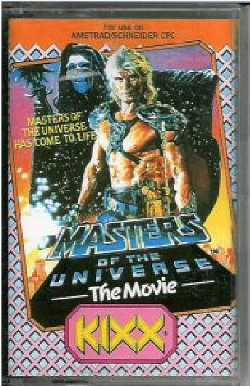
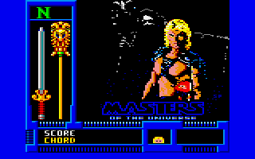

# Masters of the Universe: The Movie – Amstrad CPC Archive

## Overview

*Masters of the Universe: The Movie* on the **Amstrad CPC** and **Schneider CPC** home computers is an action-adventure adaptation of the 1987 live-action Cannon Films feature. Originally developed and published by **Gremlin Graphics** (and subsequently re-released under U.S. Gold's budget imprint **KIXX**), the game places players in control of He-Man as he explores a suburban California town on Earth to retrieve the Cosmic Key's lost musical chord tones and defeat Skeletor's occupying forces.

This document archives verified media assets from the original physical European cassette release, documents the Mode 0 graphical title screen and HUD presentation, and provides cross-platform links to the sister releases.

---

## Archived Media Assets

### 1. Cassette Box Art (`He-Man_MOTU_CPC_Box.PNG`)

* **Physical Format:** European Compact Cassette jewel case inlay card (KIXX budget re-release, circa 1989/1990).
* **Compatibility Header:** `"For use on AMSTRAD/SCHNEIDER CPC"` printed across the top orange header band.
* **Marketing Tagline:** `"MASTERS OF THE UNIVERSE HAS COME TO LIFE"` printed in gold lettering on the left side of the artwork border.
* **Title Branding:** The movie title is rendered with `"MASTERS"` in chrome-bordered 3D blue lettering, `"OF THE UNIVERSE"` in white bold capital lettering with a `™` trademark notice, and `"— The Movie —"` in white script flanked by dashes.
* **Publisher Imprint:** **KIXX ®** budget re-release imprint (a label of U.S. Gold Ltd.) positioned at the bottom in a distinctive pink hexagonal badge with yellow and red lettering.
* **Cover Art Description:** Features theatrical promotional photography of Dolph Lundgren as He-Man in his movie battle harness and armor, standing facing forward with arms at his sides against a cosmic starfield backdrop. Frank Langella's hooded Skeletor looms menacingly in the upper-left corner illuminated with dramatic blue and skull lighting.

---

### 2. Title & Attract Screen (`MOTU-movie_screen.gif`)

* **Graphic Display Mode:** Rendered in Amstrad CPC **Mode 0** graphics (160×200 pixel resolution with wide pixels, supporting up to 16 simultaneous colors selected from the system's 27-color hardware palette).
* **Title Artwork:** The central illustration presents a Mode 0 rendering of Dolph Lundgren's He-Man from the chest up, wearing his battle armor and reddish loincloth/pouch against a black starry background. The ghostly silhouette of Skeletor's hooded skull looms above him. The franchise marquee `"MASTERS OF THE UNIVERSE"` is displayed in vibrant blue block letters directly beneath the illustration.
* **HUD Architecture:** Frames the display with a royal blue border featuring the same vertical pillar layout shared with the MSX release:
  * **Compass Rose:** Top-mounted indicator featuring a bright green **`N`** (North) character.
  * **Power Sword Gauge:** Vertical sword icon with a silver blade, red grip, and gold hilt/crossguard tracking He-Man's vitality and sword charge.
  * **Havoc Staff Gauge:** Gold vertical staff topped with a ram's skull representing the countdown toward Skeletor's victory.
  * **Bottom Status Strip:** Displays labels for `SCORE` (white) and `CHORD` (yellow), a bordered He-Man life icon with yellow hair, and an initialized mission countdown clock window.

---

## Cross-Platform Navigation

* **16-bit Atari ST Map & Route Guide:** [Atari ST Navigation Map & Route Guide](../../AtariST/MOTU_The_Movie/README.html) — High-resolution 1024×720 street navigation map, 8-waypoint legend, chord tone locations, and verified speedrun routing.
* **Commodore 64 Cheats & Map Guide:** [Commodore 64 Cheats & Map Guide](../../C64/MOTU_The_Movie/README.html) — Verified unlimited-lives POKE cheats, in-game overhead radar map, and victory/defeat screen transcripts.
* **MSX Media Archive & Screen Reference:** [MSX Media Archive & Screen Reference](../../MSX/MOTU_The_Movie/README.html) — Vertical compass HUD analysis, Graveyard, Melee Duel, Sniper Gallery, and Skeletor Communicator screens.
