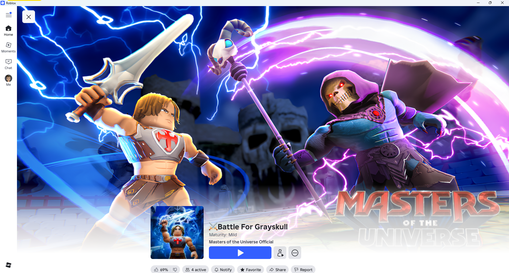
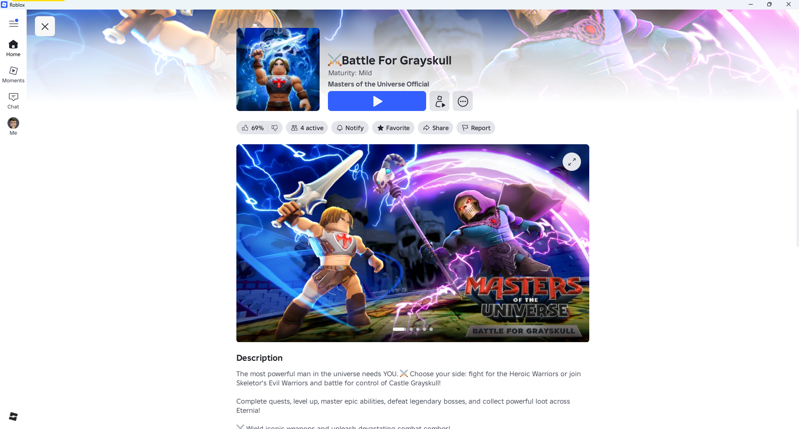
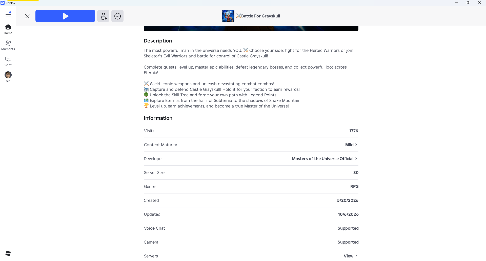
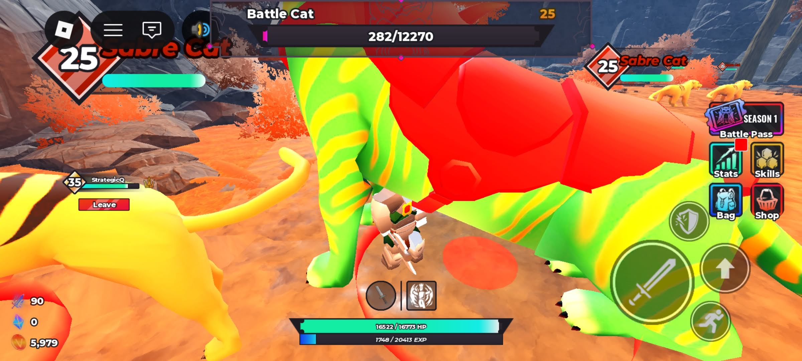
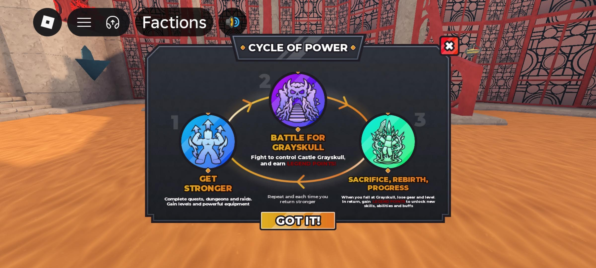
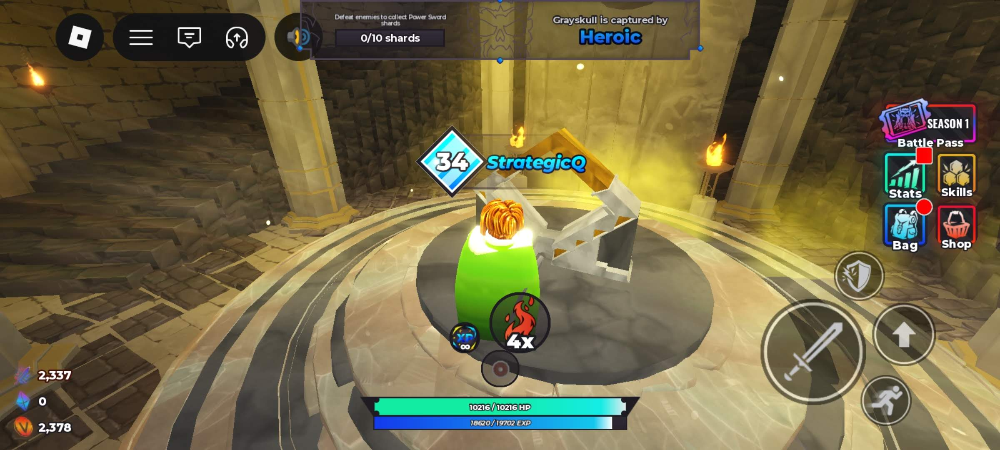
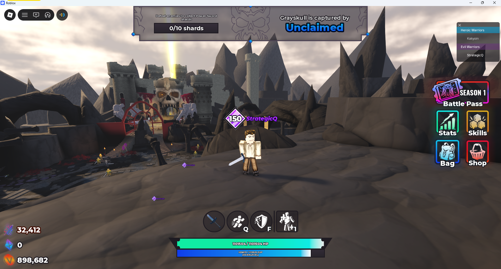
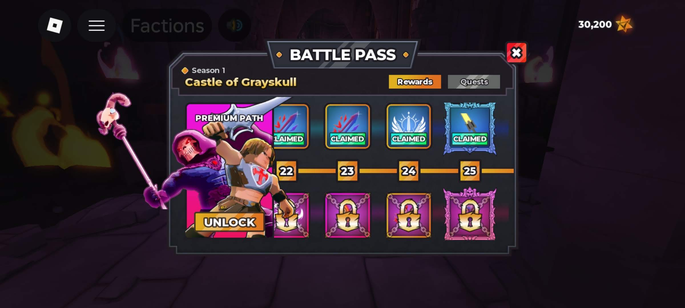
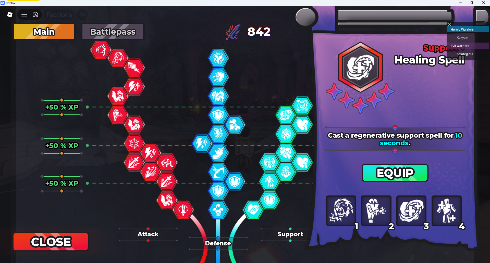
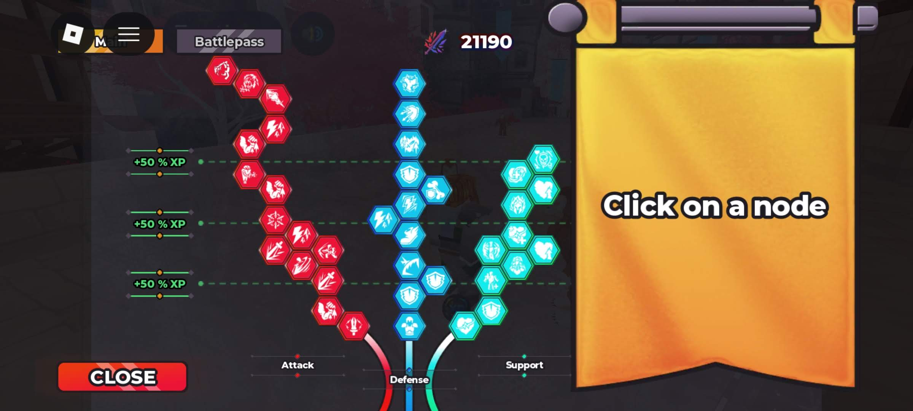

# Masters of the Universe: Battle for Grayskull

> **Platform:** Android / iOS  
> **Developer:** Ludia  
> **Publisher:** Ludia / Mattel  
> **Release Year:** 2021  
> **Genre:** Idle RPG / Castle Defense / Gacha  
> **Author:** Jacob Quisenberry — Version 1.00 (2026-11-05)

---

## Overview

*Masters of the Universe: Battle for Grayskull* is a mobile idle RPG and castle-defense game developed by Ludia in collaboration with Mattel, released on Android and iOS in 2021. The game draws on the **2021 Netflix animated series** reboot (*Masters of the Universe: Revelation* and *Masters of the Universe: New Eternia*), featuring characters in their updated visual designs.

Players collect heroes and villains from the Masters of the Universe universe, build squads, and deploy them in automated battle sequences to defend or siege Castle Grayskull. The game features a **Battle Pass** seasonal progression system, character-specific **skill trees** split between Heroic and Evil factions, and deep character-upgrade mechanics.

---

## Game Overview

| Field | Detail |
|---|---|
| **Full Title** | Masters of the Universe: Battle for Grayskull |
| **Developer** | Ludia |
| **Publisher** | Ludia / Mattel |
| **Platform** | Android, iOS |
| **Release Year** | 2021 |
| **Genre** | Idle RPG / Castle Defense / Gacha |
| **Setting** | Eternia — drawing on 2021 Netflix series visual style |
| **Monetization** | Free-to-play with Battle Pass and in-app purchases |

---

## Screenshot Archive

The following screenshots were captured during active gameplay and document key states of the game's progression systems.

---

### App Store Product Presentation

#### Product Screenshot 1 — Character Roster Banner

**Caption:** Official app store banner for *Battle for Grayskull*. The image displays the principal character roster in the 2021 Netflix animated-series visual style: He-Man in blue-and-gold armor (center), flanked by Teela in red combat gear (left), and Skeletor (right). Castle Grayskull appears prominently in the background. The game title appears in stylized Masters of the Universe franchise lettering.

---

#### Product Screenshot 2 — Store Listing Image 1

**Caption:** App store product image 1. Depicts an idle combat sequence showing multiple characters deployed against an enemy wave. Character ability indicators and health bars are visible. The interface shows the castle-defense lane structure central to gameplay.

---

#### Product Screenshot 3 — Store Listing Image 2

**Caption:** App store product image 2. Shows the squad-building roster interface where players select which characters to deploy. Character cards with rarity indicators, power ratings, and portrait artwork are visible. The UI reflects the game's gacha-style character-collection system.

---

### In-Game Progression

#### Battle Cat — Character Detail

**Caption:** In-game character detail screen for **Battle Cat**, He-Man's feline companion. The screen displays Battle Cat's combat statistics, ability loadout, upgrade level, and bond rating with He-Man. Battle Cat functions as a support/tank character who accompanies He-Man in combat. Stat values reflect a mid-to-high upgrade state.

---

#### Gameplay Loop — Active Combat

**Caption:** Screenshot of the core **gameplay loop** during an active battle. The screen shows the lane-based castle-defense structure: heroic characters advance from the left side of the screen toward enemy forces on the right. Ability cooldown timers, HP bars, and stage progress indicators are visible at screen margins. The idle-combat nature of the game is evident from the automatic character movement and attack animations.

---

#### Holding the Castle — Defense State

**Caption:** Screenshot showing the **castle-holding defense state**. Enemy forces (Skeletor's army) are attacking Castle Grayskull from the right side of the screen while heroic defenders hold the left. The castle structure is partially visible at the left edge. This capture illustrates the core tension of the castle-defense genre: preventing enemy units from breaching the castle gate.

---

#### Level 150 — High-Level Progression State

**Caption:** Screenshot documenting a **Level 150 progression state**, one of the highest character or account levels visible in this archive. This capture serves as a reference for end-game stat scaling and UI presentation at maximum progression. Level indicators, cumulative power ratings, and unlocked content are visible.

---

#### Maximum Battle Pass — Completed Season Pass

**Caption:** Screenshot showing a **fully completed Battle Pass** with all reward tiers claimed. The Battle Pass UI displays the season's tier track from left to right, with every node marked as claimed. This capture documents the maximum achievable Battle Pass state, including all premium-track rewards. The specific season and tier count are reflected in the visible UI elements.

---

#### Maximum Skill Tree — Evil Faction

**Caption:** Screenshot of the **Evil faction skill tree at maximum level**, with all skill nodes fully unlocked and upgraded. The skill tree is displayed as a branching network of interconnected nodes, each representing a passive ability or stat bonus applicable to evil-aligned characters (Skeletor, Evil-Lyn, Beast Man, etc.). All nodes appear activated, indicating full tree completion.

---

#### Maximum Skill Tree — Heroic Faction

**Caption:** Screenshot of the **Heroic faction skill tree at maximum level**, with all skill nodes fully unlocked and upgraded. The mirror of the Evil skill tree, this tree applies bonuses to heroic-aligned characters (He-Man, Teela, Man-At-Arms, Sorceress, etc.). The tree's branching structure and node distribution are visible, documenting the full scope of heroic progression.

---

## Gameplay Systems Summary

| System | Description |
|---|---|
| **Core Loop** | Idle/automated lane-based combat; deploy characters, they fight automatically |
| **Castle Defense** | Defend Castle Grayskull from enemy waves; also siege enemy positions |
| **Character Collection** | Gacha-style character acquisition across Heroic and Evil factions |
| **Skill Trees** | Separate Heroic and Evil faction trees with passive stat upgrades |
| **Battle Pass** | Seasonal tier-based progression rewarding currency, characters, and upgrades |
| **Character Levels** | Per-character upgrade system affecting base stats and ability power |
| **Progression Depth** | Documents suggest Level 150+ achievable with extended play |

---

*Document authored by Jacob Quisenberry. Version 1.00 — 2026-11-05.*

