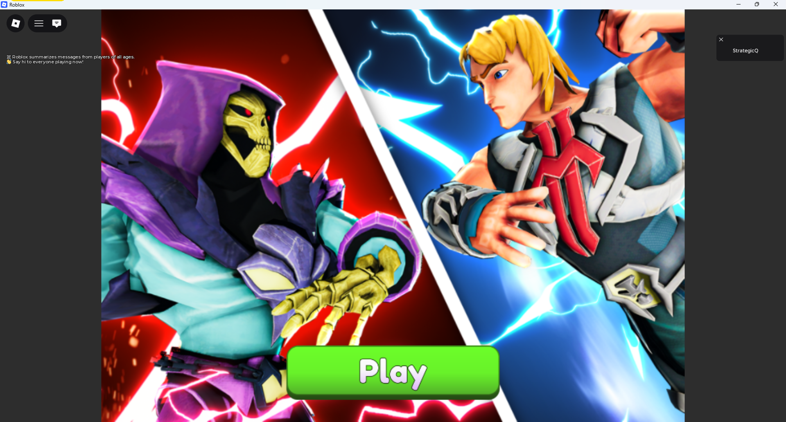
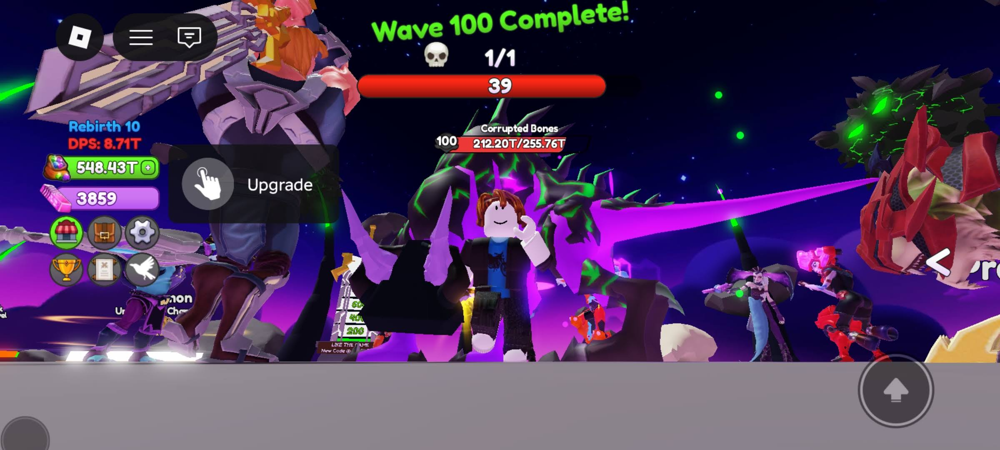
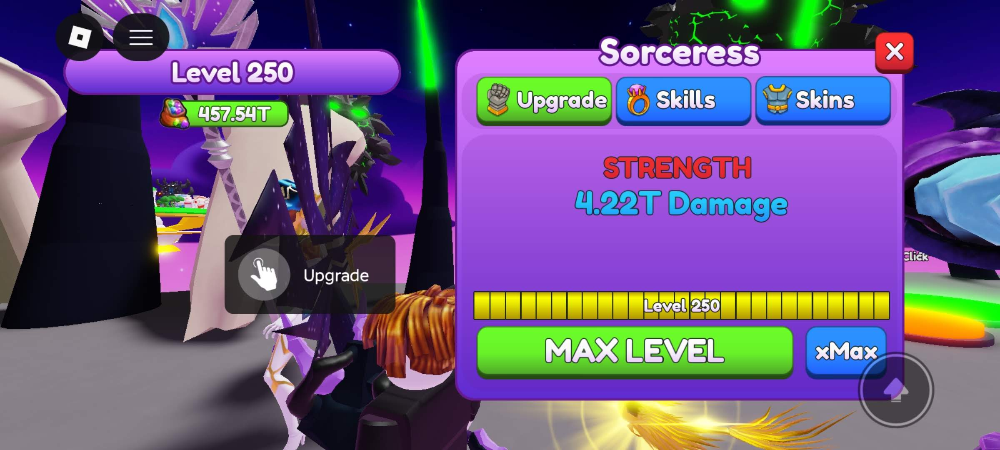
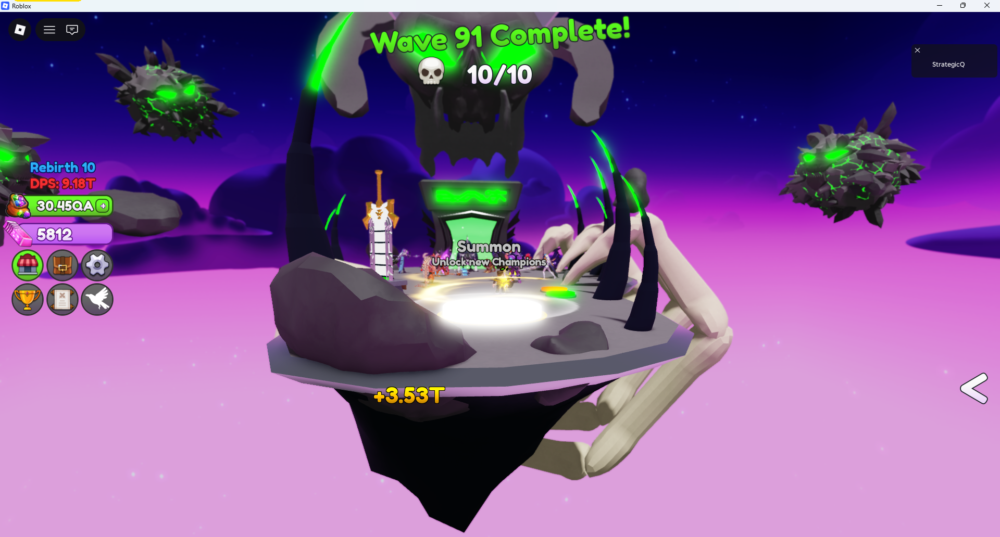
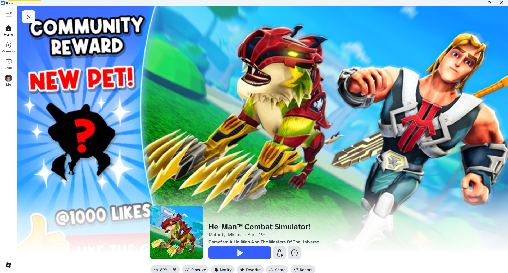
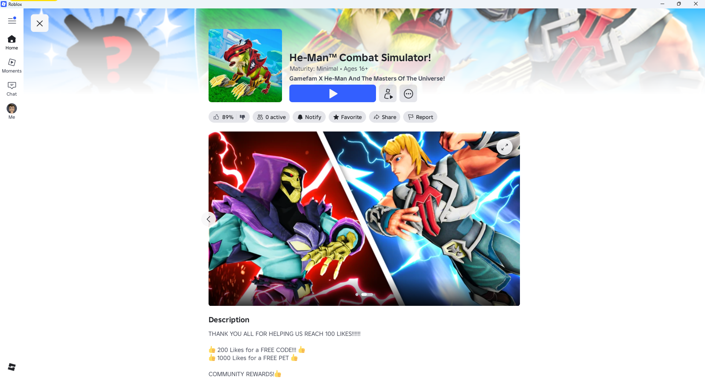
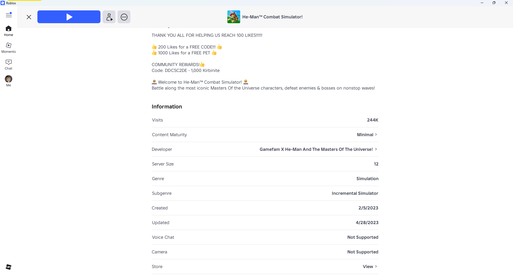
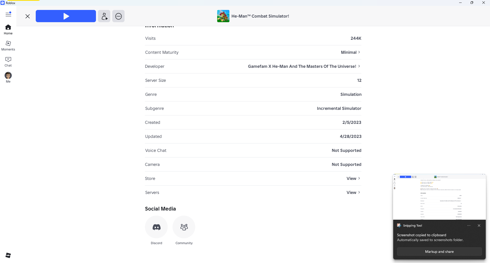

# He-Man: Combat Simulator

> **Platform:** Android / iOS  
> **Developer:** Gamefam
> **Publisher:** Mattel Inc.
> **Genre:** Combat Simulator / Fighting  
> **Author:** Jacob Quisenberry — Version 1.00 (2026-11-05)

---

## Overview

*He-Man: Combat Simulator* (also known as *Masters of the Universe: He-Man Combat Simulator*) is a mobile combat and fighting game developed by Gamefam and published by Mattel Inc. for Android and iOS. The game presents turn-based or action-based combat encounters using characters from the Masters of the Universe universe, featuring upgradeable fighters with distinct ability sets and level-based progression.

The character roster includes iconic MOTU figures from multiple eras of the franchise. The **Sorceress of Castle Grayskull** is documented at maximum level in this archive, illustrating the game's character upgrade ceiling and stat presentation.

---

## Game Overview

| Field | Detail |
|---|---|
| **Full Title** | He-Man: Combat Simulator |
| **Developer** | Gamefam |
| **Publisher** | Mattel Inc. |
| **Platform** | Android, iOS |
| **Genre** | Combat Simulator / Fighting |
| **Setting** | Eternia — Masters of the Universe universe |
| **Monetization** | Free-to-play with in-app purchases |

---

## Screenshot Archive

---

### Loading Screen

**Caption:** The **game loading screen** for *He-Man: Combat Simulator*. The screen displays the game's title treatment — "He-Man: Combat Simulator" — set against a dramatic Eternia backdrop, likely featuring Castle Grayskull or the Power Sword motif. A progress bar or spinner indicates game asset loading. This is typically the first screen players see on launch after the initial app-store installation.

---

### In-Game Combat — Level 100

**Caption:** Screenshot of active **combat gameplay at Level 100**, documenting a high-level encounter. He-Man (or the player's chosen fighter) is shown engaged in a combat sequence, with enemy HP bars, ability activation indicators, and damage numbers visible. Level 100 represents deep progression within the game's character upgrade system. The combat arena background art and UI layout are clearly visible.

---

### Sorceress — Maximum Level

**Caption:** Character detail screen for **the Sorceress of Castle Grayskull at maximum level**. The Sorceress is a central character in the Masters of the Universe lore, guardian of Castle Grayskull and magical advisor to He-Man. This screenshot documents her maximum-level stat block: attack power, defense, speed, and special ability ratings. The character portrait reflects her classic falcon-winged appearance or the 2021 animated series redesign. This capture serves as a reference for the game's character-upgrade ceiling.

---

### Full Arena — Zoom-Out View

**Caption:** **Full arena zoom-out screenshot** providing a wide-perspective view of the combat environment. This capture shows the complete battlefield: character positions on opposing sides, the arena background artwork (possibly Eternia landscapes, Snake Mountain, or Castle Grayskull interior), and the full UI framing including ability bars, HP displays, and round/stage indicators. This view is useful for understanding the combat area's proportions and visual design.

---

### App Store Product Screenshots

#### Product Screenshot 1

**Caption:** App store product screenshot 1 for *He-Man: Combat Simulator*. Likely depicts a combat gameplay highlight, feature callout, or character roster overview designed to showcase the game's core combat mechanics to prospective players.

---

#### Product Screenshot 2

**Caption:** App store product screenshot 2. Likely showcases the character upgrade system, collection interface, or a specific hero's ability screen, highlighting the depth of the game's character progression.

---

#### Product Screenshot 3

**Caption:** App store product screenshot 3. May depict a PvP (player-versus-player) mode, special event, or unique game-mode feature designed to highlight competitive or cooperative play options.

---

#### Product Screenshot 4

**Caption:** App store product screenshot 4. Likely depicts a story mode sequence, cutscene presentation, or additional gameplay feature such as guild mechanics, daily challenges, or world map exploration.

---

## Gameplay Systems Summary

| System | Description |
|---|---|
| **Core Combat** | Turn-based or action combat between fighters |
| **Character Levels** | Per-character level upgrades; Sorceress documented at max level |
| **Abilities** | Unique ability sets per character with cooldowns and power costs |
| **Arena** | Dedicated combat arena with Eternia-themed backgrounds |
| **Progression** | Level 100+ achievable; stat scaling documented at high levels |

---

*Document authored by Jacob Quisenberry. Version 1.00 — 2026-11-05.*
