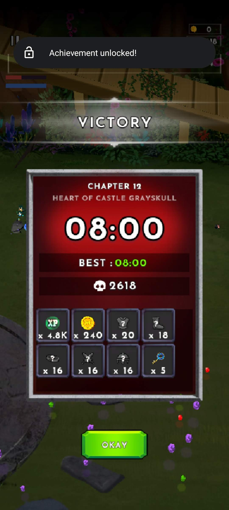
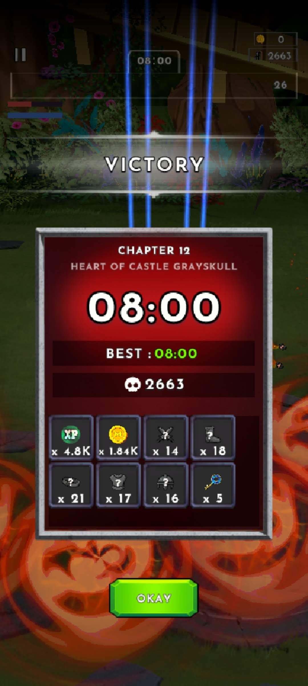

# Masters of the Universe: Guardians of Grayskull

> **Platform:** Android / iOS  
> **Developer:** Kabam  
> **Publisher:** Kabam / Mattel  
> **Genre:** RPG / Action RPG  
> **Author:** Jacob Quisenberry — Version 1.00 (2026-11-05)

---

## Overview

*Masters of the Universe: Guardians of Grayskull* is a mobile RPG developed by Kabam for Android and iOS. The game is set within the Masters of the Universe universe and follows He-Man and allies (the Guardians of Grayskull) in story-driven combat missions. The title draws on the **2021 Netflix animated series** aesthetic.

This archive focuses on the **game-ending screens** captured at the conclusion of the game's primary story content, preserving the final victory states that most players would have seen upon completing the main campaign or final boss sequence.

---

## Game Overview

| Field | Detail |
|---|---|
| **Full Title** | Masters of the Universe: Guardians of Grayskull |
| **Developer** | Kabam |
| **Publisher** | Kabam / Mattel |
| **Platform** | Android, iOS |
| **Genre** | RPG / Action RPG |
| **Setting** | Eternia — 2021 Netflix series visual style |
| **Monetization** | Free-to-play with in-app purchases |

---

## Ending Screens

The following two screenshots document the game's ending sequence, capturing the final visual states presented to players who completed the game's primary content.

---

### Ending Screen 1 — Victory / Conclusion Part 1

**Caption:** **First ending screen** of *Masters of the Universe: Guardians of Grayskull*, captured at story completion. The screen presents the initial phase of the game's conclusion sequence — likely a victory splash, dialogue exchange, or cinematographic composition showing He-Man and the Guardians triumphant. Character portraits, environmental backdrop (Castle Grayskull or Eternia landscape), and narrative text or dialogue are visible. This is the first visual state players encounter upon defeating the final boss or completing the final mission.

---

### Ending Screen 2 — Victory / Conclusion Part 2

**Caption:** **Second ending screen** of *Masters of the Universe: Guardians of Grayskull*, capturing the continuation or conclusion of the ending sequence. This screen likely presents a reward summary, closing narrative text, credits roll, or final character tableau. Together with Ending Screen 1, these two captures preserve the complete ending presentation, ensuring the game's conclusion is documented for future reference even if the live-service title becomes unavailable.

---

## Preservation Notes

As a live-service mobile game, *Guardians of Grayskull* is subject to server shutdown and content removal without advance notice. The ending screens archived here represent the game's story conclusion as captured during active service. These screenshots preserve the visual experience of the game's finale for historical and research purposes.

---

*Document authored by Jacob Quisenberry. Version 1.00 — 2026-11-05.*

