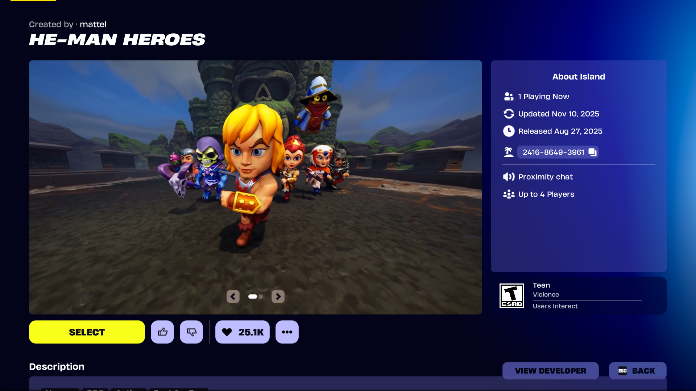
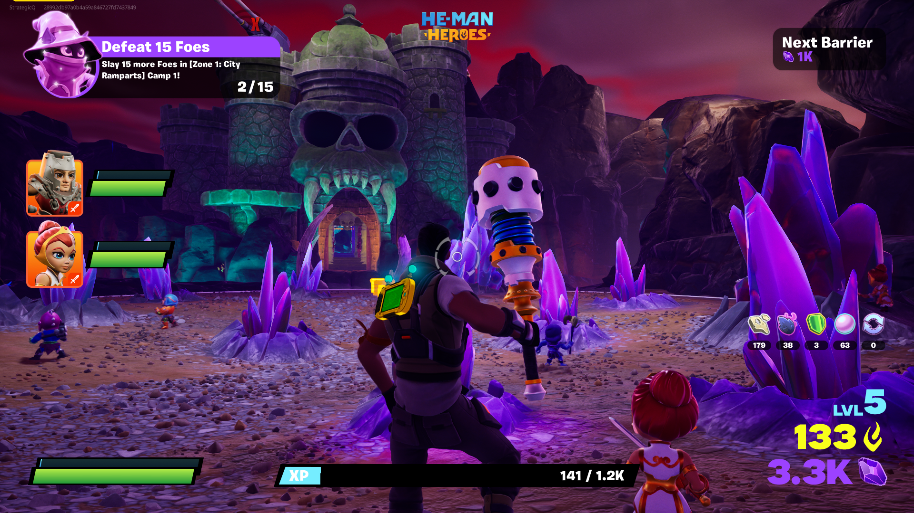

# He-Man: Masters of the Universe Heroes

> **Platform:** Android / iOS  
> **Developer:** Budge Studios  
> **Publisher:** Budge Studios / Mattel  
> **Genre:** Action / Adventure  
> **Author:** Jacob Quisenberry — Version 1.00 (2026-11-05)

---

## Overview

*He-Man: Masters of the Universe Heroes* is a mobile action/adventure game developed by Budge Studios for Android and iOS. The game features He-Man and characters from the Masters of the Universe universe in a child-friendly action experience, drawing on the **2021 Netflix animated series** visual aesthetic (*Masters of the Universe: Revelation* and related productions).

---

## Game Overview

| Field | Detail |
|---|---|
| **Full Title** | He-Man: Masters of the Universe Heroes |
| **Developer** | Budge Studios |
| **Publisher** | Budge Studios / Mattel |
| **Platform** | Android, iOS |
| **Genre** | Action / Adventure |
| **Target Audience** | Family / Kids |
| **Setting** | Eternia — 2021 Netflix series visual style |
| **Monetization** | Free-to-play with in-app purchases |

---

## Screenshot Archive

---

### App Store Banner

**Caption:** Official **app store banner** for *He-Man: Masters of the Universe Heroes*. The banner features He-Man in a heroic power pose — likely holding the Power Sword aloft — in the 2021 Netflix animated series visual style. Supporting characters such as Teela, Man-At-Arms, or other Masters may appear in the background alongside Castle Grayskull. The game title "He-Man: Masters of the Universe Heroes" is displayed in franchise-branded lettering. This banner functions as the primary marketing image for the app store listing.

---

### In-Game Gameplay

**Caption:** **In-game gameplay screenshot** showing active play. He-Man is depicted navigating through an Eternia environment — likely a Grayskull courtyard, forest, or village setting — encountering enemies. The HUD displays health, lives or energy, score or stage progress, and ability indicators typical of mobile action games. This screenshot illustrates the core gameplay loop: traversal, combat, and collection within a side-scrolling or top-down perspective environment.

---

## Preservation Notes

This archive documents two key visual assets from *He-Man: Masters of the Universe Heroes* — the app store banner and an in-game gameplay screenshot — capturing the game's visual identity during its active live-service period.

---

*Document authored by Jacob Quisenberry. Version 1.00 — 2026-11-05.*

