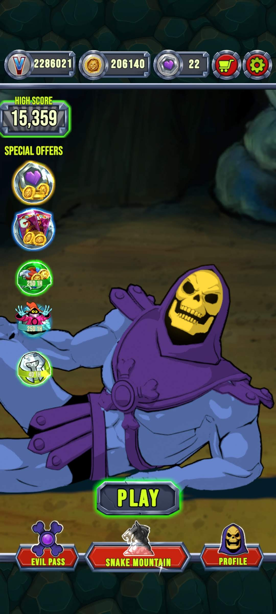
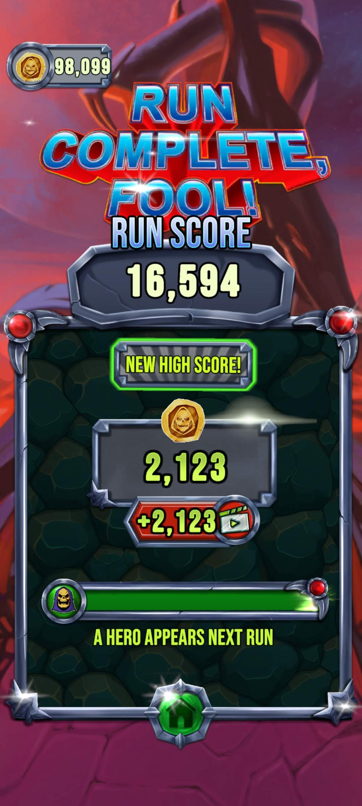
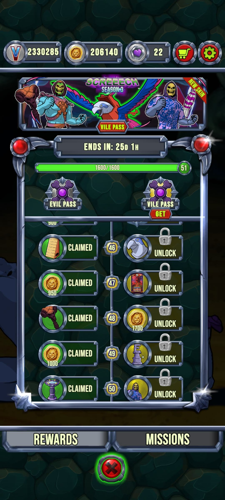
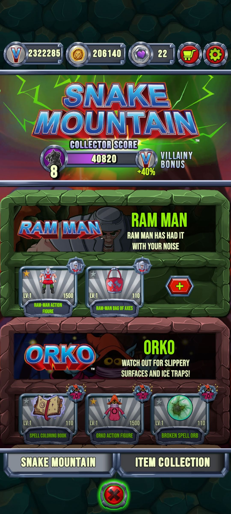

# Masters of the Universe: Skeletor: Until Next Time

> **Platform:** Android / iOS  
> **Developer:** Mattel Game Studios and Amber
> **Publisher:** Mattel Game Studios
> **Genre:** Endless runner 
> **Author:** Jacob Quisenberry — Version 1.02 (2026-11-16)

---

## Overview

*Masters of the Universe: Skeletor: Until Next Time* is an endless runner developed by Mattel Game Studios and Amber for Android and iOS. Players control **Skeletor**, the primary antagonist of the Masters of the Universe franchise, in runs for score and rewards. The game also includes an **Evil Battle Pass** and **Snake Mountain** item collection.

The game has no traditional finish line. The Battle Pass rewards and Snake Mountain shelves documented here reflect the available progression at the time of capture.

---

## Game Overview

| Field | Detail |
|---|---|
| **Full Title** | Masters of the Universe: Skeletor: Until Next Time |
| **Developer** | Mattel Game Studios and Amber |
| **Publisher** | Mattel Game Studios |
| **Platform** | Android, iOS |
| **Genre** | Endless runner |
| **Player Faction** | Evil (Skeletor's forces) |
| **Hub Structure** | Snake Mountain |
| **Monetization** | Free-to-play with Evil Battle Pass and in-app purchases |

---

## Screenshot Archive

---

### Main Menu

**Caption:** The **main menu** for *Masters of the Universe: Skeletor: Until Next Time* shows Skeletor reclined, with a **PLAY** button and navigation tabs for **EVIL PASS**, **SNAKE MOUNTAIN**, and **PROFILE**.

---

### Run Complete — Results Screen

**Caption:** The **RUN COMPLETE** results screen shows a run score of **16,594**, a **NEW HIGH SCORE!** notice, and a coin reward of **2,123**. It also says, **“A HERO APPEARS NEXT RUN.”**

---

### Evil Battle Pass — Maximum Tier 50

**Caption:** The **Evil Pass** track shows claimed rewards for tiers **46–50**, reaching the maximum tier of **50**. The corresponding premium **Vile Pass** rewards shown are locked. Visible Evil Pass rewards include currency, upgrade materials, and cosmetic items.

---

### Snake Mountain — Highest Available Shelves at Capture

**Caption:** The **Snake Mountain** item collection screen displays the highest available shelves at the time of capture, including character and item cards.

---

## Gameplay Systems Summary

| System | Description |
|---|---|
| **Player Character** | Skeletor |
| **Collection Screen** | Snake Mountain |
| **Core Loop** | Endless runs, score-based results, and rewards |
| **Evil Battle Pass** | Seasonal reward track with a maximum tier of 50 |
| **Progression** | Run scores, Battle Pass rewards, and Snake Mountain item collection |

---

## Preservation Notes

As a live-service game, *Masters of the Universe: Skeletor: Until Next Time* is subject to server shutdown without advance notice. The four screenshots archived here preserve the main menu, run results, Evil Pass rewards through tier 50, and the highest Snake Mountain shelves available at the time of capture.

---

*Document authored by Jacob Quisenberry. Version 1.02 — 2026-11-16.*
