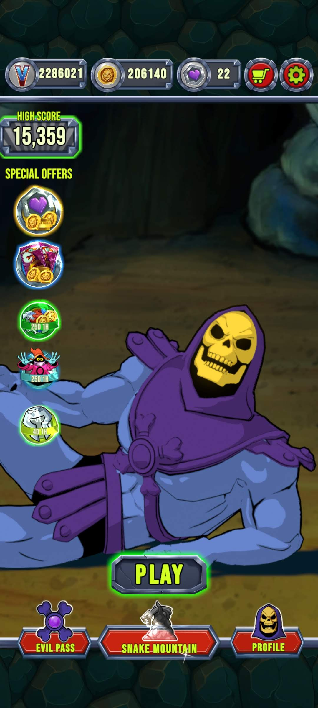
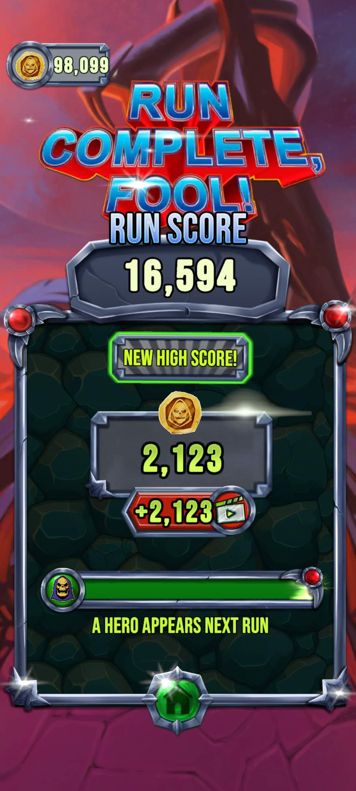
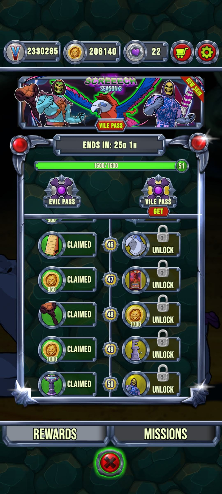
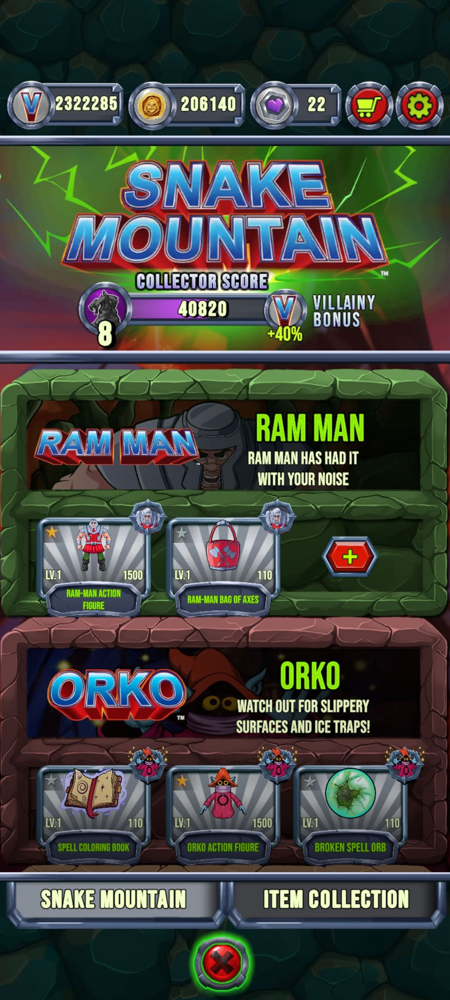

# Masters of the Universe: Skeletor: Until Next Time

> **Platform:** Android / iOS  
> **Developer:** Mattel Game Studios and Amber
> **Publisher:** Mattel Game Studios
> **Genre:** Idle RPG / Villain Strategy  
> **Author:** Jacob Quisenberry — Version 1.00 (2026-11-09)

---

## Overview

*Masters of the Universe: Skeletor: Until Next Time* is a mobile idle RPG developed by Mattel Game Studios and Amber for Android and iOS, taking the unique perspective of placing the player in control of **Skeletor**, the primary antagonist of the Masters of the Universe franchise. Rather than defending Castle Grayskull, the player commands Skeletor's forces from **Snake Mountain**, the villain's fortress stronghold on Eternia.

The game mirrors the structure of *Masters of the Universe: Battle for Grayskull* but inverts the faction dynamic — the player pursues conquest rather than defense, using an **Evil Battle Pass** seasonal system and upgrading Snake Mountain as the game's central hub structure.

---

## Game Overview

| Field | Detail |
|---|---|
| **Full Title** | Masters of the Universe: Skeletor: Until Next Time |
| **Developer** | Mattel Game Studios and Amber |
| **Publisher** | Mattel Game Studios |
| **Platform** | Android, iOS |
| **Genre** | Idle RPG / Villain Strategy |
| **Player Faction** | Evil (Skeletor's forces) |
| **Hub Structure** | Snake Mountain |
| **Monetization** | Free-to-play with Evil Battle Pass and in-app purchases |

---

## Screenshot Archive

---

### Intro / Title Screen

**Caption:** The **intro or title screen** for *Masters of the Universe: Skeletor: Until Next Time*. Skeletor is depicted in his iconic appearance — blue-and-purple hooded robe, skull face — in a commanding pose, likely holding his Havoc Staff. Snake Mountain, Skeletor's fortress stronghold (characterized by its jagged rocky spires and cave-entrance mouth), appears prominently in the background. The game title is rendered in franchise-branded lettering with villain-appropriate color treatment (purples, blacks, greens). This screen establishes the game's villain-protagonist perspective from the first moment of play.

---

### Level End — Stage Results Screen

**Caption:** **Level-end results screen** shown after completing a battle stage. The screen summarizes Skeletor's (and his army's) performance in the concluded stage: rewards earned (currency, upgrade materials, character fragments), a star rating or performance indicator, and progression toward the next stage. This capture documents the standard post-stage result UI, illustrating the pacing of the game's reward loop.

---

### Maximum Evil Battle Pass — Fully Completed

**Caption:** Screenshot of the **Evil Battle Pass at maximum completion**, with all seasonal reward tiers fully claimed. The Evil Battle Pass is the villain-themed counterpart to the heroic Battle Pass in *Battle for Grayskull*. The tier track is displayed horizontally with every node marked as claimed, including premium-tier rewards. Reward types visible may include currency (Dark Coins, Chaos Crystals, or similar), character unlock fragments, upgrade materials, and cosmetic items. This capture documents the maximum achievable Evil Battle Pass state for a given season.

---

### Snake Mountain — Maximum Upgrade Level

**Caption:** Screenshot of **Snake Mountain at its maximum upgrade level**, with all hub structures and fortifications fully upgraded. Snake Mountain functions as the game's central base hub, analogous to Castle Grayskull in the heroic games. This capture shows the fortress in its fully-developed state: all production buildings at peak capacity, defensive structures upgraded, and the characteristic mountain-castle aesthetic of Skeletor's stronghold at its most imposing. Resource production rates, building levels, and the fortress's visual evolution from base to maximum are documented through this screenshot.

---

## Gameplay Systems Summary

| System | Description |
|---|---|
| **Player Faction** | Evil — player commands Skeletor's army |
| **Hub** | Snake Mountain; upgradeable fortress-base |
| **Core Loop** | Idle/automated combat conquering Eternia |
| **Evil Battle Pass** | Seasonal tier-based progression for evil-aligned rewards |
| **Stage Results** | Star-rated post-stage results with reward summary |
| **Progression** | Hub and character upgrade systems; maximum states documented |

---

## Preservation Notes

As a live-service game, *Masters of the Universe: Skeletor: Until Next Time* is subject to server shutdown without advance notice. The four screenshots archived here represent the game's key visual states — intro, stage results, maximum Battle Pass, and maximum base — captured during active service.

---

*Document authored by Jacob Quisenberry. Version 1.00 — 2026-11-05.*
