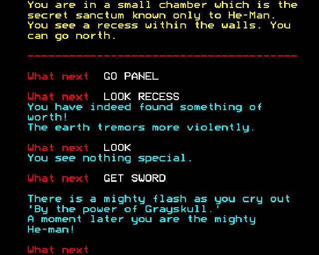
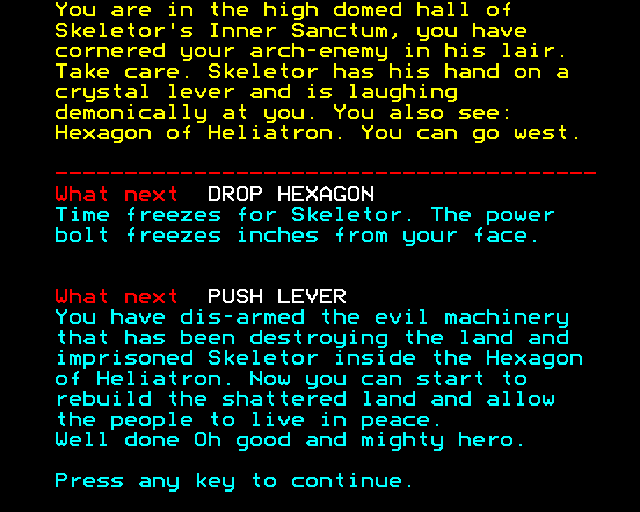
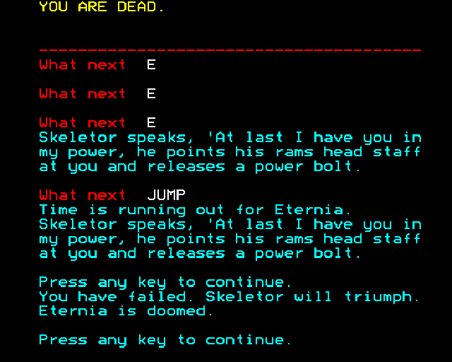

# Masters of the Universe in Terraquake – BBC Micro Archive

## Overview

*Masters of the Universe in Terraquake* (also published as *Masters of the Universe Super Adventure*) is a 1987 text adventure written by Mike Woodroffe, Teoman Irmak, Stefan Ufnowski, and Graham Lilley, published by **U.S. Gold Ltd.** 

In contrast to the ZX Spectrum version—which integrated static graphic illustrations above each room's description—the BBC Micro and Acorn Electron releases are strictly **text-only**. The BBC Micro edition utilizes the hardware's distinctive teletext/Mode 7 high-contrast colored text layout:
* **Yellow text:** Top room titles and environmental descriptions.
* **Red horizontal dashed rule:** Separator between narrative scene descriptions and the interactive parser log.
* **Red prompts:** Command entry indicators (`What next`).
* **White text:** Player command entries.
* **Cyan text:** Game engine feedback, action responses, status changes, and narrative dialogue.

This archive preserves verified in-game screenshots and complete verbatim transcriptions from the original BBC Micro release.

---

## Archived Screenshots & Verbatim Transcripts

### 1. In-Game Gameplay & Sword Transformation (`bbc_terraquake_play_001.png`)



* **Display Type:** Teletext Mode 7 style colored text rendering.
* **Context:** Prince Adam enters He-Man's inner sanctum within Castle Eternos, investigates the secret alcove, and claims the Sword of Power.
* **Verbatim Screen Transcription:**

```text
You are in a small chamber which is the
secret sanctum known only to He-Man.
You see a recess within the walls. You
can go north.
----------------------------------------
What next  GO PANEL

What next  LOOK RECESS
You have indeed found something of
worth!
The earth tremors more violently.

What next  LOOK
You see nothing special.

What next  GET SWORD

There is a mighty flash as you cry out
'By the power of Grayskull.'
A moment later you are the mighty
He-man!

What next
```

* **Game Mechanics Observed:**
  * The command prompt appears as `What next` followed by a double space.
  * Room navigation uses directional commands or direct interaction verbs (`GO PANEL`).
  * Examining the recess alerts the player that an item of value is present (`You have indeed found something of worth!`).
  * The pervasive atmospheric quake timer message appears periodically: `"The earth tremors more violently."`
  * Picking up the Sword of Power triggers the signature He-Man transformation sequence, altering the player's physical state for subsequent puzzle obstacles.

---

## 2. Victory Ending (`bbc_terraquake_end_001.png`)



* **Display Type:** Teletext Mode 7 style colored text rendering.
* **Context:** He-Man corners Skeletor in his Inner Sanctum, neutralizes the fatal energy beam with the Hexagon of Heliatron, and pulls the seismic lever to save Eternia.
* **Verbatim Screen Transcription:**

```text
You are in the high domed hall of
Skeletor's Inner Sanctum, you have
cornered your arch-enemy in his lair.
Take care. Skeletor has his hand on a
crystal lever and is laughing
demonically at you. You also see:
Hexagon of Heliatron. You can go west.
----------------------------------------
What next  DROP HEXAGON
Time freezes for Skeletor. The power
bolt freezes inches from your face.

What next  PUSH LEVER
You have dis-armed the evil machinery
that has been destroying the land and
imprisoned Skeletor inside the Hexagon
of Heliatron. Now you can start to
rebuild the shattered land and allow
the people to live in peace.
Well done Oh good and mighty hero.

Press any key to continue.
```

* **Game Mechanics Observed:**
  * Dropping the magical artifact (`DROP HEXAGON`) halts time and suspends Skeletor's fatal attack before it connects.
  * Disarming the crystal machinery (`PUSH LEVER`) permanently neutralizes the earthquake generator and traps Skeletor inside the Hexagon.
  * The victory prompt concludes with `"Press any key to continue."`

---

## 3. Defeat & Failure State (`bbc_terraquake_fail_001.png`)



* **Display Type:** Teletext Mode 7 style colored text rendering.
* **Context:** Encountering Skeletor without initiating the time-freeze protective sequence, causing He-Man to be eliminated by Skeletor's ram's head staff.
* **Verbatim Screen Transcription:**

```text
YOU ARE DEAD.
----------------------------------------
What next  E

What next  E

What next  E
Skeletor speaks, 'At last I have you in
my power, he points his rams head staff
at you and releases a power bolt.

What next  JUMP
Time is running out for Eternia.
Skeletor speaks, 'At last I have you in
my power, he points his rams head staff
at you and releases a power bolt.

Press any key to continue.
You have failed. Skeletor will triumph.
Eternia is doomed.

Press any key to continue.
```

* **Game Mechanics Observed:**
  * Failing to freeze time allows Skeletor to discharge the deadly power bolt from his staff.
  * The player receives immediate confirmation of failure: `"YOU ARE DEAD."` followed by the game-over condition `"You have failed. Skeletor will triumph. Eternia is doomed."`

---

## Technical Notes & Parser Characteristics

1. **Four-Character Keyword Truncation:**
   As verified through extraction from the BBC binary, all verbs and nouns recognized by the game's parser are truncated to four characters or fewer. Characters entered past the four-character limit are ignored (e.g., `KILL MANT WITH SWOR` is parsed identically to `KILL MANTENNA WITH SWORD`).
2. **Platform-Specific Nuances:**
   * Unlike the C64 and Spectrum editions, the BBC Micro version does not render background artwork, relying entirely on colored mode 7 text descriptions.
   * Specific movement commands (such as the mirror traversal sequences tagged as `"speculum"`) operate identically across all 8-bit releases.

---

## Related Documentation

* **Complete Solution & Manual:** See the sister guide [Masters of the Universe in Terraquake Walkthrough & Keyword Reference (Commodore 64)](../../C64/MOTU_Terraquake/MOTU_Terraquake_Walkthrough.html) for a full move-by-move walkthrough, the game manual transcript, and the complete dictionary of parsed keywords.
