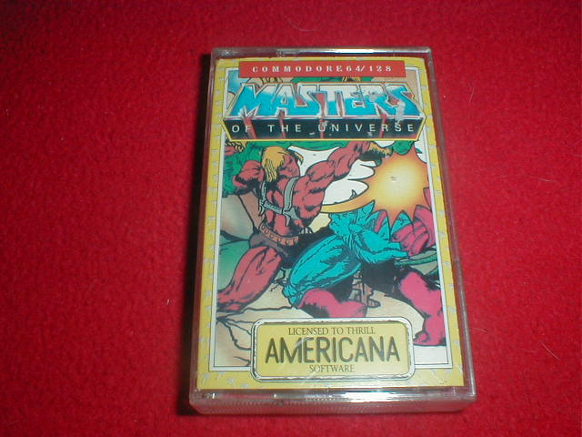
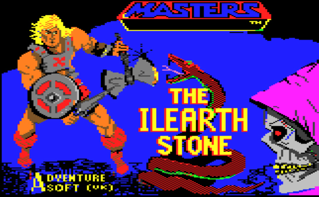
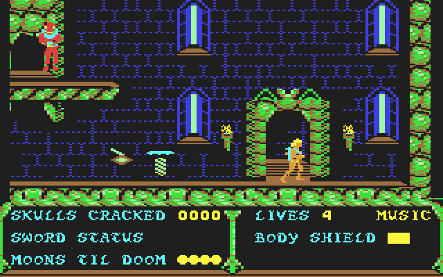

# Masters of the Universe: The Ilearth Stone / The Arcade Game

**Commodore 64 Walkthrough, System Mechanics, Game Text & Box Transcript**  
*Also documents platform-specific differences, screen indicators, and cheats for the Sinclair ZX Spectrum edition.*

---

## Table of Contents

1. [Overview & Historical Context](#overview--historical-context)
2. [Media & Screen Archive](#media--screen-archive)
3. [Movement Controls & Jump Mechanics](#movement-controls--jump-mechanics)
4. [HUD & Display Indicators](#hud--display-indicators)
5. [Core Plot & The Atom Smasher Upgrade](#core-plot--the-atom-smasher-upgrade)
6. [Frequently Asked Questions (FAQ)](#frequently-asked-questions-faq)
7. [Step-by-Step Walkthrough](#step-by-step-walkthrough)
   - [Ground Floor – Phase 1: Lever Activation](#ground-floor--phase-1-lever-activation)
   - [Ground Floor – Phase 2: Lower Ingredient Retrieval](#ground-floor--phase-2-lower-ingredient-retrieval)
   - [Outside Grayskull & Jawbridge Key](#outside-grayskull--jawbridge-key)
   - [Third Floor – First Exploration](#third-floor--first-exploration)
   - [Second Floor – Upper Ledges & Teleporter](#second-floor--upper-ledges--teleporter)
   - [Second Floor – The Snake Man & Roof Lift](#second-floor--the-snake-man--roof-lift)
   - [Exterior Roof & Towers](#exterior-roof--towers)
   - [Left Tower & Skeletor's Chamber (Infiltration)](#left-tower--skeletors-chamber-infiltration)
   - [Right Tower & Orko's Sanctum (Forging the Atom Smasher)](#right-tower--orkos-sanctum-forging-the-atom-smasher)
   - [Destroying the Ilearth Stone](#destroying-the-ilearth-stone)
   - [Final Confrontation with Skeletor](#final-confrontation-with-skeletor)
8. [Verbatim In-Game Text & Credits](#verbatim-in-game-text--credits)
9. [Physical Packaging Box Inlay Transcription](#physical-packaging-box-inlay-transcription)
10. [Cross-Platform Variations (C64 vs. Spectrum)](#cross-platform-variations-c64-vs-spectrum)

---

## Overview & Historical Context

*Masters of the Universe: The Ilearth Stone* is an action-platformer designed by Stefan Ufnowski, programmed by C Studio, and published in Europe by **U.S. Gold Ltd.** under their **Adventure Soft (UK)** label in early 1987 (bearing a 1986 Mattel copyright). 

The game was marketed under two distinct names depending on the medium and release region:
* **The Ilearth Stone:** Displayed prominently on the Commodore 64 and Sinclair ZX Spectrum title screens.
* **The Arcade Game:** Printed on the physical outer retail box inlay and marketing materials.

Unlike the side-scrolling vehicle/dungeon combat of *The Power of He-Man* or the parser-driven adventure of *Terraquake*, *The Ilearth Stone* presents a multi-tiered platforming challenge inside and around Castle Grayskull. He-Man must master rotational timing on hovering elevators, avoid deadly pit traps, bypass laser-emitting defensive turrets and clone soldiers, harvest six specific alchemical items while discarding a spoiler trap, locate Orko to transmute the Power Sword into the **Atom Smasher**, and shatter Skeletor's invulnerability talisman.

---

## Media & Screen Archive

### 1. European Retail Packaging (`c64_ilearth_box.jpg`)



* **Visual Description:** The European cassette inlay art displays the classic Masters of the Universe logo emblazoned across the upper register above a prominent red subtitle header reading *"THE ARCADE GAME"*. The cover illustration features He-Man in heroic stance brandishing the Power Sword before the craggy facade of Castle Grayskull, surrounded by lightning discharges and the looming spectral face of Skeletor against a cosmic starfield.
* **Imprints & Logos:** Displays the official **Mattel Electronics / Mattel Inc.** licensing seal, the **U.S. Gold** corporate ribbon, and the **Adventure Soft UK** emblem.

### 2. Commodore 64 Title Screen (`c64_ilearth_title.jpg`)



* **Display Architecture:** Rendered using the C64 multicolor bitmap mode. The upper display presents the dual title block in yellow and red stylized lettering against a dark slate background: `MASTERS OF THE UNIVERSE (TM)` over `THE ILEARTH STONE`.
* **Imprint Credits:**
  * Sub-header: `ADVENTURESOFT (UK)`
  * Copyright notice: `COPYRIGHT 1987 U.S. GOLD`
  * Design credit: `DESIGN AND GRAPHICS S. UFNOWSKI`
  * Engineering credits: `PROGRAMMING BY C STUDIO - MEMBERS AGY. ESZ. GP. SCH.`
  * Interaction prompt: `PRESS RETURN TO CONTINUE`

### 3. In-Game Gameplay Screen (`c64_ilearth_ingame.jpg`)



* **Main Playfield:** Features multi-level stone ledges within Castle Grayskull. He-Man is depicted in his signature harness and boots, equipped with the Power Sword. A spinning elevator platform ascends vertically near an arched passageway. Roving mechanical sentries and purple laser-firing clone warriors patrol the upper catwalks.
* **Lower Status HUD:** Spans the bottom register of the display, containing five dedicated operational monitors: `MOONS TIL DOOM`, `SKULLS CRACKED`, `LIVES`, `BODY SHIELD`, and `SWORD STATUS`.

---

## Movement Controls & Jump Mechanics

The Commodore 64 release relies on digital joystick input plugged into Port 2 (with keyboard equivalents supported via standard C64 emulators):

| Input | Action & Mechanic |
| :--- | :--- |
| **Up** | Enters doors / arched portals; walks into background depth; picks up items directly on He-Man's plane. |
| **Down** | Drops down through collapsible floor sections; walks toward the foreground depth. |
| **Left** | Walks horizontally to the left. |
| **Right** | Walks horizontally to the right. |
| **Fire** | Swings the Power Sword. If `SWORD STATUS` contains charge, fires a projectile energy beam. Disembarks spinning elevators. |
| **Left + Up** | Jumps diagonally to the left. **Hold duration determines distance:** holding **Up** longer extends horizontal trajectory. |
| **Right + Up** | Jumps diagonally to the right. Trajectory distance scales with the duration the **Up** diagonal is held. |

> [!IMPORTANT]
> **Elevator Jump-Off Mechanic:** When He-Man lands on an elevating platform, the platform begins rotating on its central axis. To disembark onto an adjacent ledge, you must press **Fire** at the precise moment He-Man faces the target ledge. Pressing the directional stick alone will not disembark.

---

## HUD & Display Indicators

The status bar docked at the base of the playfield provides critical real-time status data:

| HUD Element | Function & Mechanical Impact |
| :--- | :--- |
| **MOONS TIL DOOM** | Global countdown timer. Represented by four celestial moon icons. Moons steadily wane over time; when all four moons expire, time runs out and He-Man instantly loses one life. |
| **SKULLS CRACKED** | Player score counter. Increments by **+10 points** for every enemy sentry, clone warrior, or hazardous creature eliminated. |
| **LIVES** | Remaining chances. Losing all lives results in game over. |
| **BODY SHIELD** | Real-time health meter. Depletes upon enemy contact, projectile hits, or environmental damage. When empty, a life is lost. |
| **SWORD STATUS** | Energy meter for ranged combat. When filled or partially charged, swinging the Power Sword emits long-range plasma bursts. Recharges by collecting energy bars. |

---

## Core Plot & The Atom Smasher Upgrade

Deep beneath Snake Mountain, Skeletor discovered the ancient **Ilearth Stone**, an unholy relic granting total physical and magical invulnerability. Using its power, he captured Castle Grayskull, banished the Sorceress, and established an army of clone sentries. Orko attempted an *Imprisonment* spell to neutralize Skeletor, but the magic rebounded off Skeletor's forcefield, trapping Orko inside one of Grayskull's high towers.

He-Man must locate the trapped Orko and provide him with the **six correct alchemical ingredients** required to enchant the Power Sword into the legendary **ATOM SMASHER**. Only the Atom Smasher possesses sufficient kinetic-arcane force to shatter the Ilearth Stone, stripping Skeletor of his barrier.

### Ingredient Specification Table

Seven items spawn randomly across seven designated item pedestals throughout Grayskull. Six are vital; one is a lethal spoiler trap:

| Item Icon | Visual Appearance | Status | Function |
| :--- | :--- | :--- | :--- |
| **Weed** | Scraggly green plant / sprig | **REQUIRED (1/6)** | Necessary catalyst for Orko's enchantment. |
| **Dagger** | Small ceremonial blade | **REQUIRED (2/6)** | Sharp edge focus component. |
| **Round-bottom Flask** | Glassware narrow at neck, wide at base | **REQUIRED (3/6)** | Alchemical containment vessel. |
| **Triangle** | Equilateral geometric prism | **REQUIRED (4/6)** | Harmonic energy focuser. |
| **Wand** | Horizontal solid baton | **REQUIRED (5/6)** | Conductor for magical current. |
| **Ring** | Torus circle with open center | **REQUIRED (6/6)** | Binding containment loop. |
| **Spiked Ball** | Sphere covered in metallic spikes | <span style="color: #ef4444; font-weight: bold;">SPOILER TRAP</span> | **DO NOT TOUCH.** Picking up this item spoils the batch. If presented to Orko, all collected ingredients vanish and must be gathered again from scratch. |

---

## Frequently Asked Questions (FAQ)

* **Q: Must the six ingredients be gathered in any particular sequence?**  
  **A:** No. You may collect the six valid items in any order.

* **Q: What happens if I collect the Spiked Ball or bring an incomplete set to Orko?**  
  **A:** Orko cannot perform the enchantment. Your inventory is purged, and you must re-scour Castle Grayskull to collect the six valid components again. You do not lose a life, but you lose precious `MOONS TIL DOOM` timer units.

* **Q: What does the Ilearth Stone look like?**  
  **A:** It appears as an irregular, glowing hexagonal crystal mounted upon a stone dais inside a third-floor chamber.

* **Q: Can I destroy the Ilearth Stone without the Atom Smasher?**  
  **A:** No. Attacking it with the standard Power Sword yields zero effect. Only the Atom Smasher can shatter it.

* **Q: What happens if I attack Skeletor before destroying the Ilearth Stone?**  
  **A:** Because the stone maintains his invulnerability, touching or striking Skeletor causes catastrophic feedback that instantly drains **all remaining lives**, terminating your run.

---

## Step-by-Step Walkthrough

> [!NOTE]
> While item spawn locations are fixed, the specific ingredient appearing at each station is randomized on every new playthrough. Identify each item visually before picking it up.

### Ground Floor – Phase 1: Lever Activation

1. **Initial Room:** You begin on Castle Grayskull's ground floor facing an arched doorway, an elevating platform, a floor switch lever, and a purple clone sentry shooting energy beams from an overhead catwalk.
2. **Trip the Switch:** Step upward toward the lever from the bottom of the screen, aligning He-Man slightly to the left of its center. Flipping this lever alters environmental states outside, opening access to a secluded ingredient chamber.
3. **Ascend via Lift:** Leap onto the rotating platform as it starts ascending from its base. Time your jump using **Left + Up**. When He-Man faces the upper-left ledge, press **Fire** to leap off.
4. **Catwalk Enemies:** Strike the purple sentry with **Fire**. Advance left and dispatch the vacuum-shaped rolling droid sentry.
5. **Small Ledge Jumps:** At the ledge's terminus, jump across the small gap to the narrow pillar, and immediately leap to the next broad ledge without hesitating.
6. **Sword Charge:** Defeat the next purple warrior and collect the **Energy Bar** to charge your `SWORD STATUS` gauge.
7. **Lower Ingredient Sighting:** Continue left across the catwalk. Note the arched portal and the ingredient sitting on the floor below. Ignore it for now.
8. **Barrier Switch:** Jump across the next gap to find a forcefield barrier, an enemy sentry, a switch, and **Ingredient Station 1**. Drop down, dispatch the guard, and collect the item (verify it is not the Spiked Ball). Take the moving lift up to the switch platform, trip the switch to drop the barrier, and pass through the door to wrap around to the ground floor entrance.

### Ground Floor – Phase 2: Lower Ingredient Retrieval

1. Retrace your steps left across the high catwalks.
2. When you reach the ledge doorway, do not enter it yet. Drop down to the ground floor beneath it.
3. Defeat the gun-toting sentry using ranged sword bursts.
4. Collect the item at **Ingredient Station 2** located immediately to the left.
5. **Return to Start:** Walk right until reaching a wide chasm traversed by a horizontally oscillating spinning platform. Jump onto the disc as it nears its leftmost apex.
6. Ride the disc across the gap, disembarking to the right before it reverses. Leap across the two steps and three small fissures (watch out for the guard on the upper catwalk above) to return to the starting foyer.
7. Ride the starting vertical lift once more to the upper catwalk. Walk left to the arched portal, and press **Up** to exit outside Castle Grayskull.

### Outside Grayskull & Jawbridge Key

1. **Environmental Tint:** If you activated the ground-floor lever in Phase 1, the outdoor sky will display a distinct blue hue (unflipped levers result in an eerie green tint with invincible pink sentries).
2. **Courtyard Guards:** Eliminate the two blue spear sentries patrolling near the castle base. Walk left to collect the item at **Ingredient Station 3**.
3. **Swamp Warning:** Do not wander further into the far western marshlands unless necessary; this swamp is infested with deadly marsh lurkers and serves as the respawn zone if you plummet through Grayskull's floor.
4. **Pit Crossing:** Walk east toward the chasm. Align near the bottom boundary of the screen and jump across using **Right + Up**.
5. **Serpent Eggs:** Prowling pterodactyl-like dragons drop aerial eggs that hatch into venomous serpents on ground impact. Slice them with low sword strikes.
6. **Obtain the Jawbridge Key:** Continue east past the two spear warriors. Directly past the wooden shed at the far eastern boundary lies the **Castle Key**. Collect it to unlock the main Jawbridge for subsequent re-entries.
7. **Enter the Shed:** Backtrack slightly west and press **Up** before the wooden shed door to enter Grayskull's Third Floor interior.

### Third Floor – First Exploration

1. You materialize on an elevated parapet holding **Ingredient Station 4**. Inspect and retrieve the item.
2. Drop down to the main floor. Advance left until you observe an arched portal displaying an irregular hexagonal crystal mounted upon a stone pedestal. This is the **Ilearth Stone**. Take note of its location; do not strike it yet.
3. Turn right and sprint across the corridor, dodging arrows cascading from murder holes in the ceiling.
4. At the eastern wall, bound up the stone steps and press **Up** inside the doorway to transition to Grayskull's Second Floor.

### Second Floor – Upper Ledges & Teleporter

1. You emerge beside an elevated doorway watched by an overhead Snake Man warrior firing plasma rounds.
2. Board the elevating lift to your left. When it reaches maximum elevation, disembark onto the catwalk to the left (bypass the Snake Man for now).
3. Jump across the gap to the next catwalk and drop down to the chamber floor.
4. **Teleporter:** Walk left to locate a pulsing vertical energy conduit. Walk into the conduit while its beam is active to teleport instantly to the catwalk directly above.
5. **Precision Platforming:** Leap west across two gaps (hold **Up** firmly throughout the leap). Look down to spot a rotating platform hovering along a diagonal path.
6. Edge carefully to the lip of the catwalk. When the platform slides directly beneath He-Man's feet, walk off the edge to drop onto it cleanly.
7. Ride it to the next platform, press **Fire + Left** to disembark, and time your leap onto the clockwise square-patrol lift. Ride this lift to its upper-left apex to claim **Ingredient Station 5**.
8. Board the lift again on its lower return stroke, ride it toward the upper-right, and jump off onto the serpent-ornamented dais. Enter the portal to cycle back through the Third Floor to return safely to the second floor starting point.

### Second Floor – The Snake Man & Roof Lift

1. Return to the starting doorway below the Snake Man sentry.
2. Board the elevating platform, jump to the left catwalk, and turn to face the Snake Man. Fire ranged sword bursts to vaporize him.
3. Eliminating the Snake Man activates an overhead mechanism that lowers a vertical elevator platform containing a blue guard.
4. Dispatch the blue guard, jump onto the descending platform, and ride it upward through the ceiling shaft to reach the **Exterior Roof**.

### Exterior Roof & Towers

1. You emerge upon the windswept battlements of Grayskull.
2. Run across the roof all the way to the far eastern parapet to access **Ingredient Station 6**. Inspect and retrieve the item.
3. Having claimed this station, retrace your steps toward the western tower structure.

### Left Tower & Skeletor's Chamber (Infiltration)

1. Enter the portal into the **Left Tower**.
2. **Lower Tier:** Slay the sentry, advance right, and pass through the door to appear at the upper window ledge.
3. **Upper Tier:** Defeat the second sentry, walk right, and enter the chamber doorway leading into **Skeletor's Sanctum**.
4. **Infiltration & Item Retrieval:**
   > [!CAUTION]
   > Do **NOT** strike or make physical contact with Skeletor. He paces along the lower dais and remains completely invulnerable. Touching him will instantly deplete all remaining lives.
5. Notice **Ingredient Station 7** positioned on a raised ledge above Skeletor's pacing route. Leap up, grab the final required ingredient, and immediately retrace your steps down the stairs to the Left Tower interior.
6. Step out through the tower window by pressing **Up**, drop to the lower portal, and exit back onto the Exterior Roof.

### Right Tower & Orko's Sanctum (Forging the Atom Smasher)

1. Walk across the battlements to the **Right Tower** and enter its threshold.
2. Clear the two sentries across the lower and upper tiers exactly as done in the left tower, passing through the upper doorway into **Orko's Sanctum**.
3. **The Transformation:** Orko floats back and forth while ceiling turrets loose stray energy bolts. Dodge the bolts and make contact with Orko.
4. With all six correct ingredients (and zero spiked balls) in your possession, Orko performs the arcane ritual:
   * Your ingredient inventory vanishes from the lower interface.
   * A flashing icon of the **ATOM SMASHER** appears on the HUD.
   * He-Man's sword radiates continuous arcane power.

### Destroying the Ilearth Stone

1. Exit Orko's room and backtrack through the right tower to the roof.
2. Walk left and descend through the brown wall indentation down into the Second Floor.
3. Pass through the lower-right door to reach the Ground Floor.
4. Traverse the catwalks westward, exit via the arched door to the courtyard, cross the pit, and enter the wooden shed to appear on the Third Floor.
5. Drop down from the entry ledge and sprint west directly to the dais of the **Ilearth Stone**.
6. **Shatter the Stone:** Walk directly up to the irregular hexagonal crystal and strike it with the Atom Smasher. The Ilearth Stone disintegrates with a flash, stripping Skeletor of his mystical protection.

### Final Confrontation with Skeletor

1. Run east across the Third Floor, mount the steps, and pass through the doorway to the Second Floor.
2. Ascend via the Snake Man's elevator shaft to the Exterior Roof.
3. Enter the Left Tower, navigate the upper portal, and enter **Skeletor's Sanctum**.
4. **The Final Blow:** Approach Skeletor without fear and swing the Atom Smasher.
5. Upon landing the blow:
   * Skeletor is instantly banished.
   * On the Commodore 64, the inventory pane displays **`CAPTURED`**.
   * On the Sinclair ZX Spectrum, the screen cuts to a dedicated victory scroll.
6. Castle Grayskull is liberated, and Eternia is saved!

---

## Verbatim In-Game Text & Credits

The following exact text strings are extracted directly from the Commodore 64 and ZX Spectrum program code:

### Title & Production Credits

```text
MASTERS OF THE UNIVERSE (TM)
THE ILEARTH STONE

ADVENTURESOFT (UK)

HE-MAN
AND THE
MASTERS OF THE UNIVERSE

COPYRIGHT 1987 U.S. GOLD

DESIGN AND GRAPHICS S. UFNOWSKI

PROGRAMMING BY C STUDIO
MEMBERS AGY. ESZ. GP. SCH.

PRESS RETURN TO CONTINUE
```

### HUD & Game State Strings

```text
SKULLS CRACKED 
SWORD STATUS
MOONS TIL DOOM
LIVES
MUSIC
BODY SHIELD

TRY AGAIN
CAPTURED
```

### Sinclair ZX Spectrum Ending Text

```text
Congratulations Mighty Hero
Skeletor is defeated
Eternia is Saved
```

---

## Physical Packaging Box Inlay Transcription

*Verbatim transcription of the European multi-language retail cassette packaging for the Sinclair ZX Spectrum / Commodore 64 release:*

```text
THE MASTERS OF COMPUTER SOFTWARE PRESENT

THE ARCADE GAME
HE-MAN(TM) AND THE
MASTERS OF THE UNIVERSE(TM)
IN THE ILEARTH STONE

Deep beneath Snake Mountain, in the evil caverns, Skeletor(TM), 
Arch-Enemy of He-Man(TM) has discovered the powerful 
ILEARTH STONE.

Using its mighty magic, he has overthrown Castle Grayskull(TM), 
banished the Sorceress(TM) and created an army of evil clones for
the final assault on the Palace, thus bringing his plans to be
Lord of all Eternia to fruition!

You, as He-Man(TM), must take up the challenge and enter
Castle Greyskull(TM) to destroy the STONE from which 
Skeletor(TM) draws his invincible magical strength - only then
can you succeed in battle with the enemy of your land.

The way is treacherous - Skeletor(TM) has guarded the STONE
with magic and the force of his army of clones.

In trying to defend the Castle, Orko(TM) has let loose an
'imprison' spell upon Skeletor(TM) - but the spell rebounded
against the impenetrable force field which Skeletor(TM) has
bound around himself - with disasterous results. Orko(TM) is now
imprisoned by his own spell and helpless within one of the
many stone towers of Castle Grayskull(TM). Only his magic can
help the might of He-Man(TM). You must search out the little
magician and provide him with the CORRECT ingredients to
conjure the spell you require. The spell to turn the Sword of
Power into ATOM SMASHER!

Might goes hand in hand with right as YOU fight against the
Lord of Destruction. The struggle continues - 
BUT WHO WILL WIN???

MASTERS OF THE UNIVERSE, 
HE-MAN, SKELETOR, SORCERESS, 
BEAST MAN, TRIKLOPS AND 
CASTLE GRAYSKULL are trademarks owned by and used
under licence from MATTEL Inc.

Orko and any distinctive
likenesses thereof are trademarks
of Filmation.

Screens shots from
Commodore version.
Other versions may vary.

(c) MATTEL Inc. 1986. 
All rights reserved.

Unauthorised copying, lending
or resale by any means strictly
prohibited.

Barcode:
5 013442 534762

MANUFACTURED AND DISTRIBUTED BY U.S. GOLD LTD.,
UNITS 2/3 HOLFORD WAY, HOLFORD, BIRMINGHAM B6 7AX.
```

---

## Cross-Platform Variations (C64 vs. Spectrum)

While sharing the same narrative and room taxonomy, the Commodore 64 and Sinclair ZX Spectrum editions feature several technical and mechanical divergences:

1. **Visual Presentation & Palette:**
   * **C64:** Uses hardware multicolor sprites and a warm earth-tone palette; the roof access recess is rendered in dark brown.
   * **ZX Spectrum:** Uses high-contrast 2-color attribute cells (prone to minor attribute clash). The roof access recess is bright red.
2. **Floor 1 Catwalk Ingredient:**
   * **Spectrum:** Features an additional ingredient spawn placed on the ledge platform immediately following the second gap on the ground floor.
3. **Second Floor Lift Trigger:**
   * **Spectrum:** Features a physical wall switch mounted directly above the Snake Man sentry that must be thrown to lower the overhead roof elevator.
4. **Victory Ending Sequence:**
   * **C64:** Remains on the gameplay screen while the inventory display updates to read `CAPTURED`.
   * **Spectrum:** Cuts directly to a clean black screen displaying a 3-line white celebratory scroll (*"Congratulations Mighty Hero / Skeletor is defeated / Eternia is Saved"*).

