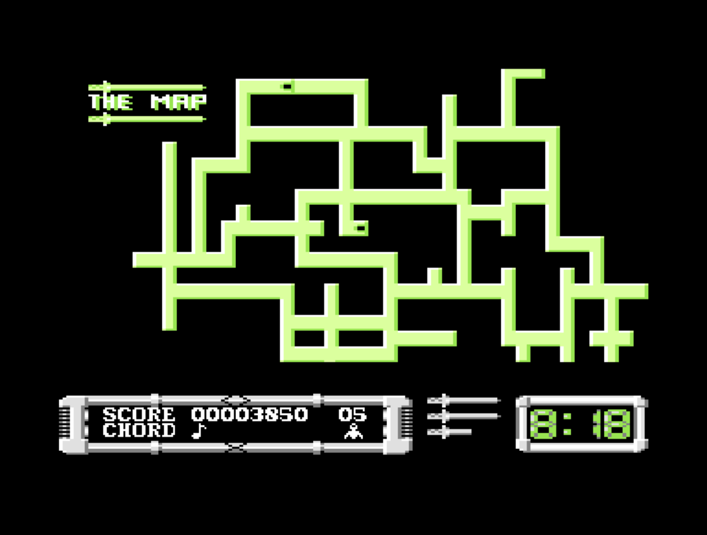
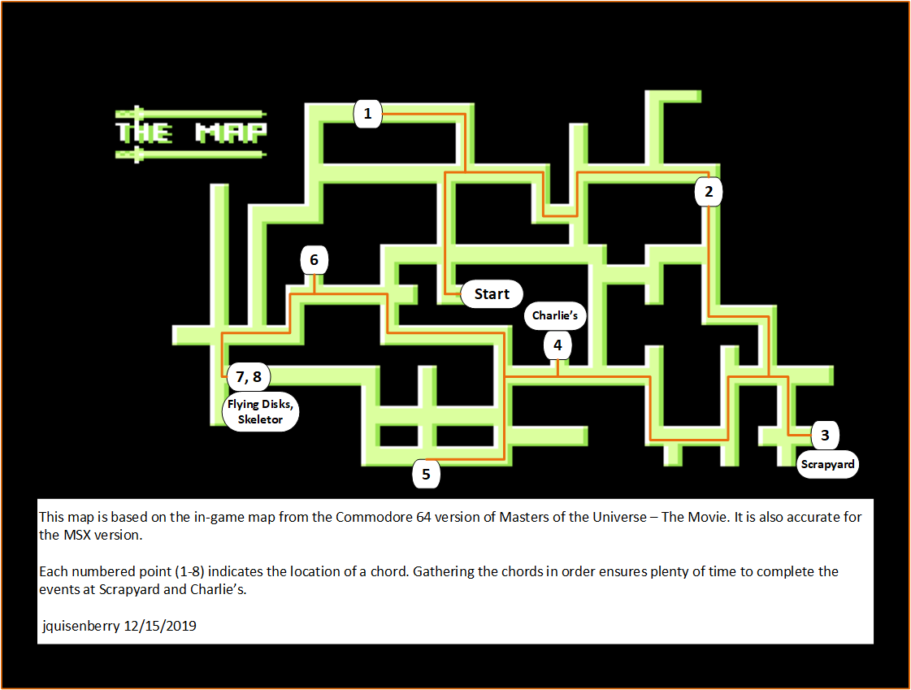
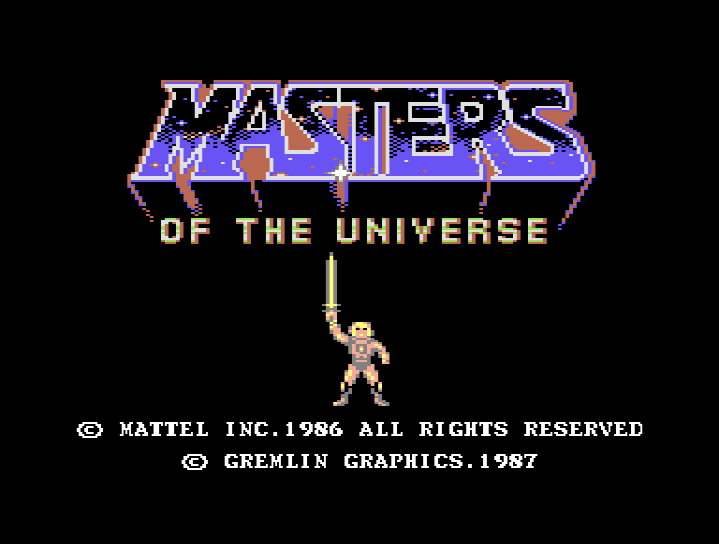
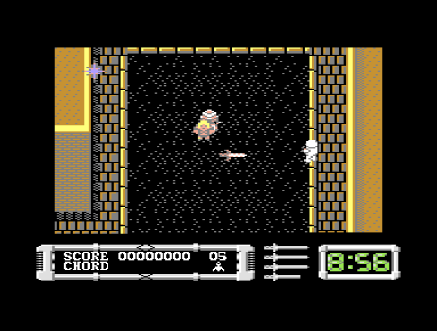
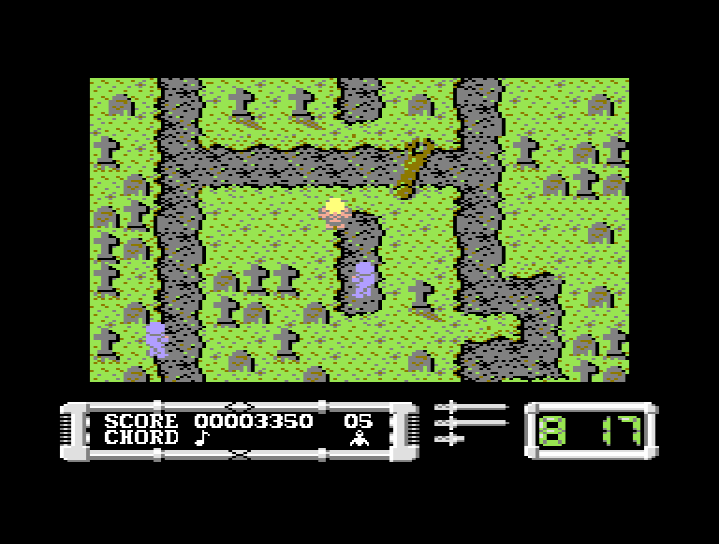
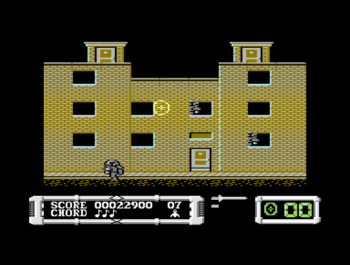
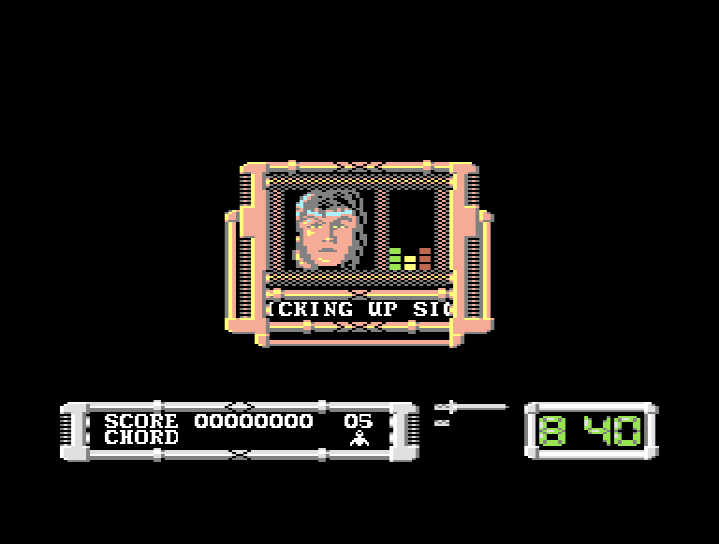
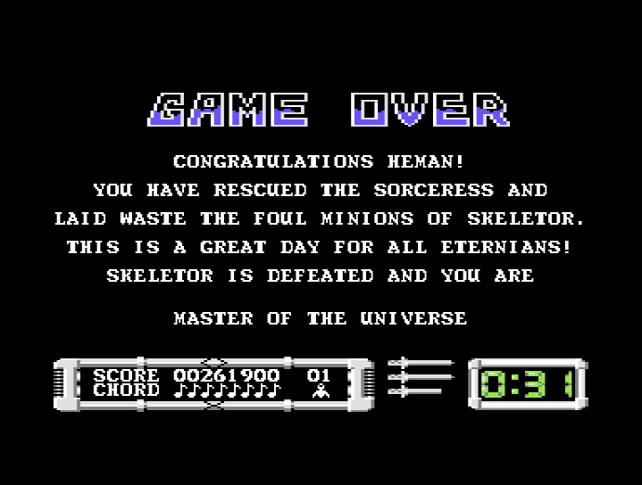
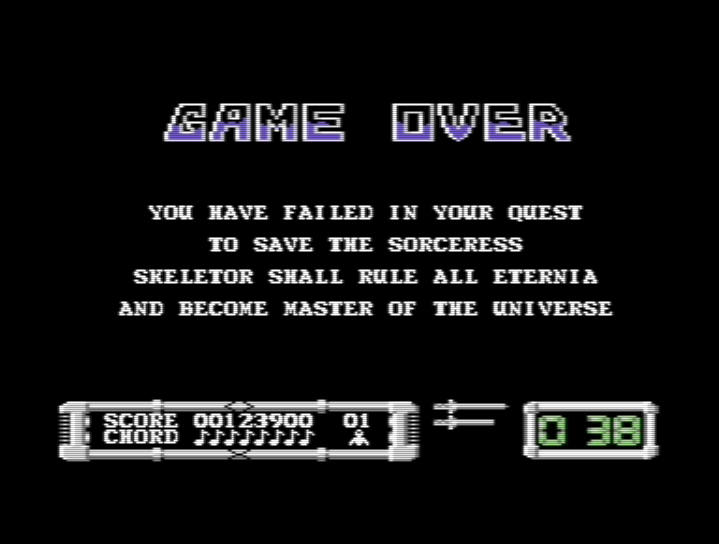

# Masters of the Universe: The Movie – Commodore 64 Reference

## Overview

The Commodore 64 release of *Masters of the Universe: The Movie* is an action-adventure adaptation of the 1987 Cannon Films movie, published by **Gremlin Graphics** (and later re-released under U.S. Gold's budget imprint **KIXX**). The game tasks He-Man with navigating the labyrinthine streets of a suburban California town on Earth, evading Skeletor's roving patrol cruisers, gathering the lost Cosmic Key chord tones, and facing Skeletor in final combat.

This document compiles verified memory POKE cheats, complete in-game and author-annotated street cartography, detailed walkthroughs of all gameplay perspectives, and complete verbatim screen transcripts.

---

## Verified Cheats: Unlimited Lives

To enable unlimited lives on the Commodore 64, load or reset the game, then execute the following BASIC memory `POKE` commands before running or restarting the program:

```basic
POKE 6266,234
POKE 6267,234
POKE 6228,234
SYS 23581
```

* **Effect:** Disables life-depletion routines upon taking fatal projectile damage or vehicle collisions, allowing unrestricted exploration across all sectors.

---

## In-Game Cartography & Street Labyrinth

### 1. In-Game Radar Map (`c64_motu_movie_play-map.png`)



* **Display Interface:** The C64 overhead radar displays the full network of traversable roadways in fluorescent green against a black background.
* **HUD Architecture:**
  * **SCORE:** 8-digit numeric score counter (`SCORE 00003850`).
  * **CHORD:** Musical notation meter tracking retrieved Cosmic Key tones (`CHORD ♪`).
  * **LIVES:** Icon counter showing remaining He-Man lives (`05`) alongside the He-Man helmet/figure symbol.
  * **HEALTH:** Horizontal sword icons (up to 4 swords, `⚔⚔⚔⚔`) indicating remaining energy before life loss.
  * **TIMER:** Mission countdown digital clock formatted in green numerals (`8:18`).

---

### 2. Annotated Route Map & Waypoint Guide (`c64_motu_movie_map-002.png`)



This map is based on the in-game street grid from the Commodore 64 version (and is fully applicable to the MSX edition as well). Gathering the chord tones in numerical order (1 through 8) guarantees sufficient time to navigate timed events at the Scrapyard and Charlie's music store.

#### Waypoint & Navigation Legend

| Waypoint | Sector / Target | Description & Navigation Notes |
|---|---|---|
| **Start** | Central Town Intersection | Initial starting location. Head north along the main thoroughfare to reach Waypoint 1. |
| **1** | North Highway | **Cosmic Key Chord Tone 1.** Retrieve the flashing chord star on the northern perimeter roadway. |
| **2** | Northeast Avenue | **Cosmic Key Chord Tone 2.** Travel east, then south along the northeastern corridor. |
| **3** | Scrapyard (Southeast) | **Cosmic Key Chord Tone 3.** Navigate the winding passages down to the far-southeast junkyard area. |
| **4** | Charlie's (Central-South) | **Cosmic Key Chord Tone 4.** Travel west into the central-south music store district. |
| **5** | South Industrial Sector | **Cosmic Key Chord Tone 5.** Follow the lower east-west boulevard along the southern edge of town. |
| **6** | West Residential Avenue | **Cosmic Key Chord Tone 6.** Head northwest into the western residential neighborhood. |
| **7, 8** | Flying Disks & Skeletor (Far West) | **Cosmic Key Chords 7 & 8.** Terminal confrontation sector. Evade Skeletor's hover-cruisers and flying disks to defeat Skeletor in final combat. |

---

## Screen Archive & Verbatim Transcriptions

### 1. Title Screen (`c64_motu_movie_intro.png`)



* **Visual Breakdown:** Multi-color purple and orange stone-hewn "MASTERS OF THE UNIVERSE" marquee with a sparkling star in the lettering. Below the logo, a sprite of He-Man stands centrally holding the Power Sword high overhead.
* **Copyright Inscription:**

```text
© MATTEL INC. 1986 ALL RIGHTS RESERVED
© GREMLIN GRAPHICS. 1987
```

---

### 2. In-Game Exploration & Sector Scenes

#### A. Suburban Street Traversal (`c64_motu_movie_play-001.png`)



* **Mechanics Depicted:** Overhead town traversal. He-Man maneuvers down a paved street while dodging laser projectile fire from a patrolling ground trooper.
* **Item Pickup:** A flashing Cosmic Key chord tone star is visible on the upper-left sidewalk.
* **HUD Status:** `SCORE 00000000`, `CHORD` (empty), `LIVES 05`, 4 health swords, `TIMER 8:56`.

#### B. Cemetery / Graveyard Sector (`c64_motu_movie_play-002.png`)



* **Mechanics Depicted:** Overhead navigation through the Graveyard sector. He-Man traverses dirt trails bounded by grass lawns, tombstones, cross grave markers (`†`), and fallen tree trunks while evading purple-clad troopers.
* **HUD Status:** `SCORE 00003350`, `CHORD ♪` (1 note collected), `LIVES 05`, 3 health swords, `TIMER 8 17`.

#### C. Tenement Building Sniper Gallery (`c64_motu_movie_play-003.png`)



* **Mechanics Depicted:** First-person crosshair target-shooting sequence. Skeletor's troopers lean out of windows and doorways in a three-story brick tenement building. The player controls a yellow crosshair reticle.
* **Target HUD:** The mission timer switches to an active reticle icon with target counter (`(+) 00`).
* **HUD Status:** `SCORE 00022900`, `CHORD ♪♪♪` (3 notes collected), `LIVES 07`, 1 health sword, reticle indicator `(+) 00`.

#### D. Communicator Transmission Monitor (`c64_motu_movie_play-004.png`)



* **Mechanics Depicted:** High-tech CRT video communication terminal displaying an incoming transmission. Features a character portrait, multi-color audio equalizer / signal bars (green, yellow, red), and a scrolling ticker-tape message along the bottom (`...CKING UP SIG...`, completing "...PICKING UP SIGNAL...").
* **HUD Status:** `SCORE 00000000`, `CHORD` (empty), `LIVES 05`, 1 health sword, `TIMER 8 40`.

---

### 3. Victory Ending (`c64_motu_movie_win.png`)



* **Context:** Triggered upon collecting all 8 Cosmic Key chord notes and defeating Skeletor before the mission timer expires.
* **Verbatim Transcription:**

```text
GAME OVER

CONGRATULATIONS HEMAN!
YOU HAVE RESCUED THE SORCERESS AND
LAID WASTE THE FOUL MINIONS OF SKELETOR.
THIS IS A GREAT DAY FOR ALL ETERNIANS!
SKELETOR IS DEFEATED AND YOU ARE

MASTER OF THE UNIVERSE
```

* **Status at Completion:** `SCORE 00261900`, `CHORD ♪♪♪♪♪♪♪♪` (all 8 tones locked), `LIVES 01`, 3 health swords, `TIMER 0:31`.

---

### 4. Defeat / Game Over Screen (`c64_motu_movie_lose.png`)



* **Context:** Triggered if all lives are exhausted or if the countdown timer elapses before the Cosmic Key chords are assembled.
* **Verbatim Transcription:**

```text
GAME OVER

YOU HAVE FAILED IN YOUR QUEST
TO SAVE THE SORCERESS
SKELETOR SHALL RULE ALL ETERNIA
AND BECOME MASTER OF THE UNIVERSE
```

* **Status at Failure:** `SCORE 00123900`, `CHORD ♪♪♪♪♪♪♪` (7 notes collected), `LIVES 01`, 2 health swords, `TIMER 0 38`.

---

## Cross-Platform Navigation

* **16-bit Atari ST Map & Guide:** [Atari ST Navigation Map & Route Guide](../../AtariST/MOTU_The_Movie/README.html) — High-resolution 1024×720 cartography, numbered waypoint coordinates, and optimal speedrun paths.
* **Amstrad CPC Archive:** [Amstrad CPC Media Archive](../../AmstradCPC/MOTU_The_Movie/README.html) — European KIXX cassette inlay transcriptions and Mode 0 display analysis.
* **MSX Edition:** [MSX Media Archive & Screen Reference](../../MSX/MOTU_The_Movie/README.html) — Vertical compass HUD analysis, Graveyard, Melee Duel, Sniper Gallery, and Skeletor Communicator screens.
