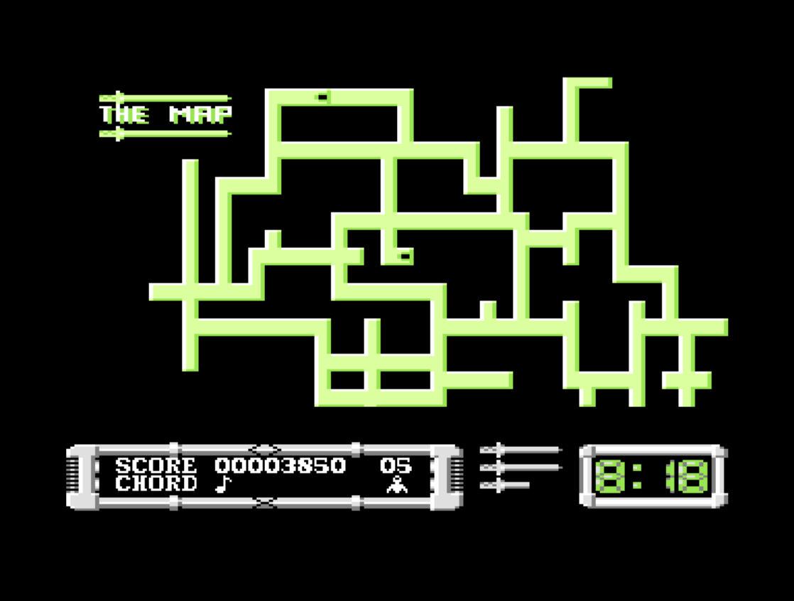
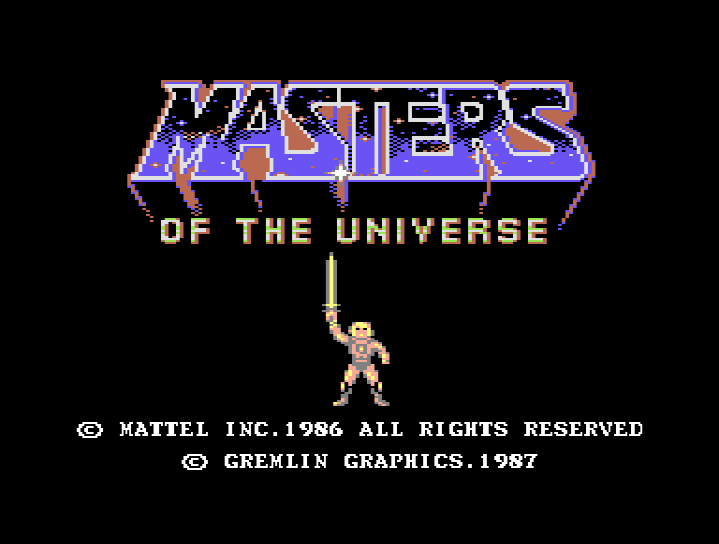
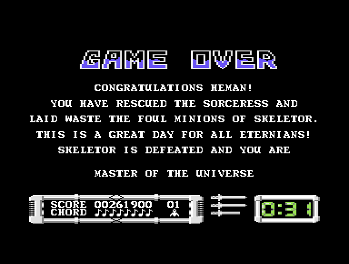
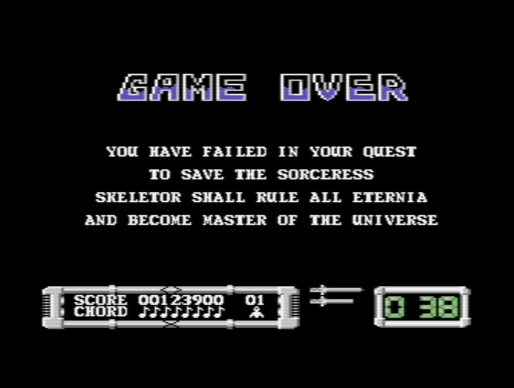

# Masters of the Universe: The Movie – Commodore 64 Reference

## Overview

The Commodore 64 release of *Masters of the Universe: The Movie* is an overhead action-adventure adaptation of the 1987 Cannon Films movie, published by **Gremlin Graphics** (and later re-released under U.S. Gold's budget imprint **KIXX**). The game tasks He-Man with navigating the labyrinthine streets of a suburban California town, evading Skeletor's roving patrol cruisers, gathering the lost Cosmic Key chord tones, and facing Skeletor in final combat.

This document compiles verified memory POKE cheats, the C64 town labyrinth map, and complete transcriptions of the in-game screens.

---

## Verified Cheats: Unlimited Lives

To enable unlimited lives on the Commodore 64, load or reset the game, then execute the following BASIC memory `POKE` commands before running or restarting the program:

```basic
POKE 6266,234
POKE 6267,234
POKE 6228,234
SYS 23581
```

* **Effect:** Disables life-depletion routines upon taking fatal projectile damage or vehicle collisions, allowing unrestricted exploration across all sectors.

---

## In-Game Cartography & Street Labyrinth

### Overhead City Map (`c64_motu_movie_play-map.png`)



* **Display Interface:** The C64 overhead radar displays the full network of traversable roadways in fluorescent green against a black background.
* **HUD Architecture:**
  * **SCORE:** 8-digit numeric score counter (`SCORE 00003850`).
  * **CHORD:** Musical notation meter tracking retrieved Cosmic Key tones (`CHORD ♪`).
  * **LIVES:** Icon counter showing remaining He-Man reserves (`05`).
  * **HEALTH:** Horizontal sword icons indicating remaining energy before life loss.
  * **TIMER:** Mission countdown digital clock (`8:18`).

---

## Screen Archive & Verbatim Transcriptions

### 1. Title Screen (`c64_motu_movie_intro.png`)



* **Visual Breakdown:** Multi-color purple and orange stone-hewn "MASTERS OF THE UNIVERSE" logo with He-Man standing centrally holding the Power Sword high overhead.
* **Copyright Inscription:**
  ```text
  (C) MATTEL INC. 1986 ALL RIGHTS RESERVED
  (C) GREMLIN GRAPHICS. 1987
  ```

---

### 2. Victory Ending (`c64_motu_movie_win.png`)



* **Context:** Triggered upon collecting all 8 Cosmic Key chord notes and defeating Skeletor before the mission timer expires.
* **Verbatim Transcription:**

```text
GAME OVER

CONGRATULATIONS HEMAN!
YOU HAVE RESCUED THE SORCERESS AND
LAID WASTE THE FOUL MINIONS OF SKELETOR.
THIS IS A GREAT DAY FOR ALL ETERNIANS!
SKELETOR IS DEFEATED AND YOU ARE

MASTER OF THE UNIVERSE
```

* **Status at Completion:** `SCORE 00261900`, `CHORD ♪♪♪♪♪♪♪♪` (all 8 tones locked), `LIVES 01`, `TIMER 0:31`.

---

### 3. Defeat / Game Over Screen (`c64_motu_movie_lose.png`)



* **Context:** Triggered if all lives are exhausted or if the countdown timer elapses before the Cosmic Key chords are assembled.
* **Outcome:** Skeletor claims total dominion over Castle Grayskull and Eternia.

---

## Cross-Platform Reference

* **Atari ST 16-bit Guide:** See [Atari ST Navigation Map & Route Guide](../../AtariST/MOTU_The_Movie/README.html) for high-resolution 1024×720 cartography, numbered waypoint coordinates, and optimal speedrun paths.
* **Amstrad CPC Archive:** See [Amstrad CPC Media Archive](../../AmstradCPC/MOTU_The_Movie/README.html) for European KIXX cassette inlay transcriptions and Mode 0/1 display analysis.
* **MSX Edition:** See [MSX Media Archive & Screen Reference](../../MSX/MOTU_The_Movie/README.html) for vertical compass HUD analysis.
