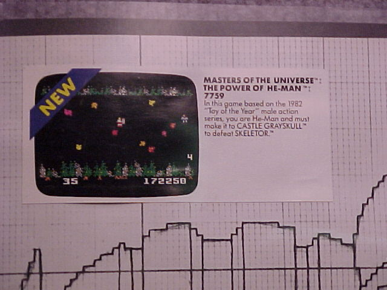
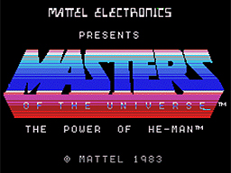

# Masters of the Universe: The Power of He-Man – ColecoVision Prototype

## Overview

In 1983, following the successful releases of *Masters of the Universe: The Power of He-Man* on the Atari 2600 and Intellivision, **Mattel Electronics** developed an official port for the **ColecoVision** (catalog item `#7759`). Although featured in Mattel's dealer catalogs and trade previews, the game was never commercially released following the collapse of the home video game market in 1983–1984 and the closure of Mattel Electronics.

In subsequent decades, playable prototype cartridges surfaced within the classic gaming preservation community (documented by the National Videogame Museum and classic gaming historians on AtariAge). This archive compiles verified catalog descriptions, hardware cartridge photographs, and title screen captures.

---

## Historical Catalog Listing (`post-25956-0-30426600-1305418640.jpg`)



* **Catalog Number:** 7759
* **Verbatim Promotional Copy:**
  > "MASTERS OF THE UNIVERSE™: THE POWER OF HE-MAN™
  > 7759
  > In this game based on the 1982 'Toy of the Year' male action series, you are He-Man and must make it to CASTLE GRAYSKULL™ to defeat SKELETOR.™"

---

## Prototype Hardware & Title Screen (`post-25956-0-32988000-1305418657.png`)



* **Display Architecture:** The ColecoVision edition renders a striking gradient logo utilizing the TMS9918A VDP graphics chip:
  ```text
  MATTEL ELECTRONICS
  PRESENTS
  MASTERS OF THE UNIVERSE
  THE POWER OF HE-MAN
  (C) MATTEL 1983
  ```
* **Cartridge & Board Photography:** Original EPROM prototype boards with handwritten Mattel development labels were exhibited by the original Blue Sky Rangers development team at the Classic Gaming Expo (CGE).

---

## Gameplay Mechanics

Similar to the Intellivision and Atari 2600 editions, gameplay consists of two primary phases:
1. **Wind Raider Aerial Flight:** Flying through Eternian airspace dodging Skeletor's patrol ships, using the ION Cannon and dropping MUTRON bombs.
2. **Castle Grayskull Infiltration:** Ground approach past rolling blast walls and laser traps to confront Skeletor.

---

## Cross-Platform Reference

* **Atari 2600 Manual:** See [Atari 2600 Game Manual Transcription](../../Atari2600/MOTU_Power_of_He-Man/MOTU_Power_of_He-Man_Manual.html) for full verbatim manual copy, scoring tables, and difficulty settings.
