# Masters of the Universe: The Power of He-Man – ColecoVision Prototype

**Historical Preservation Archive, Development Blueprints, Prototype Hardware & Screen Analysis**

---

## Overview

In 1983, following the successful commercial releases of *Masters of the Universe: The Power of He-Man* on the Intellivision and Atari 2600, **Mattel Electronics** developed an official conversion for the **ColecoVision** (designated as catalog item `#7759`). Utilizing the ColecoVision's Texas Instruments TMS9918A Video Display Processor (VDP) and Zilog Z80A CPU, the game featured significantly higher visual fidelity than the Atari 2600 edition and smoother multi-directional scrolling than the original Intellivision game.

Although featured prominently in Mattel's internal 1983 dealer catalogs and scheduled for commercial distribution, the title was abruptly cancelled following the catastrophic video game industry crash of 1983–1984, which culminated in the closure of Mattel Electronics in early 1984.

The ColecoVision prototype remained hidden for two decades until August 2003, when the **Blue Sky Rangers** (the collective of former Mattel Electronics programmers led by Keith Robinson) brought a playable EPROM prototype board and original hand-drawn design documents to the **Classic Gaming Expo (CGE 2003)** in Las Vegas, Nevada. This archive consolidates the dealer catalog listings, original pre-production artwork, hardware photographs, title screen transcriptions, and gameplay frame captures preserved from the prototype.

---

## 1. Retail Catalog & Commercial Cancellation

### Mattel 1983 Dealer Catalog Listing (`post-25956-0-30426600-1305418640.jpg`)

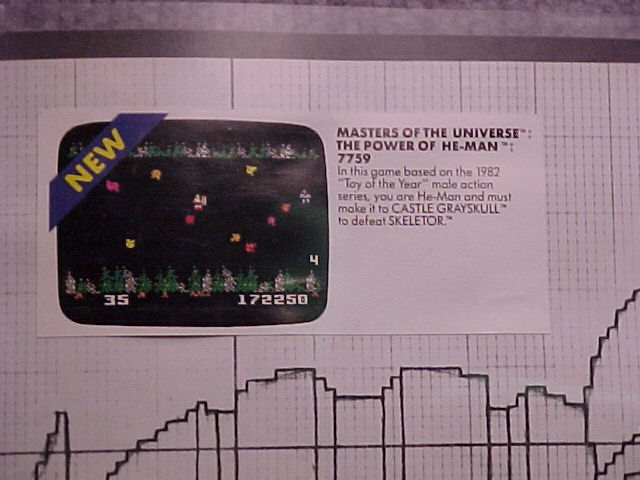

* **Catalog Number:** 7759
* **Promotional Banner:** Overlaid with a diagonal blue-and-yellow *"NEW"* badge.
* **Catalog Screenshot:** Displays an early development capture of Phase 1 (Wind Raider aerial flight) showing a starfield, mountains, and the Wind Raider engaged in combat.
* **Verbatim Promotional Copy:**
  > "MASTERS OF THE UNIVERSE™: THE POWER OF HE-MAN™  
  > 7759  
  > In this game based on the 1982 'Toy of the Year' male action series, you are He-Man and must make it to CASTLE GRAYSKULL™ to defeat SKELETOR.™"

---

## 2. Original Mattel Production Artwork & Blueprints

### 2.1 Architectural Grid Layout & Color Mockup (`EVW2FAqXYAM1Pkh.jpg`)

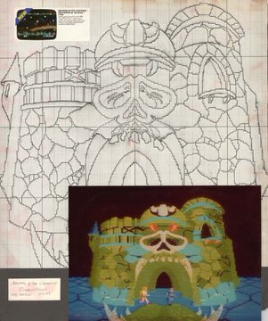

* **Display Architecture:** A composite design board preserved from Mattel Electronics' internal art department:
  * **Top/Main Section:** Hand-drawn graph paper blueprint displaying the pixel-grid architectural line art for the exterior of **Castle Grayskull**. Each stone block, turret crenellation, and the central skull jawbridge is plotted on coordinate grid lines for sprite and tile conversion by the programming team. In the upper-left corner is a clipped paste-up of the catalog #7759 entry with its *"NEW"* banner.
  * **Bottom Inset:** An original gouache/acrylic color screen concept painting showing Castle Grayskull rendered with glowing red eyes inside the skull sockets, blue and green atmospheric stone shading, and He-Man confronting a soldier atop a blue hexagonal-tiled foreground bridge.
  * **Exhibition Tag:** Lower-left handwritten label reads: *"MASTERS OF THE UNIVERSE / COLECOVISION / CGE DISPLAY 2003"*.

---

### 2.2 CGE 2003 Framed Exhibition Display (`post-25956-0-24373700-1305418634.jpg`)

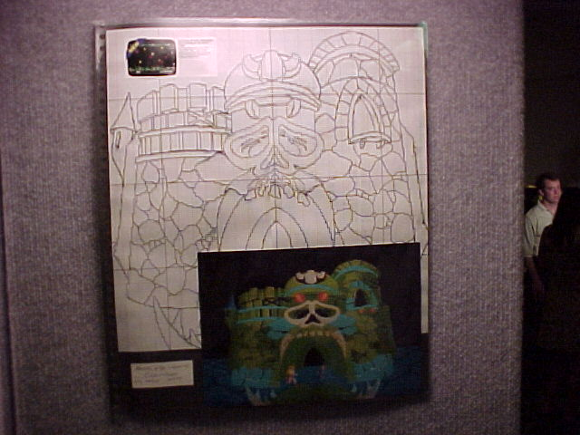

* **Display Analysis:** Photograph of the framed production blueprint mounted on the exhibition hall wall at the Classic Gaming Expo 2003 in Las Vegas, Nevada. The document was preserved by the Blue Sky Rangers and exhibited publicly for the first time to attendees and video game historians.

---

## 3. Hardware Prototype & CGE 2003 Exhibition

### 3.1 Prototype Cartridge (`EVW2FAqXYAAymDQ.jpg`)

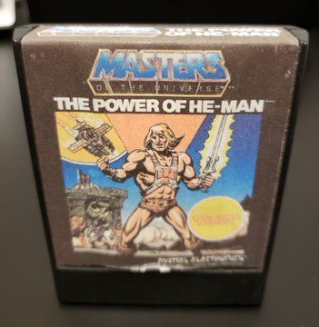

* **Cartridge Architecture:** Standard ColecoVision cartridge shell featuring a custom Mattel Electronics prototype face label:
  * **Upper Register:** Classic embossed *Masters of the Universe* logo above the bold white subtitle *"THE POWER OF HE-MAN"*.
  * **Illustration:** The iconic cover art of He-Man in his harness brandishing the glowing Power Sword, with the Wind Raider soaring overhead and Castle Grayskull in the background.
  * **System Identification:** A distinctive yellow circular label in the lower right reading *"COLECOVISION"*.
  * **Publisher Imprint:** *"MATTEL ELECTRONICS"* along the bottom border.

---

### 3.2 Live Hardware Demonstration Station (`post-25956-0-41131100-1305418619.jpg`)

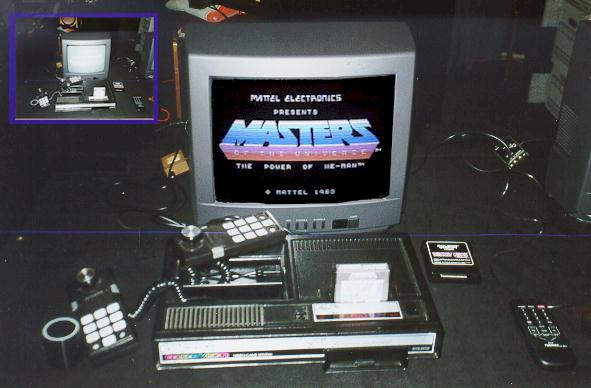

* **Exhibition Setup:** The Blue Sky Rangers' interactive demo station at CGE 2003:
  * **Console:** An original ColecoVision Video Game System console connected to a standard CRT television monitor.
  * **Cartridge Port:** A development prototype cartridge with EPROM board inserted directly into the console cartridge slot.
  * **Controllers:** Two standard ColecoVision hand controllers with numeric keypads and direction knobs resting on the console deck.
  * **Display:** The CRT monitor displays the live title screen in its native 4:3 cathode-ray presentation.
  * **Inset Photo:** Upper-left corner displays a wide view of the exhibit booth table.

---

### 3.3 The Blue Sky Rangers at CGE 2003 (`post-25956-0-26048800-1305418607.jpg`)

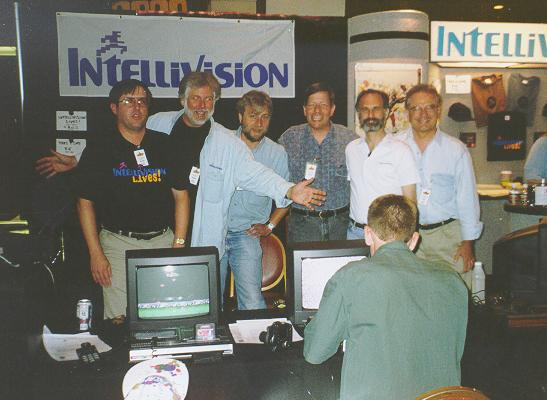

* **Historical Record:** The former Mattel Electronics development staff gathered behind the interactive demo desk beneath the *"Intellivision Lives!"* banner at CGE 2003. Keith Robinson (second from left, wearing light blue shirt and Intellivision badge) and fellow Blue Sky Rangers brought the unreleased ColecoVision prototype out of private company archives to demonstrate its playability to the preservation community.

---

## 4. Title Screen & TMS9918A Visual Architecture

### 4.1 Direct Title Screen Capture (`post-25956-0-32988000-1305418657.png`)

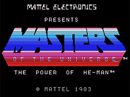

### 4.2 Off-Screen CRT Title Photograph (`post-25956-0-99057400-1305418644.jpg`)

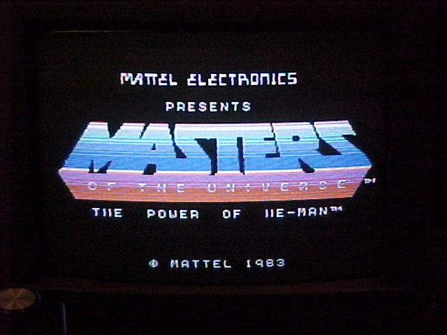

* **Display Architecture:** Rendered using the ColecoVision's Texas Instruments TMS9918A VDP at 256×192 resolution against a solid black backdrop.
* **Graphic Design:** The central *Masters of the Universe* logo utilizes a horizontal multi-color raster gradient effect (transitioning across white, cyan, light blue, dark blue, magenta, and orange bands) that far surpassed the flat solid-color rendering of the Atari 2600 and Intellivision editions.
* **Verbatim Title Screen Credits:**
  ```text
  MATTEL ELECTRONICS
       PRESENTS

       MASTERS
  OF THE UNIVERSE (TM)

  THE POWER OF HE-MAN (TM)

    (C) MATTEL 1983
  ```

---

## 5. Gameplay Mechanics & Direct Frame Captures

Like its Intellivision predecessor, *The Power of He-Man* on ColecoVision is structured into two distinct, alternating phases of play:

---

### 5.1 Phase 1: Wind Raider Aerial Flight

In Phase 1, He-Man pilots the Wind Raider across the skies of Eternia toward Castle Grayskull, navigating through Skeletor's aerial and ground defenses.

#### Direct Digital Capture (`post-25956-0-56162000-1305418662.gif`)

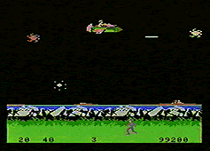

#### Off-Screen CRT Display Capture (`post-25956-0-34757200-1305418649.jpg`)

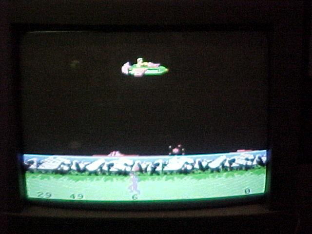

* **Visual & Mechanical Analysis:**
  * **Wind Raider:** Rendered in green, pink, and white sprite layers. The craft can maneuver vertically and horizontally across the screen while adjusting flight speed.
  * **Combat Mechanics:** The Wind Raider fires forward-projecting white ION Cannon laser beams to vaporize Skeletor's red/orange patrol ships in mid-air, and can drop downward MUTRON bombs to destroy ground targets.
  * **Parallax Scrolling:** The background features multi-layered scrolling mountains and hills with white-capped peaks and green foliage, providing a sense of speed and depth that was widely compared to Irem's *Moon Patrol*.
  * **Ground Threats:** Purple enemy soldiers march along the green terrain below while anti-aircraft ground batteries loose flak projectiles upward.
  * **HUD Telemetry Bar:** Four operational metrics are docked along the lower green boundary:
    * **Leftmost Counter (`20` / `29`):** Remaining flight distance / waypoints to Castle Grayskull.
    * **Second Counter (`48` / `49`):** Wind Raider energy / fuel gauge.
    * **Third Counter (`3` / `6`):** Remaining lives.
    * **Rightmost Counter (`99200` / `0`):** Accumulated score.

---

### 5.2 Phase 2: Castle Grayskull Infiltration

Upon surviving the aerial approach, He-Man reaches the fortress itself to confront Skeletor.

#### Direct Digital Capture (`post-25956-0-58459200-1305418668.gif`)

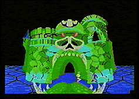

* **Visual & Mechanical Analysis:**
  * **Castle Grayskull Facade:** Rendered in vibrant lime-green and teal stone brickwork, closely matching the production layout blueprint (`EVW2FAqXYAM1Pkh.jpg`). The fortress towers feature medieval crenellations, arched parapet windows, and the iconic skull face with glowing red eyes in the eye sockets.
  * **Entryway & Floor:** He-Man (yellow and white sprite) stands upon a blue hexagonal-tiled foreground platform spanning the entrance moat.
  * **Combat Objective:** He-Man must advance toward the gaping skull jawbridge, dodging magical energy barriers and blast walls, before entering the castle to confront Skeletor in direct hand-to-hand combat.

---

## 6. Archival Preservation Files

The documentation in this repository is derived from files preserved during the 2003 CGE demonstration and subsequent research on AtariAge:

* **AtariAge Forum Discussion Thread:** `Masters of the Universe - The Power of He-Man - ColecoVision _ Adam - AtariAge Forums.pdf`  
  *Archival PDF of the May 2011 AtariAge research thread initiated by user `niad`, documenting the CGE 2003 demonstration, EPROM preservation history, and community efforts to catalog unreleased ColecoVision software.*
* **CGE 2003 Live Video Footage:** `Masters of the Universe - The Power of He-Man - Videos.zip`  
  *Compressed archive containing two video clips (`#01.mpeg` and `#02.mpeg`) recorded on the exhibition floor at CGE 2003, showing live gameplay of Phase 1 and Phase 2 on the ColecoVision console.*

---

## 7. Cross-Platform Reference

* **Atari 2600 Manual:** See [Atari 2600 Game Manual Transcription](../../Atari2600/MOTU_Power_of_He-Man/MOTU_Power_of_He-Man_Manual.html) for full verbatim manual copy, scoring tables, and difficulty settings applicable to the 1983 Mattel game mechanics.
