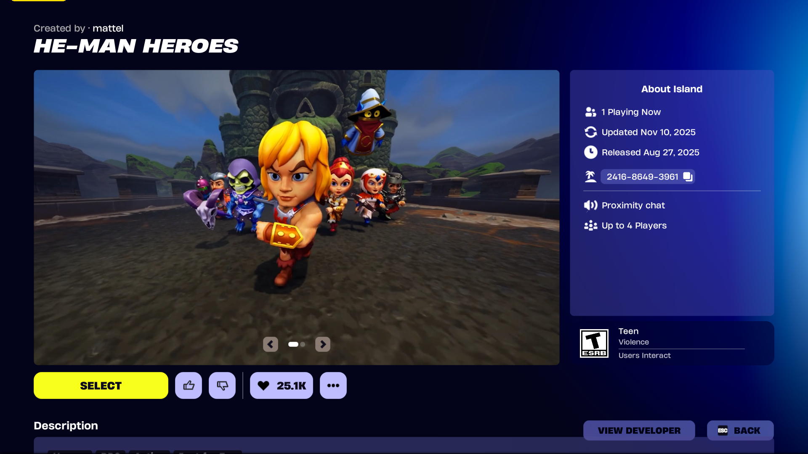
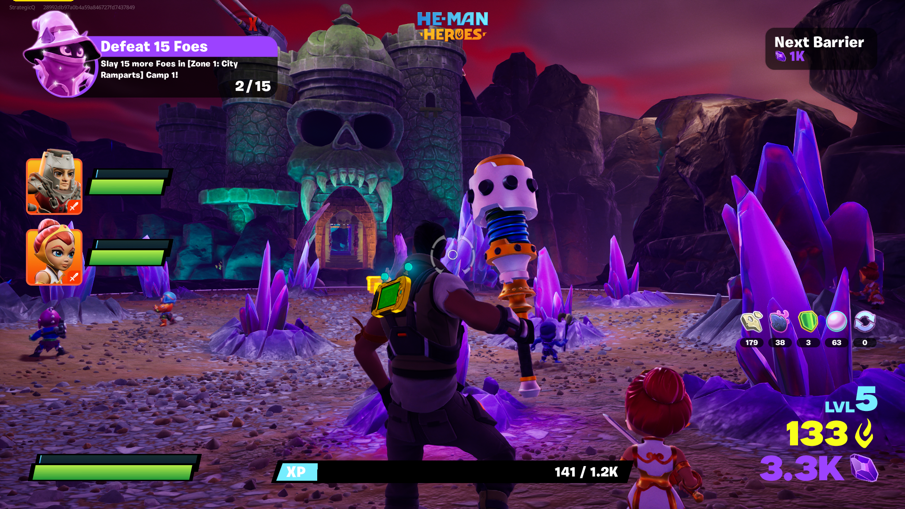

# Masters of the Universe: He-Man Heroes

> **Platform:** Fortnite 
> **Developer:** Mattel and Loot Foundry 
> **Publisher:** Mattel 
> **Genre:** Action / Adventure  
> **Author:** Jacob Quisenberry — Version 1.01 (2026-11-14)

---

## Overview

*Masters of the Universe: He-Man Heroes* is a Fortnite island developed by Mattel and Loot Foundry. The island supports up to four players and was released on August 27, 2025.

---

## Game Overview

| Field | Detail |
|---|---|
| **Full Title** | Masters of the Universe: He-Man Heroes |
| **Developer** | Mattel and Loot Foundry |
| **Publisher** | Mattel |
| **Platform** | Fortnite |
| **Genre** | Action / Adventure |
| **Players** | Up to 4 |
| **Fortnite Island Code** | 2416-8649-3961 |
| **Release Date** | August 27, 2025 |
| **Rating** | Teen |

---

## Screenshot Archive

---

### Fortnite Island Listing

**Caption:** Fortnite island listing for **HE-MAN HEROES**. The page identifies the creator as Mattel, shows the release date as August 27, 2025, and displays island code **2416-8649-3961**, support for up to four players, and a Teen rating. The featured artwork shows He-Man and other characters in front of Castle Grayskull.

---

### In-Game Gameplay

**Caption:** Fortnite gameplay screenshot showing the objective **“Defeat 15 Foes”** at **2/15** in **Zone 1: City Ramparts, Camp 1**. Castle Grayskull is visible in the environment. The HUD also shows **Next Barrier 1K** and character level **5**.

---

## Preservation Notes

This archive documents the Fortnite island listing and a gameplay screenshot for *Masters of the Universe: He-Man Heroes*.

---

*Document authored by Jacob Quisenberry. Version 1.01 — 2026-11-14.*
