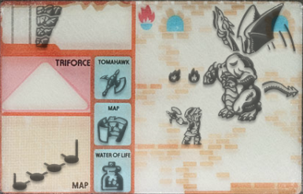
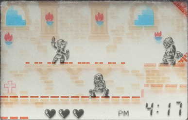

# The Legend of Zelda Game & Watch ZL-65 - Media & Product Reference

## Product identification

The source notes identify this as Nintendo's dual-screen handheld rather than the separate Nelsonic wristwatch game. The recorded details are:

- Product ID: **ZL-65**
- UPC: **035051010012**
- Date noted: **August 1989**
- Developer and publisher: **Nintendo**

The source supplied links to an instruction-manual reference, UPC listing, and box-back image:

- [Instruction manual reference (Zelda Dungeon)](https://www.zeldadungeon.net/gallery/displayimage.php?album=496&pid=14035#top_display_media)
- [UPC reference (UPCitemdb)](https://www.upcitemdb.com/upc/35051010012)
- [Box back with barcode (MobyGames)](https://www.mobygames.com/game/dedicated-handheld/game-watch-multi-screen-zelda/cover-art/gameCoverId,429665/)

## Screen photographs

**Caption:** Photograph of the upper gameplay display. Link and enemies appear among brick-patterned platforms; the lower edge shows three heart icons, a PM indicator, and a time reading of 4:17. The image documents the displayed play state, not a complete level map.

**Caption:** Photograph of the lower display and printed game-reference panel. Visible labels include “TRIFORCE,” “TOMAHAWK,” “MAP,” and “WATER OF LIFE,” alongside small item illustrations and a route/map diagram.

## Identification caveat

This Nintendo dual-screen unit is a different product from **The Legend of Zelda 8321**, the Nelsonic wristwatch game documented separately in this folder. The source notes do not provide a complete manual transcription or walkthrough for this dual-screen release.
