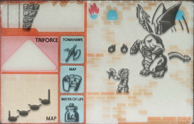
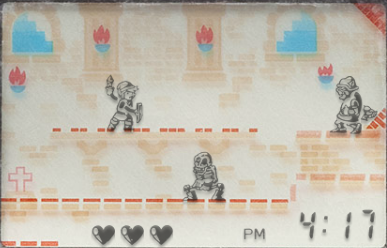

# The Legend of Zelda Game & Watch ZL-65 - Media & Product Reference

## Product identification

The source notes identify this as Nintendo's dual-screen handheld rather than the separate Nelsonic wristwatch game. The recorded details are:

- Product ID: **ZL-65**
- UPC: **035051010012**
- Date noted: **August 1989**
- Developer and publisher: **Nintendo**

The source supplied links to an instruction-manual reference, UPC listing, and box-back image:

- [Instruction manual reference (Zelda Dungeon)](https://www.zeldadungeon.net/gallery/displayimage.php?album=496&pid=14035#top_display_media)
- [UPC reference (UPCitemdb)](https://www.upcitemdb.com/upc/35051010012)
- [Box back with barcode (MobyGames)](https://www.mobygames.com/game/dedicated-handheld/game-watch-multi-screen-zelda/cover-art/gameCoverId,429665/)

## Screen photographs

### 1. Upper Screen – Dragon Boss Lair & Inventory (`Zelda_Game_and_Watch_upper.png`)

**Caption:** Photograph of the upper LCD display. On the right, Link confronts the fire-breathing Dragon boss with his tomahawk drawn in the final chamber of a dungeon level. The printed panel on the left displays equipment and quest progress indicators, including the **TRIFORCE** triangle, **TOMAHAWK**, **MAP**, **WATER OF LIFE**, and a 5-chamber dungeon progression path.

---

### 2. Lower Screen – Main Dungeon Chamber & Clock (`Zelda_Game_and_Watch_lower.png`)

**Caption:** Photograph of the lower LCD display. Link traverses multi-tiered brick platforms past torch braziers and arched stairways, engaging a Stalfos (skeleton) on the ground floor and a Moblin on the upper-right ledge. The bottom register shows Link's three Heart life containers, a PM indicator, and the real-time digital clock reading **4:17**.

---

## Identification caveat

This Nintendo dual-screen unit is a different product from **The Legend of Zelda 8321**, the Nelsonic wristwatch game documented separately in this folder. The source notes do not provide a complete manual transcription or walkthrough for this dual-screen release.
