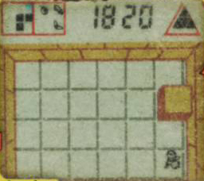

# The Legend of Zelda 8321 Nelsonic Game Watch - Manual & Strategy Archive

**Source version:** 1.00, initially released 2019-02-05. The source's strategy section is explicitly marked “Incomplete”; no missing route or strategy has been supplied here.

## Product identification

The source identifies the game as a Nelsonic Industries wristwatch released in the United States on October 5, 1989, licensed by Nintendo. The recorded identifiers are model **8321** and product ID **04935301251**. It is not Nintendo's two-screen Zelda Game & Watch.

## Controls and operation

| Control | Manual-described function |
|---|---|
| S1 (Mode) | Switches among normal time, game, and alarm displays. |
| S2 (Set) | Starts a game; used with the K buttons to set time and alarm values. |
| K1 | Moves Link left during the game. |
| K2 | Moves Link right during the game. |
| K3 | Moves Link downward during the game. |
| K4 | Moves Link upward during the game. |

The manual describes normal-time, alarm, mute, and battery-replacement procedures in the transcription below. It recommends a Silver Oxide 392 or equivalent battery and warns that small watch parts can be hazardous to young children.

## Game rules and scoring

The objective described in the manual is to collect four Triforce pieces across four levels, with four caves per level. Link begins without a weapon and must avoid Iron Balls until collecting the Boomerang. The source's enemy/weapon table is:

| Enemy | Weapon |
|---|---|
| Iron Balls | Boomerang |
| Bats | Sword |
| Dragon | Bomb |

The manual says a key is worth 20 bonus points if collected within four seconds. After enemies are cleared, the player has ten seconds to reach the door; the source says ten points are deducted for each additional second. A Dragon appears at the end of each level; the manual says to collect and drop a bomb near it, then move away before it explodes. The final Triforce triangle is worth 60 points, and the recorded top score is 1820.

The manual further states that later-level bats require clearing all Iron Balls with the Boomerang before a Sword appears, and that the Sword can be used eight times.

## Gameplay photograph



**Caption:** Photograph of the watch's monochrome LCD during a game. The screen shows a rectangular cave grid, Link near the lower-right area, the score 1820, and a triangular Triforce indicator at the top. The photograph is a single screen state, not a full map.

## Manual content summary

This editorial summary groups the source's controls, rules, and operating instructions. A complete source text transcription follows it; wording and typographical errors in that transcription are retained.

### Display modes

In normal mode, the watch displays hours and minutes with a PM indicator. Press S1 once to enter game mode; press it again to display alarm time.

### Character and item points

| Character or item | Points / note |
|---|---|
| Dragon | 50 |
| Iron Ball | 20 |
| Bat | 40 |
| Key | 20 if picked up within four seconds |
| Triangle | 20 |
| Last Triforce triangle | 60 |
| Boomerang, Sword, Bomb, Door | No point value stated |

### Sound effects

The manual lists effects for starting a game, Link's movement, being hit, losing all lives, picking up a weapon or extra heart, moving between caves, game over, and reaching the top score.

### Game mode operations

In normal time mode, press S1 to enter game mode. Press S2 to start; the manual says the Top Score appears and then resets to zero. Two Link shields and two hearts are displayed, described as four lives in total.

### Object of the game

Link enters a cave without weapons and is attacked by Iron Balls, bats, and Dragons. He must avoid enemies until he finds the weapon intended for them. Press S1 to pick up a displayed weapon; press S2 to use it against an enemy. After clearing enemies, collect the key and reach the door before the time penalty exhausts the score. The source describes four caves per level and four levels, with a Dragon at each level's end. After a Dragon is defeated, collect the Triforce triangle and proceed through the next level's key and cave.

The source notes that a sword has limited uses and that Link loses all lives if hit by a Dragon's fire or caught in the bomb blast.

### Setting the watch and alarm

The source describes setting seconds by holding S2 in normal mode, then using the K buttons. S1 advances to hour and minute settings; holding any K button advances the selected digit. Press S2 to return to normal time mode.

For the alarm, enter alarm mode with S1, hold S2 to set hours, use S1 to move to minutes, and press S2 to finish. The manual says S2 arms or disarms the alarm, with the Link shield indicating the armed state.

### Battery replacement and age warning

The manual gives five battery-replacement steps: remove the four rear screws, remove the battery-retaining screw and contact, replace the battery, and reinstall the retaining hardware. It recommends Silver Oxide 392 or equivalent. It also recommends the watch for ages five and up and advises that an adult handle battery replacement.

## Strategy status and source references

The original FAQ's strategy section consists only of the word “Incomplete.” This archive therefore does not claim to provide a route or tactics beyond the manual transcription.

The source listed these external references:

- [Nintendo/Game & Watch product photo reference](http://www.gamewatchguys.com/game_watch_details.php?toggle2=off&watchid=272#anchor1)
- [Instruction manual PDF reference](https://www.puissance-zelda.com/img/spinoff/zw/f_manuel.pdf)
- [Release and developer reference](https://zelda.gamepedia.com/The_Legend_of_Zelda_Game_Watch)
- [Barcode listing reference](https://www.ebay.com/itm/New-Old-Stock-Black-Legend-Of-Zelda-Nelsonic-Game-Watch-Nintendo-WORKS-PERFECT/303050956101)

## Complete source FAQ text

The original FAQ follows in a fixed-width block to preserve its wording and diagrams. Email contact details, if present, are omitted. An embedded UTF-8 right quotation mark in the legacy source is normalized to an ASCII quotation mark.

````text
The Legend of Zelda Game Watch
a.k.a
THE LEGEND OF ZELDA 8321

FAQ by Jacob Quisenberry
Current Version: 1.00

-=-=-=-=-=-=-=-=-=-=-=-=-=-=-=-=-=-=-=-=-=-=-=-=-=-=-=-=-=-=-=-=-=-=-=-=-=-=-=-
I. INTRODUCTION

The Legend of Zelda Game Watch is a wristwatch in which the player must 
obtain four pieces of the Triforce. It was published by Nelsonic in the USA 
on October 5, 1989. 

This game should not be confused with the Zelda Game & Watch, which is a 
two-screen hand-held published by Nintendo.

Format: This document is a plain-text document meant to be viewed with a 
monospace font, such as Courier New.

-=-=-=-=-=-=-=-=-=-=-=-=-=-=-=-=-=-=-=-=-=-=-=-=-=-=-=-=-=-=-=-=-=-=-=-=-=-=-=-


TABLE OF CONTENTS

I.   Introduction
II.  Version History
III. Manual Transcription
IV.  Strategy
V.   Rights
VI.  Contact


II. VERSION HISTORY

2/5/2019
* Initial release.


III. MANUAL TRANSCRIPTION

Following is a verbatim transcription of the game's instruction manual. It 
leaves grammatical errors intact.


THE LEGEND OF ZELDA 8321

S1 (Mode); Normal time - Game mode - Alarm time
S2 (Set); Press and hold to reach the setting mode (The
seconds will start to flash)
K1 (Left button): To move left (at game mode)
K2 (Right button): To move right (at game mode)
K3 (Lower button): To move downward (at game mode)
K4 (Upper button): To move upward (at game mode)


DISPLAY MODE OPERATIONS ____________
In normal mode, watch displays hours and minutes (with PM indicator) Press S1 
once to enter game mode and a zero will appear. Press S1 once more for alarm 
time to appear.


CAST OF CHARACTERS FIGURE POINTS
Link
Dragon             50
Iron Bait          20
Bat                40
Key                20 (if picked up within 4 seconds)
Triangle           20
Last Triangle 
   of the Triforce 60
Boomerang
Sword
Bomb
Door


SOUND EFFECTS_____________________
The different musical effects will sound at these various times:
1. Game start 
2. Each movement by Link
3. When Link is hit by an enemy
4. When Link loses all his lives (hearts)
5. When Link picks up a weapon 
6. When Link exits one cave to enter the next cave
7. When Link picks up an extra heart (life)
8. Game over. 
9. Top score 1820 


GAME MODE OPERATIONS __________________
While in normal time mode press S1 to enter game mode, zero
will appear at the top of watch. To start the game press S2,
the musical effect will sound, Top Score will appear, and then
will reset to zero. Two shields (Link's) will appear at the top, 
and two hearts will appear on bottom right signifying that you have 
a total of 4 Link lives for each game.


LINK'S CONTROL BUTTONSU_____________
K1: Moves Left
K2: Moves Right
K3: Moves Downward
K4: Moves Upward


OBJECT OF GAME ______________________
Link enters a cave. His is defenseless, without any weapons.
Link is attacked by crushing Iron Balls, Ferocious bats, and a fire 
breathing Dragons. In order to defeat these enemies he must
pick up the appropriate weapon designed to destroy a specific
enemy. When entering the first cave two Iron Balls chase Link. He
must avoid them by using the K directional controls. If the
"weaponless" Link does not avoid the attacking Iron balls and they
catch him, a musical effect will be heard and Link will flash
signifying that he lost one life. In the upper left corner a Boomerang 
will appear. When he reaches this needed weapon press S1 to pick up the 
boomerang. When a weapon is picked up it will be seen in the top left square. 
Letting you know that Link has acquired the weapon and can now defend 
himself. Link now chases the Iron Balls and when he catches one, press S2 
and it will be destroyed. After all enemies are destroyed a key will
appear in top left corner. If you can pick up the key (S1) with in 4
seconds 20 bonus points will be awarded to you. Once Link has
the key a door will appear telling Link which way to go to the
next cave. You have 10 seconds to get Link through the door.
For every second after that, 10 points will be deducted from your
score until all points are lost and game is over. At the top left
there is a flashing map telling you in which cave Link is located. 
There are 4 caves in each level and 4 levels for a total of 16 caves.
At the end of each level the fire breathing Dragon will appear. If
Link is hit by the fire, no weapon will protect him and he will lose
all his lives. Link must destroy the dragon by picking up a bomb
(S1) at the top left corner and dropping the bomb (S1) near the
Dragon. Link must get away before the bomb explodes or else
Link loses all his lives. When the Dragon is destroyed a triangle
will be seen in the bottom right corner. Pick it up (S1) and it will
be added to the Triforce triangle of the top right. A key will then
appear to enter the next level and cave. The running score is displayed 
at the top. After Link has lost all his lives the game is over. To resume 
play press S2. The score is cleared and a new game will begin.


Note: In higher levels to destroy bats, Link must first destroy
all Iron Balls with the boomerang and then a sword will appear
in bottom middle for the destruction of the bats.


Note: The Sword can only be used eight times (press key S2).


ENEMY          WEAPON
Iron balls     Boomerang
Bats           Sword
Dragon         Bomb


IMPORTANT NOTE ABOUT SOUND EFFECTS_____
To mute or to reactivate the electronic sound effects, while in
normal mode press S1 twice to enter alarm mode ("AL"), then press S2 once 
and the Link shield will ether disappear (indicating silent play) or appear 
(indicating full sound effects). Press S1 twice to enter game mode. 

HOW TO SET YOUR WATCH___________________
1. Seconds 
While in normal time mode, depress and hold S2 until flashing seconds appear 
in place of the time display. Press any K button to set seconds to :00.

2. Hours
Press S1 and the full time will be displayed with the hours flashing.
Depress and hold any K button to advance the hours to the desired
time (PM indicator if necessary) then release. 

3. Minutes
Press S1 once again and then minutes will begin flashing. Depress and hold 
any K button to advance minutes to the desired time, then release. Press S2 
to return to normal time mode. Your watch is now set to the desired 
hours/minutes.


HOUR OR MINUTE DIGIT SELECT
K4 
K1 
TIME SETTING
K2 
PRESS ANY KEY TO ADVANCE HOUR OR MINUTE DIGIT
HOUR MINUTE DIGIT


ALARM SETTING OPERATION__________
1. Hours
While in normal time mode, press S1 twice to enter alarm
mode (indicated by AL). Depress and hold S2 until alarm
hours begin flashing. Depress and hold any K button to
advance hours to desired setting (PM indicator as
necessary) then release.

2. Minutes
Press S1 and alarm minutes will begin Flashing. Depress
and hold any K button to advance alarm minutes to
desired setting then release. Press S2 and the alarm now
at the desired setting.

3. Arming Alarm
To arm alarm, press S2 button and the Link shield will
appear to the left of the alarm time. The alarm will now
sound at the set time every 24 hours. To disarm the
alarm press S2 until indicator disappears.
To turn alarm off while sounding at the set time in normal
time mode, press S2 button. Alarm will then remain
armed to sound again in 24 hours. To return to normal
time mode from alarm set mode press S1 again.


HOUR MINUTE DIGIT SELECT
K4
K1
ALARM TIME SETTING
K2
PRESS ANY BUTTON TO
ADVANCE HOUR OR MINUTE DIGIT


REPLACE BATTERY PROCEDURES

1. Use a small screwdriver to unfasten the 4 screws
on the reverse side of the watch. Carefully lift off the back cover.

2. Now unscrew the screw holding the battery in place. Lift off the battery 
contact that holds the battery in place.

3. Lift out the dead battery and insert a new one.

4. Replace the screws in the metal clip to lock the new battery into place

5. Recommended battery: Silver Oxide 392 or Equ.


RECOMMENDED FOR AGES 5 YEARS OR UPWARDS.
DON'T CHANGE THE WATCH'S BATTERY
YOURSELF. LET YOUR PARENTS DO IT.

THE WATCH BATTER\Y SCREWS CONSTITUTE SMALL
PARTS AND HAVE FUNCTIONAL SHARP POINTS THAT
COULD PROVE HAZZARDOUS TO CHILDREN UNDER #^ 
MONTHS.


IV. STRATEGY

Incomplete.


V. RIGHTS

I grant to sites to which I have submitted this document rights required by 
those sites. Currently, this includes GameFAQs.

To everyone else, I make this document available under the GNU General 
Public License v3. https://www.gnu.org/licenses/gpl.html


VI. CONTACT

I need to setup a new public email address. In the meantime, I am likely to 
see posts on the GameFAQs message board for this game. 
````
