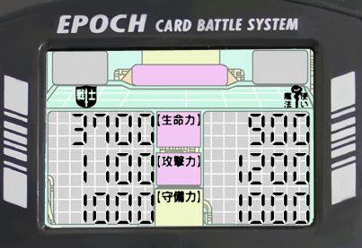
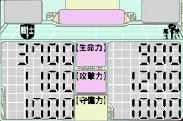
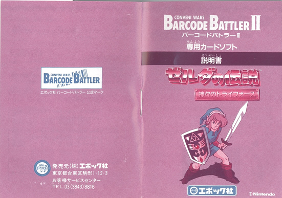
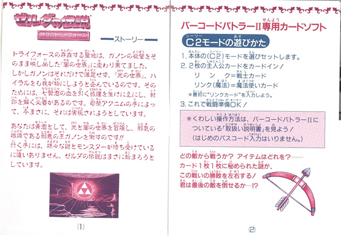
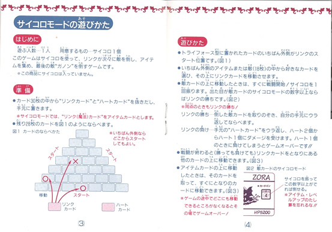
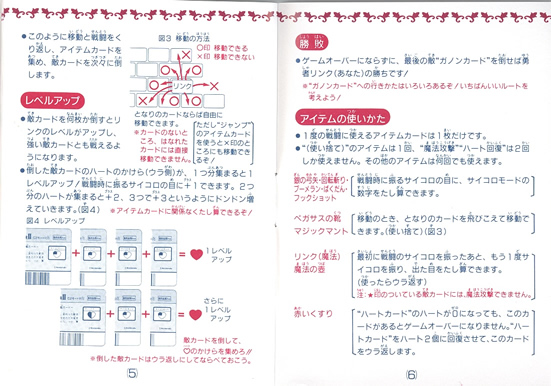

# Conveni Wars Barcode Battler II

The Barcode Battler II is a dedicated LCD game system that reads barcodes as character, enemy, and item data. This guide combines the device instructions and gameplay strategy with the available English transcription of the *The Legend of Zelda: A Link to the Past* card-deck reference. 

## Contents

- [Device Display](#device-display)
  - [LCD Indicators](#lcd-indicators)
  - [Buttons and Switch](#buttons-and-switch)
    - [Buttons](#buttons)
- [Game Modes](#game-modes)
  - [C0: Player versus Player](#c0-player-versus-player)
  - [C1: Player versus CPU](#c1-player-versus-cpu)
  - [C2: Card-Deck Battles](#c2-card-deck-battles)
- [Strategy](#strategy)
  - [Wizard Over Warrior](#wizard-over-warrior)
  - [Level Order](#level-order)
  - [Heal After Battle](#heal-after-battle)
  - [Run or Reload](#run-or-reload)
- [Magic Spell Reference](#magic-spell-reference)
- [Progression and Entry Codes](#progression-and-entry-codes)
  - [P-Codes](#p-codes)
  - [F-Codes](#f-codes)
- [Zelda: A Link to the Past Card Deck](#zelda-a-link-to-the-past-card-deck)
  - [Hero Cards](#hero-cards)
  - [Item Cards](#item-cards)
  - [Enemy Cards](#enemy-cards)
  - [Instruction Manual Transcription and Translation](#instruction-manual-transcription-and-translation)
- [Custom Barcodes](#custom-barcodes)
- [References and Preservation Notes](#references-and-preservation-notes)

<a id="device-display"></a>
## Device Display



**Caption:** The monochrome LCD labels the life, attack, defense stats, and character type for two combatants.



**Caption:** Enlarged view of the same display diagram. The central Japanese labels identify life/HP (生命力), attack power (攻撃力), and defensive power (守備力). The left and right number fields represent the two combatants.

<a id="lcd-indicators"></a>
### LCD Indicators

```
-----------------------------------------------

Attack Mode      Escape          Recovery Mode
Card Scan        Critical Hit    MISS
Staff  Shield    Item Entry      Shield  Staff

88800            HP              88800
18800            Attack          18800
18800            Defense         18800

*          *          *          *          *
-----------------------------------------------

```


| Indicator | Meaning |
|---|---|
| Attack Mode | Indicates that the player is in attack mode and will attack its enemy. |
| Recovery Mode | Indicates that the player is in recovery mode and may either cast a spell or consume an herb. If the display alternates between attack and recovery, then the player has not chosen whether to attack or use an herb or spell. |
| Escape | Indicates an attempt to escape from battle. |
| Card Scan / Data Input | Indicates that a card should be scanned. |
| Critical Hit | Indicates that the last attack was especially effective. |
| MISS | Indicates that the last attack failed to hit or that the user committed an error, e.g. inserting an enemy card when an item card was required. |
| Staff | Indicates that the character is a wizard character. |
| Shield | Indicates that the character is a warrior character. |
| Item Entry | Indicates that an item card should be scanned. |
| HP | Indicates the vitality of the character. |
| Attack | Indicates the attack power of the character. |
| Defense | Indicates the resistance of the character. |
| Turn LEDs | The lit LED indicates the side whose turn it is. |

<a id="buttons-and-switch"></a>
### Buttons and Switch

<a id="buttons"></a>
#### Buttons

The buttons have these functions:

ON/OFF
* Turns the unit on or off.

SELECT
* Selects the game mode - C0, C1, or C2.
* Selects a level in the current epoch.
* Alternates between the wizard and warrior heroes.
* Enters the magic / herb screen. 
* On the magic / herb screen, alternates between magic and herbs.
* Selects which spell to cast.
* Selects the number of herbs to heal with.
* Selects digits in a P-code.
* Selects digits in an F-code.

SET
* Sets the game mode - C0, C1, or C2.
* Sets the level from which a stage will be selected.
* Sets the hero to fight with.
* Sets the spell to use.
* Sets the number of herbs to consume.
* If the option to use a spell or herb was selected, pressing SET when [] 
  is displayed cancels spell or herb selection.
* After battle, claims statistics increases and proceeds to the level-
  selection display.
* Sets each digit of a P-code.
* Sets each digit of an F-code.

L-BATTLE
* Attacks with the left character.
* In mode C1 on the level-selection screen, enters the F-code entry display.

L-POWER
* Causes the left character to consume one healing herb. To consume two or 
  three herbs, it is necessary to enter the magic / herb screen instead.
* When not in battle, allows scanning of a different hero.
* Upon completion of an epoch in mode C1, displays a P-code.
* In mode C2, enters the P-code entry display. 

R-BATTLE
* Attacks with the right character in mode C0.
* Saves game progress.
* Loads game progress.

R-POWER
* Causes the right character to consume one healing herb.
* Attempts escape from battle.

SOUND OFF ON
* This switch turns sound on or off.


<a id="game-modes"></a>
## Game Modes

<a id="c0-player-versus-player"></a>
### C0: Player versus Player

* Turn the unit on by pressing ON/OFF.
* Use the SELECT button to select mode C0.
* Press SET to start C0.
* Scan the left-side character.
* Scan the right-side character.
* Scan the left-side item, or push SET to cancel item entry.
* Scan the right-side item, or push SET to cancel item entry.
* Do one of the following:
  * Press L-BATTLE or R-BATTLE to attack.
  * Press L-POWER or R-POWER to consume one healing herb.
  * Press SELECT to enter the magic / herb display.
* Continue attacking, healing, and casting spells until one side's health is depleted.

<a id="c1-player-versus-cpu"></a>
### C1: Player versus CPU

This is a player versus CPU mode, and it is the main game mode. The C1 mode
consists of four epochs, each of which contains six levels, each of which 
contains five stages. This equates to 120 built-in computer opponents. Three 
random stages in levels L1 to L5 hide a key. Completing these levels unlocks 
level LH. Completing stage LH-HH completes the epoch. After completing an 
epoch, a P-code becomes available and may be used to enhance heroes in mode
C2. Completing epoch E-4, level LH-HH is considered beating the game, 
according to the Barcode Battler II manual.

* Turn on the unit by pressing ON/OFF.
* Use the SELECT button to select mode C1.
* Press SET to start C1.
* Scan a warrior character.
* Scan a wizard character.
* Press SET to confirm character selection.
* Press SELECT to choose a level, and then press SET.

  _Consider the advice in section STRATEGY, LEVEL ORDER._

* The CPU selects a random stage within the level.
* If the selected level is undesirable, press R-POWER to attempt to escape.

  _Consider the advice in section STRATEGY, RUN OR RELOAD._

  * If escape is successful, then the game returns to level-selection.
  * If escape fails, then MISS is displayed and battle proceeds.
* Press SELECT to select between the warrior and wizard character, and then
  press SET.
  
  _Consider the advice in section STRATEGY, WIZARD OVER WARRIOR._
  
* Scan an item card. Ideally, the item card will include an HP boost, since 
  HP is the only statistic that persists after the battle. To start the 
  without scanning an item, simply press SET.
* Red LEDs will flash and indicate which player has the first turn.
* Do one of the following:
  * Press L-BATTLE to attack.
  * Press L-POWER to consume one healing herb.
  * Press SELECT to enter the magic / herb display. Do the following:
    * Press SELECT to switch between healing herbs (the lower number) and
    MP (the upper number), and then press SET.
    * When selecting healing herbs, press SELECT to choose 1-3 herbs, and then
    press SET. Otherwise, select [] and press SET to cancel from this view.
    * When selecting magic, press SELECT to choose a spell, and then
    press SET. Otherwise, select [] and press SET to cancel from this view.
* Continue battling until the enemy's HP is depleted.
* Press SELECT to enter recovery mode for a chance to restore HP to its maximum.
  
  _Consider the advice in section STRATEGY, HEAL AFTER BATTLE._
  
* If the stage contains a key, the new key count will be displayed. When
  all three keys are found, level H- will become available.
* Press R-BATTLE to save game progress if desired, and then press SET. 

  _Consider the advice in section STRATEGY, RUN OR RELOAD._

* To load game progress later, turn the unit off and then on, enter mode C1, 
  and then press R-BATTLE.
* Select a level and continue battling until level H-HH of the current epoch
  is completed.
* Press L-POWER to display the P-code awarded for completion of the epoch.
* Once epoch E-4, level H-HH is completed, mode C1 is completed.

<a id="c2-card-deck-battles"></a>
### C2: Card-Deck Battles

This is a second player versus CPU mode. The hero plays against a series of 
enemies specified by a card deck. For instance, the Zelda card deck features 
20 enemy cards. One partial Japanese-to-English translation of the 
manual included with the card deck specifies an enemy order. Assuming 
that the player completes mode C1 and obtains a P-code, completing mode
C2 is feasible, regardless of enemy order.

* Turn on the unit by pressing ON/OFF.
* Use the SELECT button to select mode C2.
* Press SET to start C2.
* Scan a warrior character.
* Scan a wizard character.
* Press SET to confirm character selection.
* Press L-POWER to enter a P-code.
* Scan an enemy card.
* Battle the enemy as in mode C1.
* After battle, scan another enemy card.
  It is possible that some card decks include instructions on the order in 
  which enemy cards should be battled. 
* Continue scanning and battling enemy cards until the final card in the 
  sequence has been defeated.

<a id="strategy"></a>
## Strategy

<a id="wizard-over-warrior"></a>
### Wizard Over Warrior

If there is not much difference in statistics between the wizard and warrior
heroes, it is advisable to use the wizard. The wizard is capable of casting 
spells capable or restoring hero health, increasing hero statistics or 
decreasing enemy statistics. These abilities are enhanced by the ability
to steal enemy MP. The warrior does not have compensatory abilities.


<a id="level-order"></a>
### Level Order

Take on easier enemies first to build up HP, attack, and defense for use
against tougher enemies. Within an epoch, the easiest enemies are not 
necessarily in the first level. They are more likely to be appear in the 
first two stages of each level.  
  
Take on easier warriors before easier wizards. The goal is to gain HP, 
attack, and defense sufficient to survive long enough against wizards to 
steal all of their MP.

It is not necessary to complete all levels within an epoch. After finding 
all three keys in an epoch, level H- becomes available. If the hero has a
good stockpile of MP, a few casts of spells F6 and F7 should make completion 
of H-HH easy. 

It does not appear that the P-code obtained after completing H-HH depends on 
how many levels of the epoch were completed. It also does not matter whether
one of the heroes was killed, as it will be revived in the next epoch.

This level order has proven effective but is not guaranteed to be optimal.

**E-1:**
```
L1-1, L1-2, L1-3, L2-1, L2-2, L2-3, L1-4, L2-4, L3-2, L3-1, L3-3, L4-1, 
L4-2, L4-3, L4-4, L5-1, L5-2, L5-3, L1-HH, L2-HH, L3-4, L3-HH, LH-1, LH-2, 
LH-3, L5-4, L4-HH, L5-HH, LH-4, LH-HH
```

**E-2:**
```
L1-1, L1-2, L2-1, L1-3, L2-3, L2-2, L3-1, L1-4, L1-HH, L2-4, L3-2, L4-2, 
L4-3, L2-HH, L3-3, L4-1, L5-2, L5-3, L3-4, L3-HH, L4-4, L4-HH, L5-4, 
L5-1, LH-2, LH-1, LH-4, L5-HH, LH-3, LH-HH
```

**E-3:**
```
L2-1, L2-2, L1-3, L1-1, L1-2, L4-2, L3-4, L4-1, L1-4, L1-HH, L3-2, L3-3, 
L2-3, L2-4, L2-HH, L3-1, L5-2, L5-1, L3-HH, L4-3, LH-1, L4-4, L4-HH, L5-3, 
L5-4, L5-HH, LH-3, LH-2, LH-4, LH-HH
```

**E-4:**
``` 
L1-2, L1-1, L2-1, L2-2, L3-1, L3-2, L4-1, L4-2, L5-1, L5-2, L1-3, L1-4,
L2-3, L2-4, L1-HH, L2-HH, L3-3, L3-4, L3-HH, L4-3, L4-4, L4-HH, LH-1, LH-2,
L5-3, L5-4, L5-HH, LH-3, LH-4, LH-HH
```


<a id="heal-after-battle"></a>
### Heal After Battle

The hero's HP capacity is equal to the amount of HP that the hero had at the
end of the previous battle. Therefore, healing fully, or nearly so, is 
critical. 

Upon completing a battle, the hero may heal one time. To do so, press SELECT. 
The hero will then have the option to heal with a spell or 1-3 potions.


<a id="run-or-reload"></a>
### Run or Reload

The value of a willingness to run from battle or reload progress cannot be
overstated. This especially true early in epochs E-3 and E-4.

Stages within a level are randomly selected. If the selected stage is more
difficult than ideal, defeat is not the worst case scenario. If the hero is 
defeated, it is easy enough to reload progress. The worst case scenario is 
that one of the following occurs:

* The hero depletes his supply of potions or MP.
* The hero is unable to heal HP to maximum or near maximum after battle. 

The consequence of either of the above is that the hero may be left with 
insufficient resources to progress through future battles. If progress is
saved at this point, then it will be necessary to restart the game from the
beginning.


<a id="magic-spell-reference"></a>
## Magic Spell Reference

| Code | Japanese manual name (romanized) | MP cost | Recorded effect |
|---|---|---:|---|
| F0 | Toruma | 0 | Steals a random amount of the enemy's MP. |
| F1 | Gantsu | 2 | Increases own attack. |
| F2 | Dekantsu | 5 | Greatly increases own attack. |
| F3 | Rimo | 2 | Recovers HP. |
| F4 | Denimo | 4 | Recovers HP greatly; the manual says “Recover total vitality!”, but the guide notes it may not fully restore HP. |
| F5 | Nyahe | 3 | Reduces enemy defense. |
| F6 | Kachikomu | 5 | Greatly reduces enemy defense. |
| F7 | Hehenda | 4 | Reduces enemy attack. |
| F8 | Tafuni | 6 | Increases own attack the most. |
| F9 | Mamiroja | 3 | Prevents the enemy from using survival points/herbs. |

The manual calls healing potions “herbs.” Spell names above are transcribed from the device manual; English descriptions are the guide author's translations.

<a id="progression-and-entry-codes"></a>
## Progression and Entry Codes

<a id="p-codes"></a>
### P-Codes

Press L-POWER after completing an epoch in C1 to display its P-code. Enter the code in C2 to strengthen the same hero cards used in C1.

| Epoch completed | Observed P-code |
|---|---:|
| E-1 | 11009 |
| E-2 | 11662 |
| E-3 | 22442 |
| E-4 | 33111 |
| Additional reported codes | 55001, 99993 |

These values were observed with the Link and Link (Magic) cards; the source credits Gregg Whitlock for the additional codes.

<a id="f-codes"></a>
### F-Codes

In C1, press L-BATTLE outside battle while in epoch E-1 to enter an F-code:

| Destination | F-code |
|---|---:|
| E-5 | 311 |
| E-6 | 389 |

The source guide notes that it is unknown whether E-5/E-6 award usable P-codes and that code behavior may depend on the selected heroes.

<a id="zelda-a-link-to-the-past-card-deck"></a>
## Zelda: A Link to the Past Card Deck

The following barcodes and statistics are transcribed from the available English reference for the Japanese *The Legend of Zelda: A Link to the Past* deck. Japanese names are retained as printed in the source transcription. The source describes a 20-enemy deck, but the available enemy table lists 18 entries; the two unlisted entries are not inferred here.

<a id="hero-cards"></a>
### Hero Cards

| English name | HP | Attack | Defense | Barcode | Japanese |
|---|---:|---:|---:|---|---|
| Link | 3,700 | 1,100 | 1,000 | `0371110125502` | リンク |
| Link (Magic) | 3,700 | 1,100 | 1,000 | `0371110274507` | リンク(魔法) |

<a id="item-cards"></a>
### Item Cards

| Item | Player effect | Barcode | Enemy effect | Japanese |
|---|---|---|---|---|
| Boomerang | +300 attack | `0000300620250` | −30% defense | ブーメラン |
| Hookshot | +300 attack | `0000300620151` | — | フックショット |
| Silver Bow & Arrow | +400 attack | `0000400620136` | — | 銀の弓矢 |
| Bomb | +1,000 attack | `0001000521106` | — | ばくだん |
| Kaitengiri | +1,000 attack | `0001000521144` | — | 回転斬り |
| Boots of Pegasus | +800 defense | `0000008820372` | — | ペガサスの靴 |
| Magic Cape | +0 defense (as transcribed) | `0000000820417` | — | マジックマント |
| Heart | +1,200 HP | `0120000902125` | — | ハート |
| Magic Decanter | +5 MP | `0000005980017` | — | 魔法の壺 |
| Red Potion | +5 herbs | `0000500970445` | — | 赤いくすり |

<a id="enemy-cards"></a>
### Enemy Cards

| Enemy | HP | Attack | Defense | Rank | Barcode | Player effect | Japanese |
|---|---:|---:|---:|---:|---|---|---|
| Spear Trooper | 3,500 | 1,100 | 1,200 | 3 | `0351112014707` | — | ヤリ兵士 |
| Vali | 3,800 | 2,100 | 2,100 | 5 | `0382121377255` | −30% defense | バリ |
| Geldman | 4,000 | 1,300 | 1,200 | 4 | `0401312423653` | — | ゲルドマン |
| Wizzrobe | 4,400 | 4,400 | 4,400 | 7 | `0444444474285` | −30% HP | ウィズローブ |
| Stalfone | 15,000 | 4,100 | 4,500 | 6* | `1504145105761` | — | スタルフォン |
| Zora | 5,200 | 1,400 | 1,600 | 4 | `0521416275801` | — | ゾーラ |
| Hiploop | 6,400 | 1,500 | 2,300 | 5 | `0641523443754` | — | ヒップループ |
| Molblin | 7,500 | 1,800 | 2,100 | 5 | `0751821024767` | — | モリブリン |
| Coppie | 8,600 | 2,700 | 2,200 | 5* | `0862722327410` | — | コッピ |
| Digtale | 8,800 | 2,300 | 2,800 | 6* | `0882328453818` | — | デグテール |
| Guplla | 9,000 | 2,900 | 2,000 | 6 | `0902920215703` | — | ガプラ |
| Ball & Chain Trooper | 10,000 | 3,500 | 3,800 | 6 | `1003538046662` | — | 鉄球兵士 |
| Hinox | 10,100 | 3,800 | 4,000 | 8 | `1013840306668` | — | ヒノックス |
| Agahnim | 12,000 | 3,500 | 3,500 | 7* | `1203535175826` | — | アグニム |
| Gibdos | 13,900 | 2,800 | 3,000 | 6 | `1392830114712` | — | ギブド |
| Geerock | 17,500 | 4,200 | 5,000 | 7* | `1754250204716` | — | ジークロック |
| Wart | 18,800 | 5,000 | 5,400 | 8* | `1885054077777` | — | ワート |
| Ganon | 24,900 | 6,100 | 6,300 | 11* | `2496163395837` | — | ガノン |

The asterisk is retained from the source rank values; its meaning is not specified in the available transcription.

<a id="instruction-manual-transcription-and-translation"></a>
### Instruction Manual Transcription and Translation

The attached Japanese deck-manual pages preserve the cover, C2 setup, battle flow, level-up display, and item rules. The following records the clearly legible headings and setup instructions; fine-print decorative or story text that cannot be verified at the same confidence is omitted.

#### Cover



**Visible Japanese text:**

```text
CONVENI WARS
バーコードバトラーII
バーコードバトラーII専用カードソフト
ゼルダの伝説
神々のトライフォース
説明書
© Nintendo
```

**English translation:** Barcode Battler II; dedicated Barcode Battler II card software; *The Legend of Zelda: A Link to the Past*; instruction manual.

#### C2 Mode Setup



**Visible Japanese headings and list:**

```text
ストーリー

C2モードの遊び方
1. 本体のC2モードを選びセットします。
2. 2枚の主人公カードをカードイン。
3. これで戦闘準備OK。
※詳しい操作方法はバーコードバトラーII本体の取扱説明書を参照してください。
```

**English translation:** Story. How to use C2 mode: (1) select C2 on the main unit and press SET; (2) scan the two hero cards; (3) battle preparation is complete. For detailed operation, refer to the Barcode Battler II main-unit manual.

#### Battle and Level-Up Rules



**Visible Japanese heading and battle procedure:**

```text
はじめに
遊び方
```

The battle page shows one hero card on the left and one enemy card on the right, connected by the Link or battle indicator. The visible diagram explains the C2 battle layout and card-scan sequence already summarized under [C2: Card-Deck Battles](#c2-card-deck-battles).



**Clearly legible Japanese headings:**

```text
レベルアップ
アイテムの使い方
レッドポーション
```

**English translation:** Level Up; How to Use Items; Red Potion.

The level-up page shows the hero's HP, attack, and defense advancing after successful battles. The item page explains that an item card can be used during a battle and shows the red potion's herb value and the five-Potion effect diagram. The attached scan is readable enough to verify these headings and displays, but the smallest fine-print prose was not transcribed here.

<a id="custom-barcodes"></a>
## Custom Barcodes

The general guide records these additional barcodes:

| Barcode | Type | HP | Attack | Defense | Effect |
|---|---|---:|---:|---:|---|
| `8509048880992` | Warrior | 4,900 | 700 | 1,000 | Reduces enemy HP by 50%. |
| `3975472382794` | Wizard | 4,700 | 500 | 1,200 | Reduces enemy defense by 80%. |

<a id="references-and-preservation-notes"></a>
## References and Preservation Notes

- The general guide describes Epoch Co., Ltd. as the manufacturer and gives a 1992 Japanese release date; it distinguishes the Japanese *Barcode Battler II* from the worldwide *Barcode Battler* release.
- Source reference for the manual and packaging scans: [BarcodeBattler.co.uk](http://barcodebattler.co.uk/).
- The Zelda deck title is *The Legend of Zelda: A Link to the Past* (Japanese title: *ゼルダの伝説 神々のトライフォース*).
- The manual name “Conveni Wars” and the device's model identity are transcribed as printed in the source materials.
