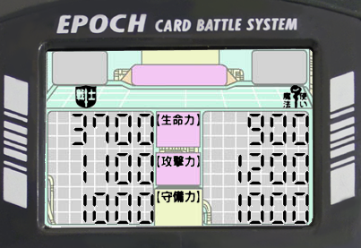
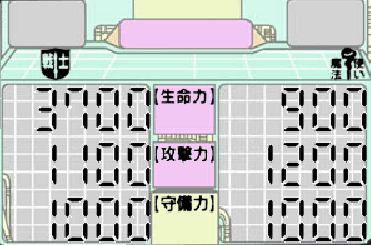

# Conveni Wars Barcode Battler II

The Barcode Battler II is a dedicated LCD game system that reads barcodes as character, enemy, and item data. This guide combines the device instructions and gameplay strategy with the available English transcription of the *The Legend of Zelda: A Link to the Past* card-deck reference. The card tables below reproduce the entries available in that transcription; the original Japanese deck booklet describes additional mode rules and card order.

## Device Display

**Caption:** The monochrome LCD diagram labels the attack, escape, and recovery states; card scanning; critical hits; misses; character-type icons; item entry; and the three numeric attributes HP, attack, and defense. Five LEDs along the bottom indicate which side's turn is active.

**Caption:** Enlarged view of the same display diagram. The central Japanese labels identify life/HP (生命力), attack power (攻撃力), and defensive power (守備力). The left and right number fields represent the two combatants; their displayed sample digits are illustrative rather than a live game state.

### LCD Indicators

| Indicator | Meaning |
|---|---|
| Attack Mode | The player is set to attack. |
| Recovery Mode | The player can cast a spell or use healing herbs. Alternating attack/recovery indicators mean no action has been selected yet. |
| Escape | An attempt to flee from the current battle. |
| Card Scan / Data Input | The unit is waiting for a barcode scan. |
| Critical Hit | The preceding attack was especially effective. |
| MISS | An attack failed or an invalid card/action was entered. |
| Staff / Shield | Identifies a wizard / warrior character. |
| Item Entry | The unit is waiting for an item card. |
| HP, Attack, Defense | Current vitality, offensive strength, and resistance. |
| Turn LEDs | The lit LED indicates whose turn it is. |

### Buttons and Switch

| Control | Function |
|---|---|
| ON/OFF | Powers the unit on or off. |
| SELECT | Selects C0/C1/C2, a level, a hero, a spell, number of herbs, or digits in a code; also opens or navigates the magic/herb screen. |
| SET | Confirms mode, level, hero, spell, herb quantity, or code digits; can cancel spell/herb selection when the empty option is selected. |
| L-BATTLE | Attacks with the left character; in C1 level selection, opens F-code entry. |
| L-POWER | Uses one herb with the left character, selects a different hero outside battle, displays an epoch P-code, or opens P-code entry in C2. |
| R-BATTLE | Attacks with the right character in C0; saves or loads progress in C1. |
| R-POWER | Uses one herb with the right character in C0 or attempts escape in battle. |
| SOUND OFF/ON | Disables or enables sound. |

## Game Modes

### C0: Player versus Player

1. Turn the unit on, select C0 with SELECT, and press SET.
2. Scan a character for each side, then scan an item for each side or press SET to skip item entry.
3. Attack with the side's BATTLE button, use one herb with its POWER button, or press SELECT to choose a spell or multiple herbs.
4. Continue until one character's HP reaches zero.

### C1: Player versus CPU

C1 is the main campaign. It contains four epochs. Each epoch has five numbered levels (L1–L5) and a special H level, with five stages per numbered level and a final HH stage. Three keys hidden across the first five levels unlock the H level. Completing the final HH stage of an epoch awards a P-code. The source guide identifies completion of E-4's H-HH stage as beating the game according to the device manual.

1. Select C1 and scan one warrior and one wizard hero; press SET to confirm.
2. Select a level. The CPU chooses a random stage within it. R-POWER attempts to escape if the selected encounter is undesirable; a failed escape proceeds to battle.
3. Select the hero to fight, then scan an item or press SET to skip it. HP bonuses are especially useful because HP is the stat carried forward between battles.
4. Attack, use an herb, or enter recovery mode with SELECT to cast a spell or choose one to three herbs.
5. After victory, press SELECT to recover before moving on. If a key was found, the key count updates. Save with R-BATTLE if desired, then press SET to continue.
6. To resume saved progress, power on, select C1, and press R-BATTLE. Complete the epoch's H-HH stage and press L-POWER to display its P-code.

### C2: Card-Deck Battles

C2 pits the selected hero against enemies scanned from a card deck. Select C2, scan a warrior and wizard, confirm, enter a P-code with L-POWER, then scan and battle the enemy cards in the deck's prescribed sequence. The *Zelda* deck materials describe a sequence for its enemy cards. P-codes are tied to the heroes used to earn them in C1.

## Strategy

### Choose the Wizard and Preserve Magic

When hero statistics are comparable, the wizard is generally more useful than the warrior because spells can restore HP, strengthen the hero, weaken an enemy, prevent herb use, and steal enemy MP. In C1, F0 (Toruma) can drain an enemy wizard's MP. The drained MP can then fund later recovery and stat-changing spells. Drain enemies when it is safe, but defeat dangerous wizards quickly if prolonging the battle risks losing the hero.

### Choose Encounter Order Carefully

Stages are selected randomly within a chosen level; the easiest enemies do not always appear in L1. The source guide recommends testing the stages near the start of each level and fleeing/reselecting or reloading when an encounter is too costly. An observed E-4 opening order was L1-1, L2-1, L2-2, L1-2, L3-1, L3-2, L4-1, L4-2, L5-1, L5-2, L1-3, L1-4. This is an example, not a guaranteed optimal route.

Three keys are needed to unlock the H level; the guide reports that it is not necessary to clear every numbered stage once the keys are found. In the H-level battles, accumulated MP can be spent on F6 and F7 to reduce enemy defense and attack.

### Recover After Every Battle

The next battle's HP maximum equals the hero's HP at the end of the preceding battle. After a victory, press SELECT to enter recovery and restore HP with a spell or one to three herbs. Heart cards add 1,200 HP. Raising maximum HP early makes later percentage-based recovery more valuable.

### Run or Reload Before Saving a Bad State

An undesirable stage or defeat is recoverable if progress has not been saved in a depleted state. Avoid saving after exhausting herbs/MP or ending a battle with too little HP to safely continue; the source guide warns that this can force a restart from the beginning.

## Magic Spell Reference

| Code | Japanese manual name (romanized) | MP cost | Recorded effect |
|---|---|---:|---|
| F0 | Toruma | 0 | Steals a random amount of the enemy's MP. |
| F1 | Gantsu | 2 | Increases own attack. |
| F2 | Dekantsu | 5 | Greatly increases own attack. |
| F3 | Rimo | 2 | Recovers HP. |
| F4 | Denimo | 4 | Recovers HP greatly; the manual says “Recover total vitality!”, but the guide notes it may not fully restore HP. |
| F5 | Nyahe | 3 | Reduces enemy defense. |
| F6 | Kachikomu | 5 | Greatly reduces enemy defense. |
| F7 | Hehenda | 4 | Reduces enemy attack. |
| F8 | Tafuni | 6 | Increases own attack the most. |
| F9 | Mamiroja | 3 | Prevents the enemy from using survival points/herbs. |

The manual calls healing potions “herbs.” Spell names above are transcribed from the device manual; English descriptions are the guide author's translations.

## Progression and Entry Codes

### P-Codes

Press L-POWER after completing an epoch in C1 to display its P-code. Enter the code in C2 to strengthen the same hero cards used in C1.

| Epoch completed | Observed P-code |
|---|---:|
| E-1 | 11009 |
| E-2 | 11662 |
| E-3 | 22442 |
| E-4 | 33111 |
| Additional reported codes | 55001, 99993 |

These values were observed with the Link and Link (Magic) cards; the source credits Gregg Whitlock for the additional codes.

### F-Codes

In C1, press L-BATTLE outside battle while in epoch E-1 to enter an F-code:

| Destination | F-code |
|---|---:|
| E-5 | 311 |
| E-6 | 389 |

The source guide notes that it is unknown whether E-5/E-6 award usable P-codes and that code behavior may depend on the selected heroes.

## Zelda: A Link to the Past Card Deck

The following barcodes and statistics are transcribed from the available English reference for the Japanese *The Legend of Zelda: A Link to the Past* deck. Japanese names are retained as printed in the source transcription. The source describes a 20-enemy deck, but the available enemy table lists 18 entries; the two unlisted entries are not inferred here.

### Hero Cards

| English name | HP | Attack | Defense | Barcode | Japanese |
|---|---:|---:|---:|---|---|
| Link | 3,700 | 1,100 | 1,000 | `0371110125502` | リンク |
| Link (Magic) | 3,700 | 1,100 | 1,000 | `0371110274507` | リンク(魔法) |

### Item Cards

| Item | Player effect | Barcode | Enemy effect | Japanese |
|---|---|---|---|---|
| Boomerang | +300 attack | `0000300620250` | −30% defense | ブーメラン |
| Hookshot | +300 attack | `0000300620151` | — | フックショット |
| Silver Bow & Arrow | +400 attack | `0000400620136` | — | 銀の弓矢 |
| Bomb | +1,000 attack | `0001000521106` | — | ばくだん |
| Kaitengiri | +1,000 attack | `0001000521144` | — | 回転斬り |
| Boots of Pegasus | +800 defense | `0000008820372` | — | ペガサスの靴 |
| Magic Cape | +0 defense (as transcribed) | `0000000820417` | — | マジックマント |
| Heart | +1,200 HP | `0120000902125` | — | ハート |
| Magic Decanter | +5 MP | `0000005980017` | — | 魔法の壺 |
| Red Potion | +5 herbs | `0000500970445` | — | 赤いくすり |

### Enemy Cards

| Enemy | HP | Attack | Defense | Rank | Barcode | Player effect | Japanese |
|---|---:|---:|---:|---:|---|---|---|
| Spear Trooper | 3,500 | 1,100 | 1,200 | 3 | `0351112014707` | — | ヤリ兵士 |
| Vali | 3,800 | 2,100 | 2,100 | 5 | `0382121377255` | −30% defense | バリ |
| Geldman | 4,000 | 1,300 | 1,200 | 4 | `0401312423653` | — | ゲルドマン |
| Wizzrobe | 4,400 | 4,400 | 4,400 | 7 | `0444444474285` | −30% HP | ウィズローブ |
| Stalfone | 15,000 | 4,100 | 4,500 | 6* | `1504145105761` | — | スタルフォン |
| Zora | 5,200 | 1,400 | 1,600 | 4 | `0521416275801` | — | ゾーラ |
| Hiploop | 6,400 | 1,500 | 2,300 | 5 | `0641523443754` | — | ヒップループ |
| Molblin | 7,500 | 1,800 | 2,100 | 5 | `0751821024767` | — | モリブリン |
| Coppie | 8,600 | 2,700 | 2,200 | 5* | `0862722327410` | — | コッピ |
| Digtale | 8,800 | 2,300 | 2,800 | 6* | `0882328453818` | — | デグテール |
| Guplla | 9,000 | 2,900 | 2,000 | 6 | `0902920215703` | — | ガプラ |
| Ball & Chain Trooper | 10,000 | 3,500 | 3,800 | 6 | `1003538046662` | — | 鉄球兵士 |
| Hinox | 10,100 | 3,800 | 4,000 | 8 | `1013840306668` | — | ヒノックス |
| Agahnim | 12,000 | 3,500 | 3,500 | 7* | `1203535175826` | — | アグニム |
| Gibdos | 13,900 | 2,800 | 3,000 | 6 | `1392830114712` | — | ギブド |
| Geerock | 17,500 | 4,200 | 5,000 | 7* | `1754250204716` | — | ジークロック |
| Wart | 18,800 | 5,000 | 5,400 | 8* | `1885054077777` | — | ワート |
| Ganon | 24,900 | 6,100 | 6,300 | 11* | `2496163395837` | — | ガノン |

The asterisk is retained from the source rank values; its meaning is not specified in the available transcription.

## Custom Barcodes

The general guide records these additional barcodes:

| Barcode | Type | HP | Attack | Defense | Effect |
|---|---|---:|---:|---:|---|
| `8509048880992` | Warrior | 4,900 | 700 | 1,000 | Reduces enemy HP by 50%. |
| `3975472382794` | Wizard | 4,700 | 500 | 1,200 | Reduces enemy defense by 80%. |

## References and Preservation Notes

- The general guide describes Epoch Co., Ltd. as the manufacturer and gives a 1992 Japanese release date; it distinguishes the Japanese *Barcode Battler II* from the worldwide *Barcode Battler* release.
- Source reference for the manual and packaging scans: [BarcodeBattler.co.uk](http://barcodebattler.co.uk/).
- The Zelda deck title is *The Legend of Zelda: A Link to the Past* (Japanese title: *ゼルダの伝説 神々のトライフォース*).
- The manual name “Conveni Wars” and the device's model identity are transcribed as printed in the source materials.
