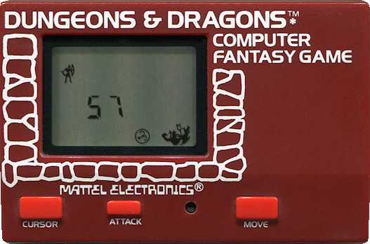
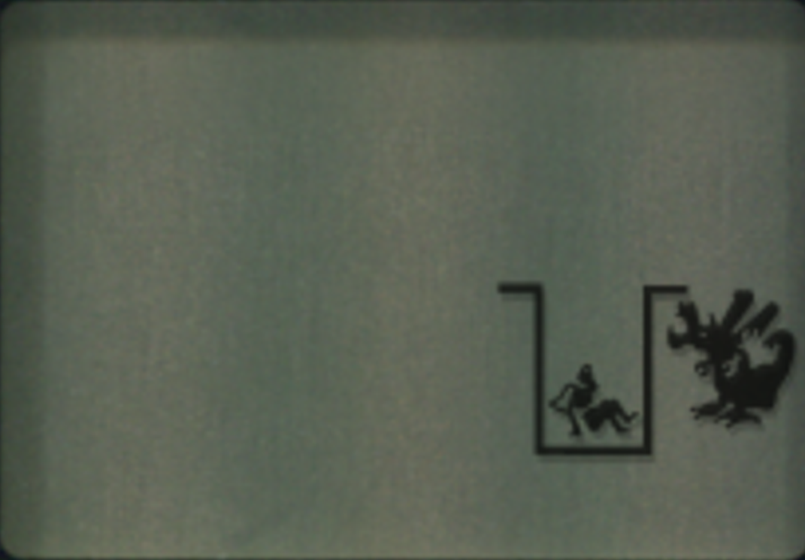
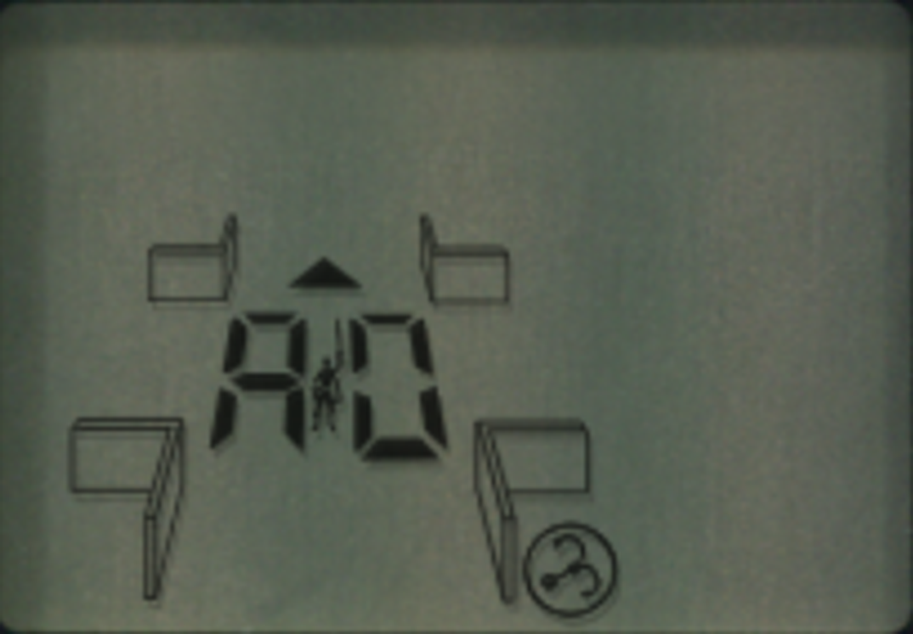
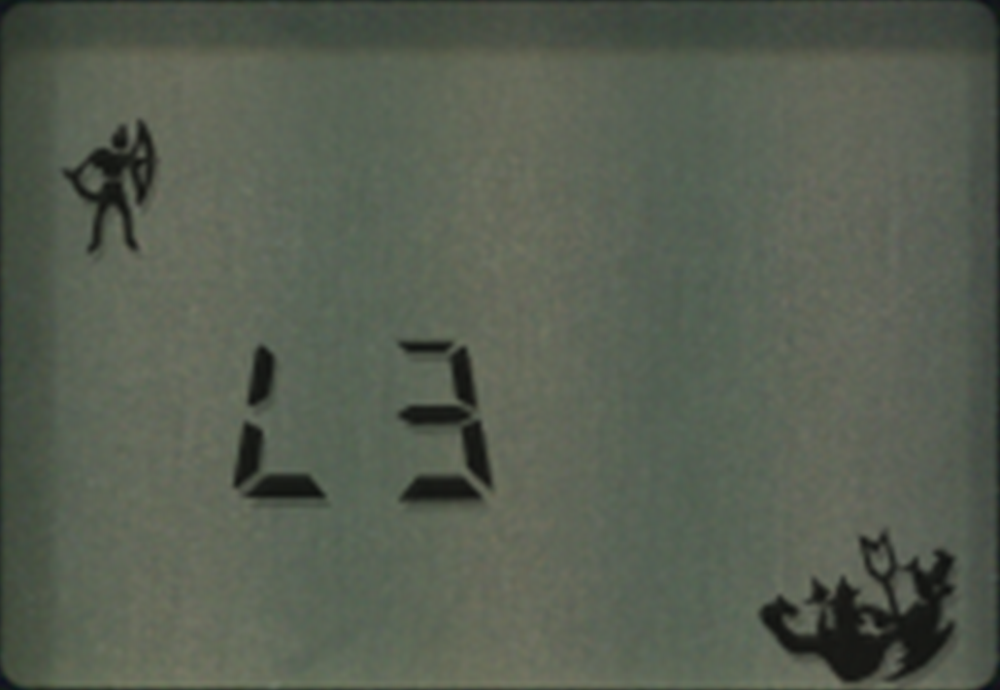

# Dungeons & Dragons Computer Fantasy Game

The *Dungeons & Dragons Computer Fantasy Game* is a 1981 Mattel Electronics handheld LCD title, identified in the supplied release-data note as North American retail model 5409-0920. The archive preserves a console photograph, three LCD captures, source metadata, and the coordinate worksheet supplied with the source files.

## Hardware and Screen Captures

**Caption and visible-text transcription:** The red handheld face is printed “DUNGEONS & DRAGONS” and “COMPUTER FANTASY GAME,” with “MATTEL ELECTRONICS” beneath the LCD. Three red controls are labeled “CURSOR,” “ATTACK,” and “MOVE.” The screen displays an adventurer, a two-digit readout, and monster graphics. The photograph does not establish what the number represents.

**Caption:** A dim monochrome LCD capture shows an adventurer inside a rectangular U-shaped barrier near the right side of the display and a large creature immediately to the right. Most of the display is blank in this frame; no instructions or text are visible.

**Caption:** The screen shows a small adventurer between two large segmented numeric characters, with four outlined display elements around the play area and a circled “3” at lower right. The image alone does not identify the numeric readout or the circled indicator's function.

**Caption:** A later LCD state shows the adventurer at upper left, a segmented “L3” near the center, and several monster silhouettes at lower right. The source filename labels this an end capture, but the image does not show a written victory or game-over message.

## Coordinate Worksheet

The supplied spreadsheet contains four repeated 10-by-10 grids of coordinate labels and no filled-in walls, room features, waypoint markers, or route. The grid below transcribes the label convention; it is a coordinate index, not a maze map or verified solution.

| Row | Coordinates |
|---|---|
| A | A0, A1, A2, A3, A4, A5, A6, A7, A8, A9 |
| B | B0, B1, B2, B3, B4, B5, B6, B7, B8, B9 |
| C | C0, C1, C2, C3, C4, C5, C6, C7, C8, C9 |
| D | D0, D1, D2, D3, D4, D5, D6, D7, D8, D9 |
| E | E0, E1, E2, E3, E4, E5, E6, E7, E8, E9 |
| F | F0, F1, F2, F3, F4, F5, F6, F7, F8, F9 |
| G | G0, G1, G2, G3, G4, G5, G6, G7, G8, G9 |
| H | H0, H1, H2, H3, H4, H5, H6, H7, H8, H9 |
| I | I0, I1, I2, I3, I4, I5, I6, I7, I8, I9 |
| J | J0, J1, J2, J3, J4, J5, J6, J7, J8, J9 |

## Source Details and Limits

| Field | Staged-source record |
|---|---|
| Category | Puzzle → Action |
| Region | North America |
| Release year | 1981 |
| Release type | Retail |
| Model / product number | 5409-0920 |
| Developer | Mattel Electronics |

The source directory does not include a legible instruction manual, a completed maze layout, or a step-by-step maze route. No movement, combat, scoring, or puzzle rules beyond the button labels visible on the hardware are inferred here.

## References

- [Handheld Museum: Mattel Dungeons and Dragons](https://www.handheldmuseum.com/Mattel/D%26D.htm) — identifies the 1981 LCD game and model 5409.
- [Gameplay video reference](https://www.youtube.com/watch?v=Sh297tbH5OI) — linked from the supplied source note.
