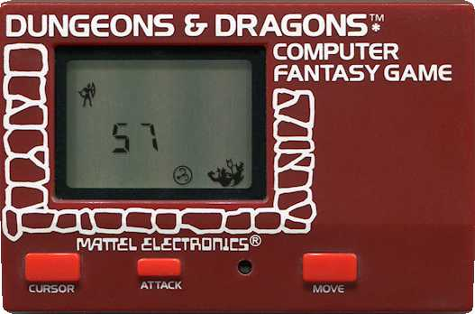
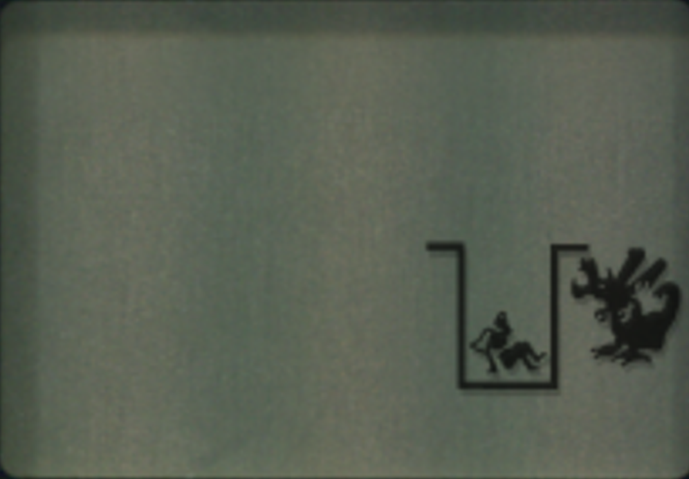
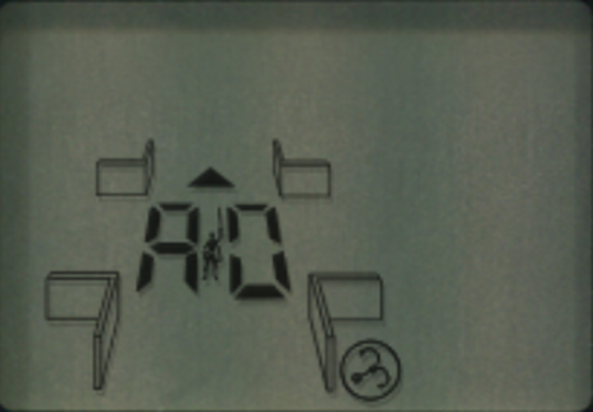
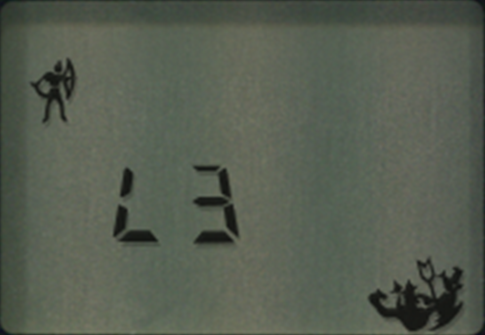

# Dungeons & Dragons Computer Fantasy Game

The *Dungeons & Dragons Computer Fantasy Game* is a 1981 Mattel Electronics handheld LCD title with retail model number 5409-0920. The archive preserves a console photograph, three LCD captures, source metadata, and the coordinate worksheet supplied with the source files.

## Hardware and Screen Captures

**Caption and visible-text transcription:** The red handheld face is printed “DUNGEONS & DRAGONS” and “COMPUTER FANTASY GAME,” with “MATTEL ELECTRONICS” beneath the LCD. Three red controls are labeled “CURSOR,” “ATTACK,” and “MOVE.” The screen displays an adventurer, a two-digit readout, and monster graphics. The two-digit number is the number of moves taken to defeat the dragon.

**Caption:** A monochrome LCD capture shows an adventurer inside a pit formed by a rectangular U-shaped barrier near the right side of the display, with a large dragon immediately to the right. Most of the display is blank in this frame; no instructions or text are visible.

**Caption:** The screen shows a small adventurer between two large segmented numeric characters, with four outlined display elements around the play area and a grappling hook at lower right. The displayed number A0 is the location of the current room within a 10 x 10 grid.

**Caption:** A later LCD state shows the adventurer at upper left, a segmented “L3” near the center, and a defeated dragon at lower right. The “L3” notation indicates the difficulty level; L3 is the hardest.

## Coordinate Worksheet

The supplied spreadsheet contains four repeated 10-by-10 grids of coordinate labels and no filled-in walls, room features, waypoint markers, or route. The maze is procedurally generated and differs for each playthrough.

The grid below transcribes the label convention. The user is meant to print the grid and make handwritten notes during a playthrough. The game employs both horizontal and vertical looping: D0 wraps to D9, and A3 wraps to J3.

| 0 | 1 | 2 | 3 | 4 | 5 | 6 | 7 | 8 | 9 |
|---|---|---|---|---|---|---|---|---|---|
| A0 | A1 | A2 | A3 | A4 | A5 | A6 | A7 | A8 | A9 |
| B0 | B1 | B2 | B3 | B4 | B5 | B6 | B7 | B8 | B9 |
| C0 | C1 | C2 | C3 | C4 | C5 | C6 | C7 | C8 | C9 |
| D0 | D1 | D2 | D3 | D4 | D5 | D6 | D7 | D8 | D9 |
| E0 | E1 | E2 | E3 | E4 | E5 | E6 | E7 | E8 | E9 |
| F0 | F1 | F2 | F3 | F4 | F5 | F6 | F7 | F8 | F9 |
| G0 | G1 | G2 | G3 | G4 | G5 | G6 | G7 | G8 | G9 |
| H0 | H1 | H2 | H3 | H4 | H5 | H6 | H7 | H8 | H9 |
| I0 | I1 | I2 | I3 | I4 | I5 | I6 | I7 | I8 | I9 |
| J0 | J1 | J2 | J3 | J4 | J5 | J6 | J7 | J8 | J9 |

## Source Details

| Field | Staged-source record |
|---|---|
| Category | Puzzle → Action |
| Region | North America |
| Release year | 1981 |
| Release type | Retail |
| Model / product number | 5409-0920 |
| Developer | Mattel Electronics |

## References

- [Handheld Museum: Mattel Dungeons and Dragons](https://www.handheldmuseum.com/Mattel/D%26D.htm) — identifies the 1981 LCD game and model 5409.
- [Gameplay video reference](https://www.youtube.com/watch?v=Sh297tbH5OI) — linked from the supplied source note.
