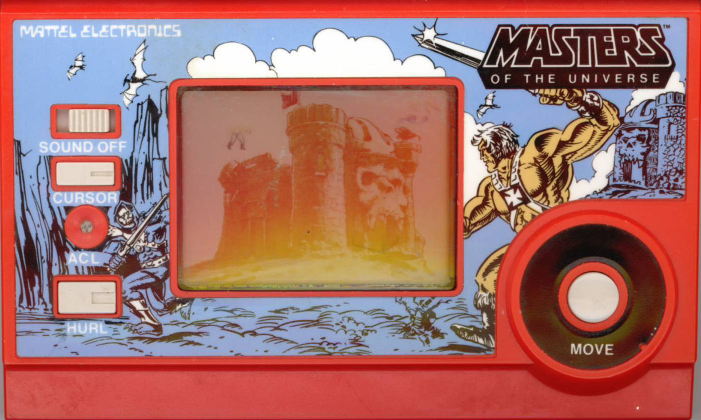
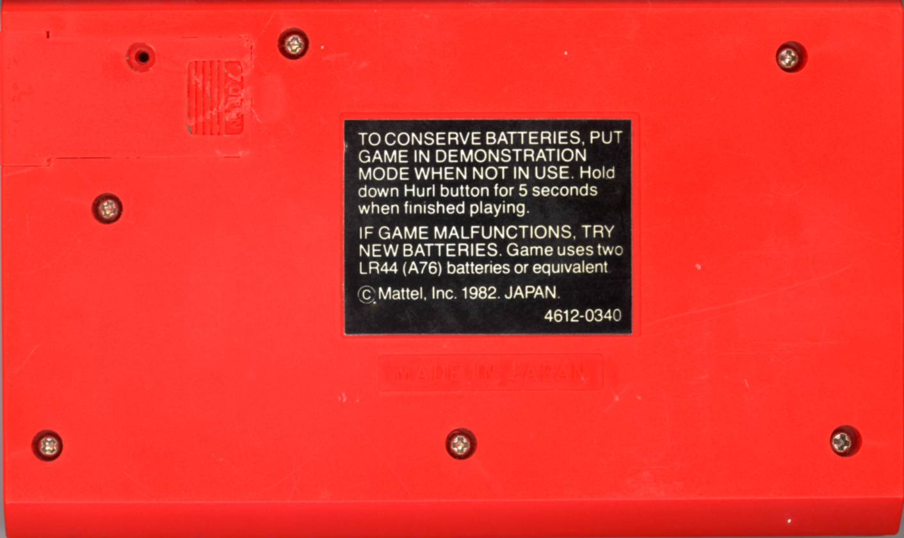
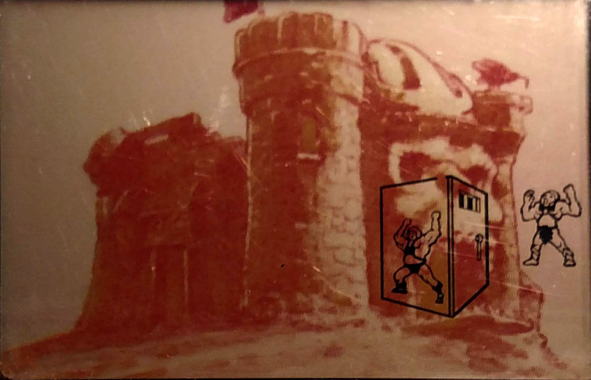
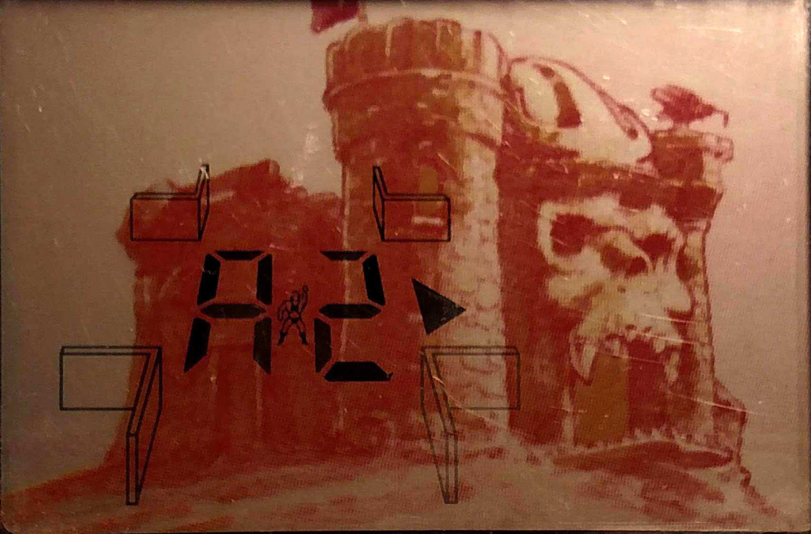
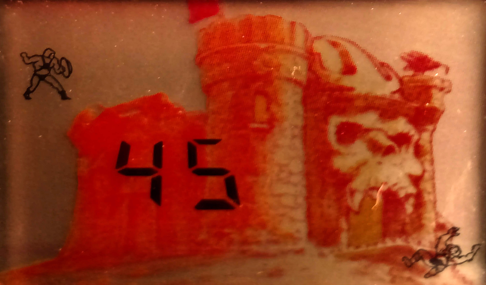
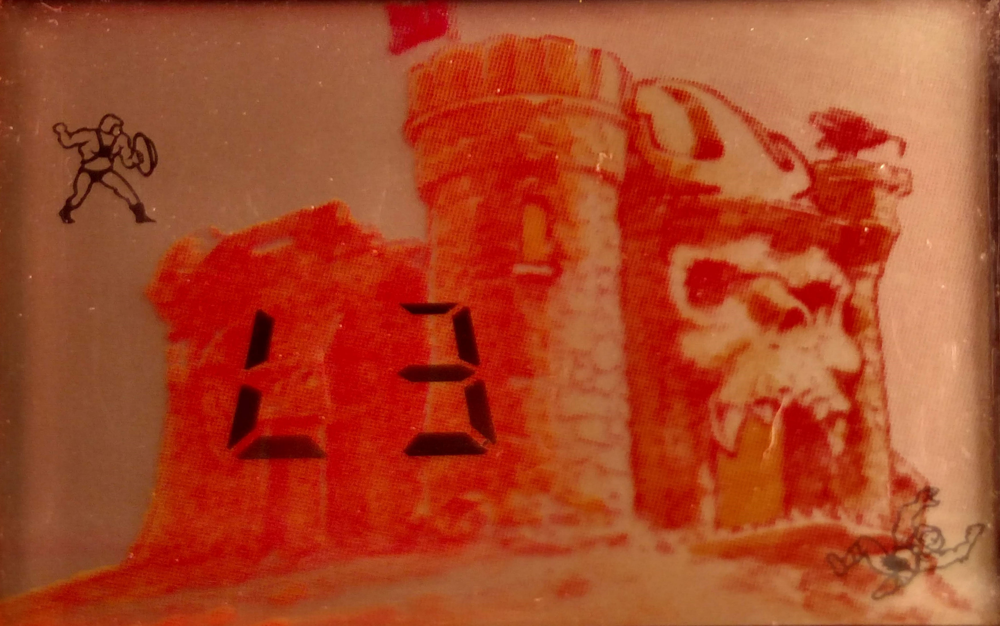

# Masters of the Universe Electronic Game

**Mattel Electronics (Model 4612-0340) • 1982 / 1983**  
*Authoritative Walkthrough, Toroidal Maze Cartography, Deductive Strategy & Hardware Archive*

---

## Table of Contents

1. [Historical Significance & Overview](#historical-significance--overview)
2. [Hardware & Visual Media Archive](#hardware--visual-media-archive)
3. [Display Architecture & The 100-Room Toroidal Maze](#display-architecture--the-100-room-toroidal-maze)
4. [Game Objects & Environmental Hazards](#game-objects--environmental-hazards)
5. [Winning & Losing Conditions](#winning--losing-conditions)
6. [Operational Controls & Difficulty Levels](#operational-controls--difficulty-levels)
7. [Deductive Cartography & Speedrun Strategy](#deductive-cartography--speedrun-strategy)
   - [Mapmaking & Standard Notation](#mapmaking--standard-notation)
   - [Complete 14-Scenario Tactical Walkthrough](#complete-14-scenario-tactical-walkthrough)
8. [Frequently Asked Questions (FAQ)](#frequently-asked-questions-faq)
9. [Verbatim Hardware & Packaging Transcriptions](#verbatim-hardware--packaging-transcriptions)

---

## Historical Significance & Overview

Released by **Mattel Electronics** in late 1982 and featured across retail catalogs and magazines throughout 1983 (including *Electronic Games* Magazine, May 1983), the *Masters of the Universe Electronic Game* (Model No. 4612-0340 / Packaging No. 4612) holds historical precedence as the **very first electronic video game in the Masters of the Universe franchise**.

Internally engineered on the micro-controller logic architecture of Mattel's 1981 *Dungeons & Dragons Computer Fantasy Game*, the title wraps an intricate deductive maze crawl around customized He-Man LCD iconography. Rather than a simple reflex brawler, the game tasks the player with mapping a non-Euclidean 100-room toroidal labyrinth within Castle Grayskull, interpreting adjacent sensory cues, avoiding lethal dungeon cells, intercepting Screeech, reclaiming the Power Sword, and hurling it from an adjacent room to slay Skeletor.

---

## Hardware & Visual Media Archive

### 1. Front Console Architecture (`motu_lcd_front.jpg`)



* **Form Factor & Housing:** Horizontal (landscape) handheld console molded in **vibrant red high-impact plastic**. Features an elaborate full-color illustrated front overlay bezel surrounding the centered display window.
* **Graphic Artwork:** 
  * **Center Backdrop:** A static, full-color painted background of Castle Grayskull rests behind the transparent LCD display glass.
  * **Left Register:** Comic-style rendering of Skeletor lunging forward in purple cowl, blue breastplate, and wielding a blade amidst craggy rocks.
  * **Right Register:** Action rendering of He-Man in his harness and battle boots brandishing the glowing **Power Sword** overhead before Castle Grayskull.
  * **Top Imprints:** `MATTEL ELECTRONICS` in light blue stylized lettering at the top-left; classic `MASTERS OF THE UNIVERSE™` logo at the top-right.
* **Control Array (Flanking the Display):**
  * **Left Side Controls:**
    * **SOUND OFF Switch:** 2-position horizontal slide toggle (`SOUND` / `OFF`) with a white grooved switch knob.
    * **CURSOR Button:** Upper rectangular white button. Rotates He-Man's heading 90° clockwise.
    * **ACL Pin:** Recessed red reset contact accessible via stylus or pin.
    * **HURL Button:** Lower rectangular white button. Throws the Power Sword forward or toggles demonstration mode.
  * **Right Side Controls:**
    * **MOVE Button:** Prominent circular multi-tiered control mechanism featuring a large black concave outer collar with a white center rocker button, recessed within a molded red circular housing. Steps He-Man forward into the adjacent chamber.

---

### 2. Rear Casing & Power Specifications (`motu_lcd_back.jpg`)



* **Housing Details:** Molded in matching red plastic with ergonomic finger indents, five machine screws, a molded `MADE IN JAPAN` cartouche, and a screw-secured battery hatch.
* **Power Requirements:** Powered by **two 1.5V button cell batteries** (type **LR44 / A76** alkaline, or silver-oxide equivalent **Energizer 357 / SR44W**).
* **Specifications Label:** Centered black foil label with crisp silver typography documenting operational instructions, battery warnings, and model number `4612-0340`.

---

### 3. Display Initialization & Demonstration Mode (`motu_lcd_intro1.jpg`)



* **Display Architecture:** Segmented monochrome LCD glass situated over the static reddish-brown Castle Grayskull background painting.
* **Demonstration Graphics:** Upon entering battery-conserving demonstration mode (holding **HURL** for 5 seconds), all customized character segments cycle. This capture demonstrates the 3D isometric Prison Cell cube with He-Man trapped behind the portcullis bars on the left, alongside the free, muscle-flexing He-Man segment on the right.

---

### 4. Active In-Game Playfield (`motu_lcd_ingame1.jpg`)



* **Playfield Breakdown:** Captures an active exploration phase at room coordinate **`A2`**:
  * **Alphanumeric Coordinate:** Center 7-segment display reads **`A2`**.
  * **Directional Cursor:** A solid black triangular arrow points **East (`▶`)**, indicating He-Man's current facing direction.
  * **Player Avatar:** A miniature silhouette of He-Man with sword raised stands directly between the `A` and `2`.
  * **Corridor Outlines:** Four 3D isometric doorway perspective frames surround the center display, representing the four potential passages leading to adjacent chambers.

---

### 5. Victory State & Score Screen (`motu_lcd_end1.jpg` & `motu_lcd_end2.jpg`)





* **Victory Display:** Upon successfully hurling the Power Sword into Skeletor's chamber from an adjacent room, the console emits a multi-tone victory fanfare and halts the timer.
* **Alternating Display Cycle:** The 7-segment display cycles between two operational screens:
  * **`motu_lcd_end1.jpg`:** Shows the player's final elapsed score: **`45`** (representing 45 five-second increments, or 225 seconds).
  * **`motu_lcd_end2.jpg`:** Alternates to display the completed difficulty level: **`L3`**.
* **Victory LCD Segments:** Both screens display the custom ending graphics: a triumphant **He-Man in combat stance with raised shield** in the upper-left corner, and **Skeletor knocked flat on his back** in the lower-right corner.

---

## Display Architecture & The 100-Room Toroidal Maze

The labyrinth is arranged as a **10×10 grid of 100 interconnected chambers**, indexed by rows **A through J** and columns **0 through 9**:
* **Upper-Left Origin:** Room `A0` (He-Man's fixed starting point in every game).
* **Lower-Right Corner:** Room `J9`.

### Toroidal Edge Wrap-Around

The maze is topologically closed in a torus shape. Moving past any boundary wraps instantly to the opposing side of the grid:
* **North from `A0`:** Enters `J0` (bottom edge).
* **South from `A0`:** Enters `B0`.
* **West from `A0`:** Enters `A9` (right edge).
* **East from `A0`:** Enters `A1`.

```text
    [J0]
     |
[A9]-A0-[A1]
     |
    [B0]
```

### Segment Display Schematic

The LCD window communicates the current room and sensory proximity warnings from all four adjacent chambers:

```text
    Screeech
    Sword-a
        |   |       
        | ▲ |
    ----     ----        
          A0       Cell  Key-a
    ----     ----        Skeletor
        |   |       
        |   | Key-b
    Sword-b
```

| Icon / Segment | Position | Meaning & Sensory Cue |
| :--- | :--- | :--- |
| **A0 – J9** | Center | Alpha-numeric coordinate of He-Man's current chamber. |
| **▲ ▶ ▼ ◀** | Center Cursor | Directional heading indicator (North, East, South, West). |
| **Sword-a** | Upper-Left | **Proximity Warning:** The Power Sword is in one of the 4 adjacent rooms. |
| **Sword-b** | Lower-Left | **Inventory Status:** He-Man currently possesses the Power Sword. |
| **Key-a** | Upper-Right | **Proximity Warning:** The Cell Key is in one of the 4 adjacent rooms. |
| **Key-b** | Lower-Right | **Inventory Status:** He-Man currently possesses the Cell Key. |
| **Screeech** | Top-Left | **Proximity Warning:** Screeech occupies an adjacent chamber. |
| **Cell** | Center-Right | **Hazard Warning:** At least one adjacent chamber contains a lethal Prison Cell. |
| **Skeletor** | Lower-Right | **Target Warning:** Skeletor occupies an adjacent chamber. |

---

## Game Objects & Environmental Hazards

### 1. Prison Cells (12 Total)
* **Danger:** Entering a cell chamber without possessing the Key triggers an immediate Game Over.
* **Key Usage:** If He-Man possesses the Key upon entering a cell, the key is consumed, freeing He-Man and causing the key to respawn randomly elsewhere in the maze.
* **Proximity Rule:** The `Cell` icon illuminates if **one, two, or three** adjacent rooms contain a cell. The icon does not indicate the direction or count.
* **Cartographic Invariant:** **Two prison cells are NEVER adjacent to each other.** If room `B3` contains a cell, rooms `A3`, `C3`, `B2`, and `B4` are guaranteed cell-free.

### 2. Screeech the Evil Barbarian Bird (4 Instances)
* **Displacement Effect:** Entering a room with Screeech causes the beast to seize He-Man and deposit him in a completely random chamber across the 100-room maze (which may itself be a prison cell).
* **Dynamic Migration:** Every 10 seconds, one or more Screeech instances randomly migrate to an adjacent chamber. Screeech can even fly directly into He-Man's room while he is standing still.

### 3. The Power Sword
* **Prerequisite for Victory:** Must be located and collected before Skeletor can be engaged.
* **Hurling Mechanics:** When standing adjacent to Skeletor, pointing the cursor toward his chamber and pressing **HURL** strikes him down.
* **Misthrow Penalty:** Hurling the sword into an empty room causes a *"Poof"* sound effect; the sword vanishes and is re-hidden in a random chamber across the maze.

### 4. The Cell Key
* **Function:** Permits escape from a single prison cell.
* **Availability:** Only one key exists at any time. Omitted entirely in **Difficulty L-3**.

### 5. Skeletor
* **Lethality:** Entering Skeletor's room directly is fatal and results in immediate Game Over.
* **Evasion:** If He-Man hurls the Power Sword in the wrong direction while adjacent to Skeletor, Skeletor flees to another random chamber in Castle Grayskull.

---

## Winning & Losing Conditions

### Victory Condition
* He-Man successfully hurls the Power Sword into Skeletor's chamber from an adjacent room.

### Defeat Conditions
1. **Time Limit Expiration:** Exceeding **495 seconds** (99 intervals of 5 seconds each).
2. **Imprisonment:** Stepping into a Prison Cell without the Key in inventory.
3. **Ambush:** Stepping directly into Skeletor's chamber.

### Scoring Calculation
The game counter starts at `00` and increments by **+1 every five seconds** up to a maximum of `99`. **Lower scores indicate superior speed and deduction.**

---

## Operational Controls & Difficulty Levels

### Controls Breakdown

| Phase | Input | Action |
| :--- | :--- | :--- |
| **Setup** | **MOVE** | Cycles skill level: `L1` &rarr; `L2` &rarr; `L3`. |
| **Setup** | **HURL** | Confirms level selection and initiates gameplay. |
| **Setup** | **HURL (Hold 5s)** | Toggles battery-conserving **Demonstration Mode**. |
| **In-Game** | **CURSOR** | Rotates He-Man's facing heading 90° clockwise: North (▲) &rarr; East (▶) &rarr; South (▼) &rarr; West (◀). |
| **In-Game** | **MOVE** | Steps He-Man forward 1 chamber in the direction of the cursor. |
| **In-Game** | **HURL** | Throws the Power Sword forward 1 chamber in the direction of the cursor. |
| **System** | **SOUND Switch** | Hardware slide switch toggling sound effects on or off. |
| **System** | **ACL Button** | Recessed all-clear reset contact. |

### Difficulty Levels

| Level | Initial Key | Maze Key Spawns | Tactical Implication |
| :--- | :--- | :--- | :--- |
| **L-1** | **Yes** (in inventory) | Respawnable | Provides 1 free error margin. Safest level for learning map deduction. |
| **L-2** | **No** | 1 hidden in maze | Player must search for the Key before taking risky traversals. |
| **L-3** | **No** | **None** | Hardcore mode. Zero room for navigational error; any cell encounter is fatal. |

---

## Deductive Cartography & Speedrun Strategy

> **Author's Record:** *"Using this strategy, I won three of the first seven games I played."*

Because the console does not retain an in-game automap, maintaining a physical 10×10 grid sheet on paper is the definitive methodology for speedrunning and winning. Writing notes on paper is significantly faster than entering them into software, and conservation of time is critical.

```text
    0   1   2   3   4   5   6   7   8   9
  +---+---+---+---+---+---+---+---+---+---+
A |   |   |   |   |   |   |   |   |   |   |
B |   |   |   |   |   |   |   |   |   |   |
C |   |   |   |   |   |   |   |   |   |   |
D |   |   |   |   |   |   |   |   |   |   |
E |   |   |   |   |   |   |   |   |   |   |
F |   |   |   |   |   |   |   |   |   |   |
G |   |   |   |   |   |   |   |   |   |   |
H |   |   |   |   |   |   |   |   |   |   |
I |   |   |   |   |   |   |   |   |   |   |
J |   |   |   |   |   |   |   |   |   |   |
  +---+---+---+---+---+---+---+---+---+---+
```

### Mapmaking & Standard Notation

* **`O` (Confirmed Safe):** The room has been visited or triangulated as cell-free. If the current room displays no cell icon, all four adjacent rooms are immediately confirmed `O`.
* **`/` (Suspected Cell):** An adjacent room illuminated the `Cell` icon. If a `/` room is later determined to be safe, change `/` to `O`. If later confirmed as a cell, change `/` to `X`.
* **`X` (Confirmed Cell):** Triangulated prison cell. Never enter!
* **`S` (Suspected Skeletor):** Adjacent room illuminated the `Skeletor` icon.
* **`☆` (Confirmed Skeletor):** Triangulated Skeletor location. Target for the Power Sword.

If a room displays both `Cell` and `Skeletor` icons, one adjacent room contains Skeletor and at least one other adjacent room contains a cell. Mark each neighbor with both `/` and `S`. It is not useful to track Screeech's coordinates on the grid, as the bird migrates dynamically.

---

### Complete 14-Scenario Tactical Walkthrough

The following 14 sequential scenarios represent real-world tactical decisions encountered during a playthrough. Room coordinates are specific to these examples, while object placement is randomized on every new game.

#### Scenario 1: `A0` (Cell Pictured)
* Mark `O` for `A0`. Mark `/` for each adjacent room: `A1`, `B0`, `J0`, and `A9`. Any of these may contain a prison cell.
* Move right (East) into `A1`. Opening as much of the top row as possible early on is recommended.

#### Scenario 2: `A1` (No Cell Pictured)
* Mark `O` for `A1`. Because no cell icon is visible, all adjacent rooms (`A2`, `B1`, `J1`, and `A0`) are guaranteed safe.
* Mark `A2`, `B1`, and `J1` with `O`. Advance right into `A2`.

#### Scenario 3: `A2` (No Cell Pictured)
* Mark `O` for `A2`, and mark `O` for all adjacent chambers (`A3`, `B2`, `J2`). Advance right into `A3`.

#### Scenario 4: `A3` (Cell Pictured)
* Mark `O` for `A3`, and mark `/` for adjacent unvisited rooms (`A4`, `B3`, `J3`).
* Do not risk entering `A4`. Backtrack to `A2` and navigate along the known safe `O` path (`B1`, `B2`, etc.).

#### Scenario 5: `B1` (No Cell Pictured)
* Mark `O` for `B1`. Change the `/` mark in `B0` to `O`, since `B1`'s clear screen proves `B0` is safe.

#### Scenario 6: `B4` (Cell Pictured — Triangulating `B3`)
* Suppose you have explored `A3`, `B2`, `C3`, and now `B4`. If all of their other surrounding rooms have been confirmed safe, then it is mathematically necessary that `B3` contains the prison cell.
* Change the `/` in `B3` to `X`. (Even if only 2 or 3 surrounding rooms have been checked and all show cell icons, `B3` has a very high probability of being the cell; it is often faster to take an alternate route than to waste time verifying with 100% certainty).

#### Scenario 7: `E4` (Screeech Pictured, No Cell Pictured)
* You wish to move right into `E5`. Go ahead and advance. The probability that Screeech is currently in `E5` is no greater than the probability that Screeech will migrate into `E4` if you hesitate. Because Screeech migrates every 10 seconds, waiting is counterproductive.

#### Scenario 8: `E5` (Taken by Screeech)
* You enter `E5` and are snatched by Screeech, who deposits you in a random room.
* **Crucial Rule:** Mark `E5` with `O`! Because Screeech cannot occupy a chamber containing a Prison Cell or Skeletor, `E5` is guaranteed safe to re-enter later.

#### Scenario 9: `G3` (Power Sword Pictured)
* The sword icon indicates the relic is in `F3`, `G2`, `G4`, or `H3`. Step into an adjacent room.
* If the sword is not there, backtrack to `G3` and try another adjacent candidate. If `G3` borders a suspected cell, loop around via an alternate safe passage to check the remaining candidates.

#### Scenario 10: `H5` (Cell Key Pictured)
* The key icon indicates the item is in `G5`, `H4`, `H6`, or `I5`. Advance into an adjacent room to retrieve it. If not found, backtrack and check the other candidates.

#### Scenario 11: `C7` (Accidental Prison Cell Entry)
* You step into `C7`, which contains a cell.
* If playing on `L-1` or `L-2` with a Key in inventory, the key is consumed, freeing He-Man.
* Mark `C7` with `X`.
* **Crucial Invariant:** Because **two cells are never adjacent to each other**, all four neighboring rooms (`B7`, `D7`, `C6`, `C8`) are immediately proven 100% cell-free! Mark them with `O`.

#### Scenario 12: `H8` (Skeletor and Cell Pictured)
* Mark `S` and `/` in all four adjacent rooms (`G8`, `I8`, `H7`, `H9`).
* **Do not step into these rooms blindly!** Approach each candidate from an alternate angle.

#### Scenario 13: `H7` (No Cell Pictured)
* Stepping into `H7` shows no cell icon, proving that `H8`'s cell warning was not referring to `H7`.

#### Scenario 14: `I7` (Skeletor Pictured — The Fatal Strike)
* Stepping into `I7` illuminates the `Skeletor` icon.
* Identify the common adjacent chamber between `H8` and `I7`: it is **`I8`**!
* Mark `I8` with **`☆`**. Cross out the `S` marks in other rooms.
* Rotate the cursor to point toward `I8` and press **HURL**.
* The Power Sword strikes Skeletor down! The victory fanfare plays, and the end screen alternates between your elapsed score and difficulty level.

---

## Frequently Asked Questions (FAQ)

* **Q: What type of batteries does the game take?**  
  **A:** It requires two **LR44 (A76)** batteries or equivalent, according to the label on the back of the device. The game works well with silver-oxide **Energizer 357** batteries.

* **Q: Which game came first — Masters of the Universe Electronic Game or Dungeons & Dragons Computer Fantasy Game?**  
  **A:** *Dungeons & Dragons* came first. It was released in 1981, and *Masters of the Universe* was released in 1982 using the same underlying logic engine.

* **Q: How is the score calculated?**  
  **A:** The score increments by one every five seconds up to a maximum of 99. Lower scores are better.

* **Q: Which stickers came with the game?**  
  **A:** Four color character stickers: *He-Man*, *Skeletor*, *Power Sword*, and *Castle Grayskull*.

---

## Verbatim Hardware & Packaging Transcriptions

### 1. Rear Console Chassis Label

```text
TO CONSERVE BATTERIES, PUT GAME IN DEMONSTRATION MODE WHEN NOT IN USE. Hold down Hurl button for 5 seconds when finished playing.

IF GAME MALFUNCTIONS, TRY NEW BATTERIES. Game uses two LR44 (A76) batteries or equivalent. 

©Mattel, Inc. 1982 JAPAN

4612-0340
```

### 2. Front Packaging Blister Card Text

```text
FOR AGES 5 AND OVER

MATTEL ELECTRONICS

MASTERS OF THE UNIVERSE ELECTRONIC GAME

<He-Man:> NOW YOU'VE MET YOUR MATCH, YOU EVIL FIEND!

<Skeletor:> YOU DARE ATTACK ME? FEEL MY POWER!

FREE INSIDE! 4 CHARACTER STICKERS! plus more than $25.00 in coupons for savings on FOOD, ENTERTAINMENT, LODGING, & MORE!

BATTERIES INCLUDED

No. 4612

He-Man ® and Skeletor ® are locked in mortal combat. Take up the challenge anywhere!
```

### 3. Rear Packaging Blister Card Specifications

```text
MATTEL ELECTRONICS

MASTERS OF THE UNIVERSE

                    [Illegible text]
No. 4612-0940       [13-digit UPC]

Search the endless maze for the Power Sword needed to destroy SKELETOR ®™ . Beware SCREEECH ®™, The Evil Barbarian Bird. The key can unlock the CASTLE GRAYSKULL ®™ dungeons. Slay Skeletor, and Castle Grayskull is yours. 
* You control He-Man ®™ !
* Sophisticated LCD graphics
* Thrilling action sounds
* Three skill levels

CONTENTS: Game, instructions, and two A76 (LR44) button type batteries.

[Illegible text, probably manufacture information and legal notices]
```

### 4. Character Stickers Transcription

```text
POWER SWORD

CASTLE GRAYSKULL

HE-MAN

SKELETOR
```
