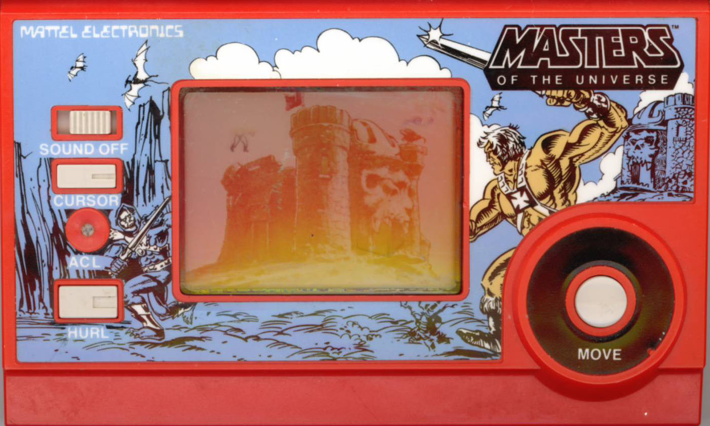
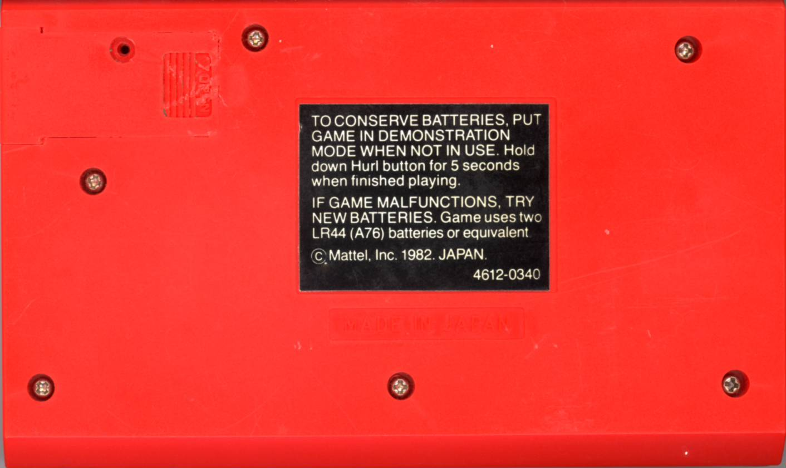
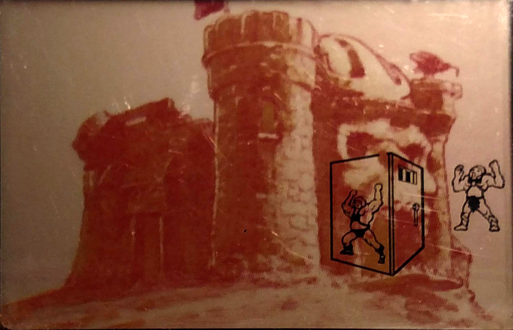
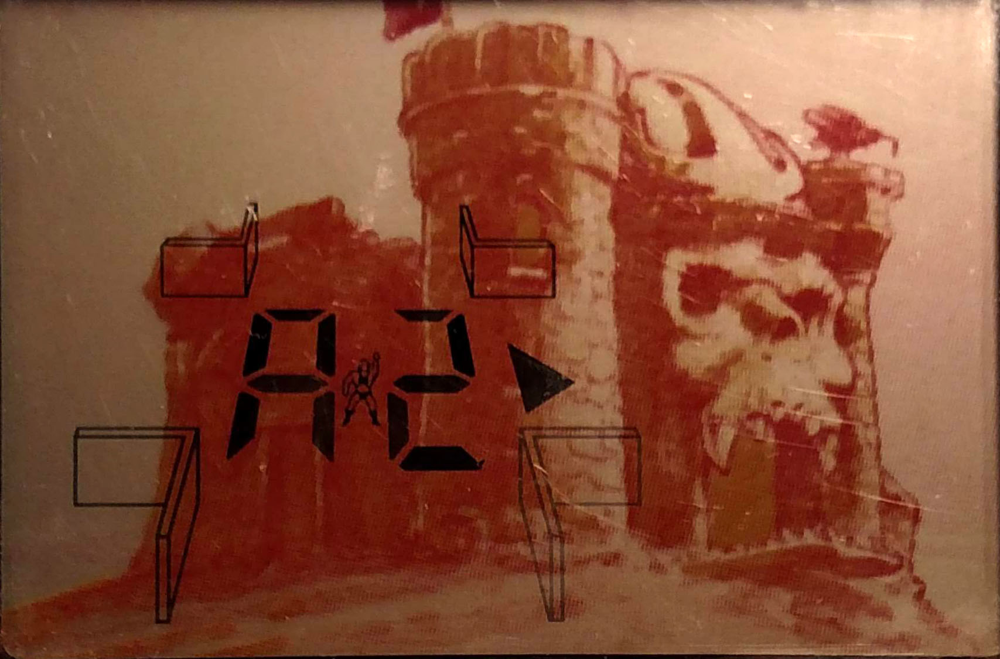
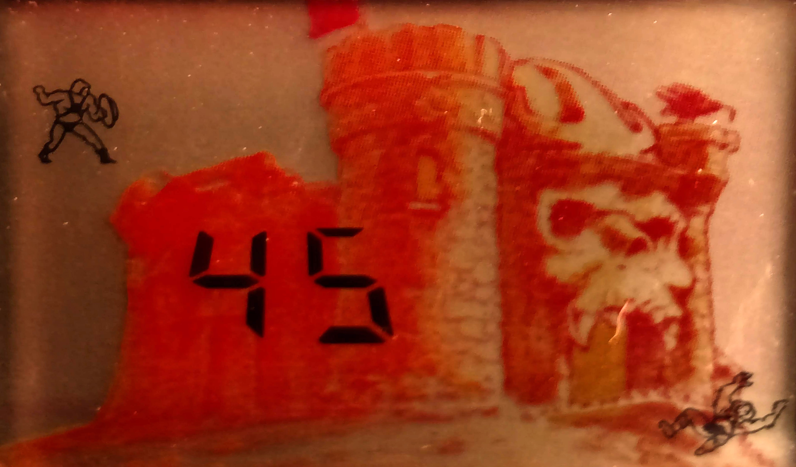
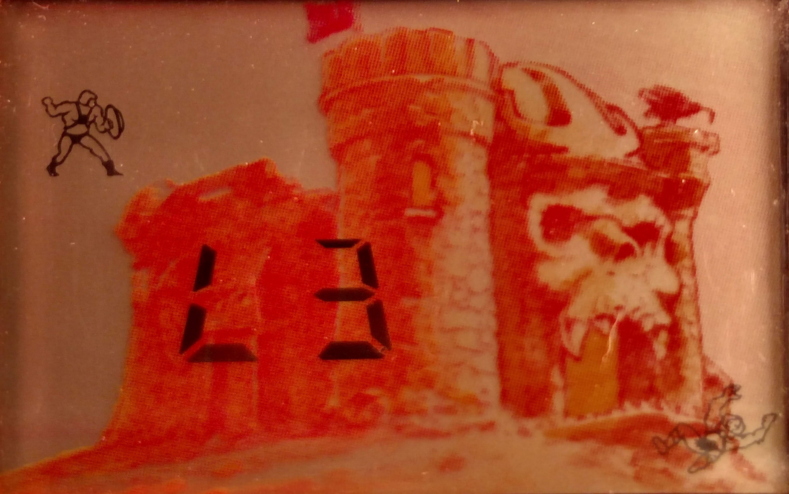

# Masters of the Universe Electronic Game

**Mattel Electronics (Model 4612-0340) • 1982 / 1983**  
*Authoritative Walkthrough, Toroidal Maze Cartography, Deductive Strategy & Hardware Archive*

---

## Table of Contents

1. [Historical Significance & Overview](#historical-significance--overview)
2. [Hardware & Visual Media Archive](#hardware--visual-media-archive)
3. [Display Architecture & The 100-Room Toroidal Maze](#display-architecture--the-100-room-toroidal-maze)
4. [Game Objects & Environmental Hazards](#game-objects--environmental-hazards)
5. [Winning & Losing Conditions](#winning--losing-conditions)
6. [Operational Controls & Difficulty Levels](#operational-controls--difficulty-levels)
7. [Deductive Cartography & Speedrun Strategy](#deductive-cartography--speedrun-strategy)
8. [Frequently Asked Questions (FAQ)](#frequently-asked-questions-faq)
9. [Verbatim Hardware & Packaging Transcriptions](#verbatim-hardware--packaging-transcriptions)

---

## Historical Significance & Overview

Released by **Mattel Electronics** in late 1982 and featured extensively across retail catalogs and magazines throughout 1983 (including *Electronic Games* Magazine, May 1983), the *Masters of the Universe Electronic Game* (Catalog No. 4612-0340) holds historical precedence as the **very first electronic video game in the Masters of the Universe franchise**.

Internally engineered on the proven logic architecture of Mattel's 1981 *Dungeons & Dragons Computer Fantasy Game*, the title wraps an intricate deductive maze crawl around customized He-Man LCD iconography. Rather than a simple reflex brawler, the game tasks the player with mapping a non-Euclidean 100-room toroidal labyrinth within Castle Grayskull, interpreting adjacent sensory cues, avoiding lethal dungeon cells, intercepting Screeech, reclaiming the Power Sword, and hurling it from an adjacent room to slay Skeletor.

---

## Hardware & Visual Media Archive

### 1. Front Console Architecture (`motu_lcd_front.jpg`)



* **Physical Layout:** Compact vertical handheld molded in dark gray high-impact plastic. Features a custom metallic illustrated bezel depicting Castle Grayskull's jawbridge facade, flanked by comic-styled depictions of He-Man brandishing his battle axe and Skeletor wielding the Havoc Staff.
* **Control Array:** Located below the display window:
  * **HURL Button:** Large primary circular red action button.
  * **CURSOR Button:** Upper secondary black navigation rocker.
  * **MOVE Button:** Lower secondary black progression rocker.
  * **SOUND Switch:** 2-position slide toggle switch (`SOUND` / `OFF`).
  * **ACL Pin:** Recessed reset switch accessible via stylus.

### 2. Rear Casing & Power Specifications (`motu_lcd_back.jpg`)



* **Housing Details:** The reverse chassis includes molded finger grips, an embossed Mattel Electronics emblem, and the battery bay cover secured with a metal set screw.
* **Power Requirements:** Powered by two **1.5V button cell batteries** (type **LR44 / A76**, or silver-oxide equivalent **Energizer 357 / SR44W**).

### 3. Display Initialization & Demo Mode (`motu_lcd_intro1.jpg`)



* **Screen Elements:** Demonstrates the customized segmented LCD overlay. Upon power-on or entering demonstration mode, all character segments flash sequentially, showcasing He-Man, Skeletor, Screeech, the Power Sword, and the dungeon cell portcullis.

### 4. Active In-Game Playfield (`motu_lcd_ingame1.jpg`)



* **Playfield Breakdown:** Shows He-Man at starting coordinate **A0** facing North (▲). Proximity indicators on the peripheral display announce adjacent hazards and relics prior to moving.

### 5. Victory State & Score Screen (`motu_lcd_end1.jpg` & `motu_lcd_end2.jpg`)





* **Victory Display:** Upon successfully hurling the Power Sword into Skeletor's chamber, the console emits the multi-tone victory fanfare. The display halts the timer, presenting the chosen difficulty level (`L1`, `L2`, or `L3`) and the final elapsed time units (`00`–`99`).

---

## Display Architecture & The 100-Room Toroidal Maze

The labyrinth is arranged as a **10×10 grid of 100 interconnected chambers**, indexed by rows **A through J** and columns **0 through 9**:
* **Upper-Left Origin:** Room `A0` (He-Man's fixed starting point).
* **Lower-Right Origin:** Room `J9`.

### Toroidal Edge Wrap-Around

The maze is topologically closed in a torus shape. Exiting past any border wraps instantly to the opposing side:
* **North from `A0`:** Enters `J0` (bottom edge).
* **South from `A0`:** Enters `B0`.
* **West from `A0`:** Enters `A9` (right edge).
* **East from `A0`:** Enters `A1`.

```text
    [J0]
     |
[A9]-A0-[A1]
     |
    [B0]
```

### Segment Display Schematic

The LCD window communicates the current room and sensory proximity warnings from all four adjacent chambers:

```text
    Screeech
    Sword-a
        |   |       
        | ▲ |
    ----     ----        
          A0       Cell  Key-a
    ----     ----        Skeletor
        |   |       
        |   | Key-b
    Sword-b
```

| Icon / Segment | Position | Meaning & Sensory Cue |
| :--- | :--- | :--- |
| **A0 – J9** | Center | Alpha-numeric coordinate of He-Man's current chamber. |
| **▲ ▶ ▼ ◀** | Center Cursor | Directional heading indicator (North, East, South, West). |
| **Sword-a** | Upper-Left | **Proximity Warning:** The Power Sword is in one of the 4 adjacent rooms. |
| **Sword-b** | Lower-Left | **Inventory Status:** He-Man currently possesses the Power Sword. |
| **Key-a** | Upper-Right | **Proximity Warning:** The Cell Key is in one of the 4 adjacent rooms. |
| **Key-b** | Lower-Right | **Inventory Status:** He-Man currently possesses the Cell Key. |
| **Screeech** | Top-Left | **Proximity Warning:** Screeech is in an adjacent chamber. |
| **Cell** | Center-Right | **Hazard Warning:** At least one adjacent chamber contains a lethal Prison Cell. |
| **Skeletor** | Lower-Right | **Target Warning:** Skeletor occupies an adjacent chamber. |

---

## Game Objects & Environmental Hazards

### 1. Prison Cells (12 Total)
* **Danger:** Entering a cell chamber without possessing the Key triggers an immediate Game Over.
* **Key Usage:** If He-Man possesses the Key upon entering a cell, the key is consumed, freeing He-Man and causing the key to respawn randomly elsewhere in the maze.
* **Proximity Rule:** The `Cell` icon illuminates if **one, two, or three** adjacent rooms contain a cell.
* **Cartographic Invariant:** **Two prison cells are NEVER adjacent to each other.** If room `B3` contains a cell, rooms `A3`, `C3`, `B2`, and `B4` are guaranteed cell-free.

### 2. Screeech the Evil Barbarian Bird (4 Instances)
* **Displacement Effect:** Entering a room with Screeech causes the beast to seize He-Man and deposit him in a completely random chamber across the 100-room maze (which may itself be a prison cell).
* **Dynamic Migration:** Every 10 seconds, one or more Screeech instances randomly migrate to an adjacent chamber. Screeech can even fly directly into He-Man's room while he is resting.

### 3. The Power Sword
* **Prerequisite for Victory:** Must be located and collected before Skeletor can be engaged.
* **Hurling Mechanics:** When standing adjacent to Skeletor, pointing the cursor toward his chamber and pressing **HURL** strikes him down.
* **Misthrow Penalty:** Hurling the sword into an empty room causes a *"Poof"* sound effect; the sword vanishes and is re-hidden in a random chamber across the maze.

### 4. The Cell Key
* **Function:** Permits escape from a single prison cell.
* **Availability:** Only one key exists at any time. Omitted entirely in **Difficulty L-3**.

### 5. Skeletor
* **Lethality:** Entering Skeletor's room directly is fatal and results in immediate Game Over.
* **Evasion:** If He-Man hurls the Power Sword in the wrong direction while adjacent to Skeletor, Skeletor flees to another random chamber in Castle Grayskull.

---

## Winning & Losing Conditions

### Victory Condition
* He-Man successfully hurls the Power Sword into Skeletor's chamber from an adjacent room.

### Defeat Conditions
1. **Time Limit Expiration:** Exceeding **495 seconds** (99 intervals of 5 seconds each).
2. **Imprisonment:** Stepping into a Prison Cell without the Key in inventory.
3. **Ambush:** Stepping directly into Skeletor's chamber.

### Scoring Calculation
The game counter starts at `00` and increments by **+1 every five seconds** up to a maximum of `99`. **Lower scores indicate superior speed and deduction.**

---

## Operational Controls & Difficulty Levels

### Controls Breakdown

| Phase | Input | Action |
| :--- | :--- | :--- |
| **Setup** | **MOVE** | Cycles skill level: `L1` &rarr; `L2` &rarr; `L3`. |
| **Setup** | **HURL** | Confirms level selection and initiates gameplay. |
| **Setup** | **HURL (Hold 5s)** | Toggles battery-conserving **Demonstration Mode**. |
| **In-Game** | **CURSOR** | Rotates He-Man's facing heading 90° clockwise: North (▲) &rarr; East (▶) &rarr; South (▼) &rarr; West (◀). |
| **In-Game** | **MOVE** | Steps He-Man forward 1 chamber in the direction of the cursor. |
| **In-Game** | **HURL** | Throws the Power Sword forward 1 chamber in the direction of the cursor. |
| **System** | **SOUND Switch** | Hardware slide switch toggling sound effects on or off. |
| **System** | **ACL Button** | Recessed all-clear reset contact. |

### Difficulty Levels

| Level | Initial Key | Maze Key Spawns | Tactical Implication |
| :--- | :--- | :--- | :--- |
| **L-1** | **Yes** (in inventory) | Respawnable | Provides 1 free error margin. Safest level for learning map deduction. |
| **L-2** | **No** | 1 hidden in maze | Player must search for the Key before taking risky traversals. |
| **L-3** | **No** | **None** | Hardcore mode. Zero room for navigational error; any cell encounter is fatal. |

---

## Deductive Cartography & Speedrun Strategy

Because the console does not retain an in-game automap, maintaining a physical 10×10 grid sheet on paper is the definitive methodology for speedrunning and winning.

```text
    0   1   2   3   4   5   6   7   8   9
  +---+---+---+---+---+---+---+---+---+---+
A |   |   |   |   |   |   |   |   |   |   |
B |   |   |   |   |   |   |   |   |   |   |
C |   |   |   |   |   |   |   |   |   |   |
D |   |   |   |   |   |   |   |   |   |   |
E |   |   |   |   |   |   |   |   |   |   |
F |   |   |   |   |   |   |   |   |   |   |
G |   |   |   |   |   |   |   |   |   |   |
H |   |   |   |   |   |   |   |   |   |   |
I |   |   |   |   |   |   |   |   |   |   |
J |   |   |   |   |   |   |   |   |   |   |
  +---+---+---+---+---+---+---+---+---+---+
```

### Standard Mapmaking Notation

* **`O` (Confirmed Safe):** The room has been visited or triangulated as cell-free.
* **`/` (Suspected Cell):** An adjacent room illuminated the `Cell` icon.
* **`X` (Confirmed Cell):** Triangulated prison cell. Never enter!
* **`S` (Suspected Skeletor):** Adjacent room illuminated the `Skeletor` icon.
* **`☆` (Confirmed Skeletor):** Triangulated Skeletor location. Target for the Power Sword.

### Triangulation Logic Scenarios

#### Scenario 1: Proving Safe Corridors
1. At **`A0`**, the `Cell` icon is illuminated. Mark `A0` as `O`, and mark `A1`, `B0`, `J0`, and `A9` with `/`.
2. Step east into **`A1`**. If `A1` displays **no cell icon**, then all its neighbors (`A0`, `A2`, `B1`, `J1`) are 100% safe.
3. Mark `A1`, `A2`, `B1`, and `J1` with `O`.
4. Because `B1` is safe, you have secured an alternate passage to loop behind suspected rooms.

#### Scenario 2: Triangulating a Confirmed Cell (`X`)
* Suppose you explore `A3`, `B2`, and `B4`, and all three illuminate the `Cell` icon.
* If surrounding rooms (`A2`, `A4`, `C2`, `C4`) are found to be safe, the single overlapping neighbor common to all three is **`B3`**.
* Mark `B3` as **`X`**. Because two cells can never be adjacent, all other neighbors of `B3` are now guaranteed safe.

#### Scenario 3: Pinpointing Skeletor without Dying
* Stepping into room **`H8`** lights up both `Cell` and `Skeletor`. Mark adjacent rooms (`H7`, `H9`, `G8`, `I8`) with `S`.
* Do not gamble on stepping blindly into any of these four rooms!
* Retreat and circle around to approach from another corridor (e.g., enter **`I7`**).
* If **`I7`** illuminates `Skeletor`, find the common adjacent chamber between `H8` and `I7`: it is **`I8`**.
* Mark `I8` with **`☆`**. Point the cursor toward `I8` and press **HURL** to banish Skeletor.

---

## Frequently Asked Questions (FAQ)

* **Q: What batteries are required?**  
  **A:** Two **LR44 (A76)** alkaline button cells or silver-oxide **Energizer 357 / SR44W** equivalents.

* **Q: Which game was developed first: Masters of the Universe or D&D Computer Fantasy Game?**  
  **A:** *Dungeons & Dragons Computer Fantasy Game* was released first in 1981; *Masters of the Universe* followed in late 1982 using the same core micro-controller logic.

* **Q: What original collectibles came packed in the box?**  
  **A:** Four color character stickers (*He-Man*, *Skeletor*, *Power Sword*, and *Castle Grayskull*), two A76 batteries, an instruction booklet, and promotional coupons.

---

## Verbatim Hardware & Packaging Transcriptions

### Rear Console Chassis Label

```text
TO CONSERVE BATTERIES, PUT GAME IN DEMONSTRATION MODE WHEN NOT IN USE. 
Hold down Hurl button for 5 seconds when finished playing.

IF GAME MALFUNCTIONS, TRY NEW BATTERIES. 
Game uses two LR44 (A76) batteries or equivalent. 

©Mattel, Inc. 1982 JAPAN
4612-0340
```

### Front Packaging Box Text

```text
FOR AGES 5 AND OVER

MATTEL ELECTRONICS

MASTERS OF THE UNIVERSE ELECTRONIC GAME

<He-Man:> NOW YOU'VE MET YOUR MATCH, YOU EVIL FIEND!
<Skeletor:> YOU DARE ATTACK ME? FEEL MY POWER!

FREE INSIDE! 4 CHARACTER STICKERS! 
plus more than $25.00 in coupons for savings on FOOD, ENTERTAINMENT, LODGING, & MORE!

BATTERIES INCLUDED
No. 4612-0340

He-Man ® and Skeletor ® are locked in mortal combat. Take up the challenge anywhere!
```

### Rear Packaging Inlay Specifications

```text
MATTEL ELECTRONICS
MASTERS OF THE UNIVERSE

No. 4612-0340

Search the endless maze for the Power Sword needed to destroy SKELETOR ®™ . 
Beware SCREEECH ®™, The Evil Barbarian Bird. 
The key can unlock the CASTLE GRAYSKULL ®™ dungeons. 
Slay Skeletor, and Castle Grayskull is yours. 

* You control He-Man ®™ !
* Sophisticated LCD graphics
* Thrilling action sounds
* Three skill levels

CONTENTS: Game, instructions, and two A76 (LR44) button type batteries.
```

