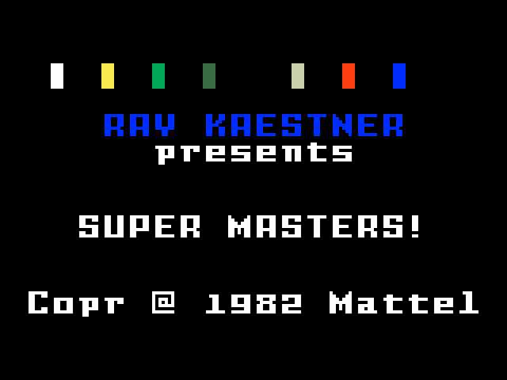
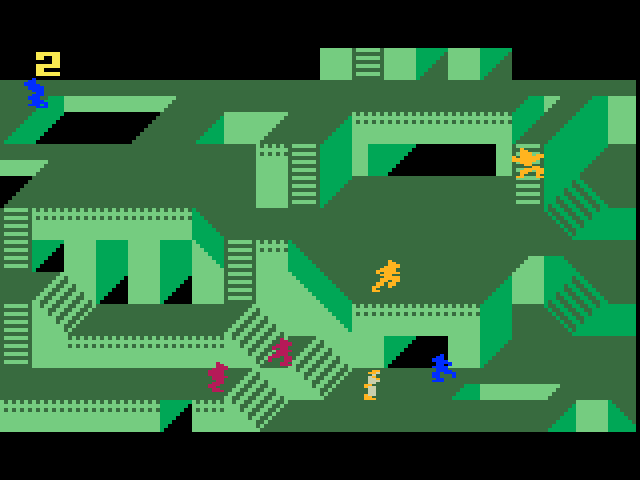
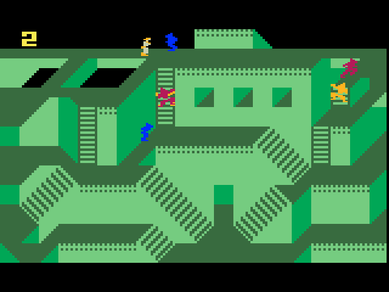
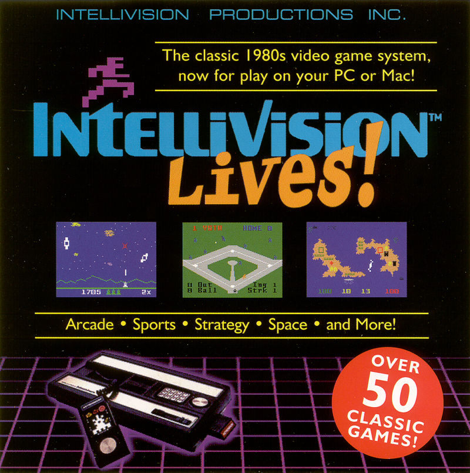
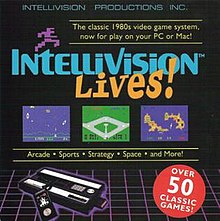
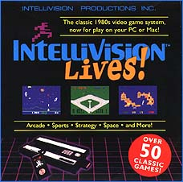
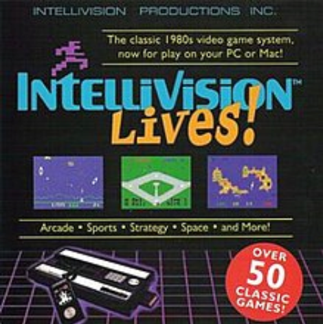

# Masters of the Universe: Super Masters – Intellivision Screen & Packaging Archive

This media archive preserves three gameplay/title-screen captures associated with *Super Masters* and four cover-art images for the *Intellivision Lives!* collection. The title screen credits Ray Wastner and displays a 1982 Mattel copyright. The available captures document the visible title and gameplay only; they do not establish the game's release status or provide a complete manual or walkthrough.

## Title Screen

**Caption and transcription:** The black title screen has a horizontal row of small colored squares across the top. Centered blue pixel lettering reads “RAY WASTNER”; smaller white text below reads “PRESENTS.” The large white title reads “SUPER MASTERS!” and the bottom line reads “COPY © 1982 MATTEL.” No platform logo, instructions, or controls are visible in this capture.

## Gameplay Captures

**Caption:** A single-screen platform area is built from layered light and dark green ledges, with short ladders and diagonal striped surfaces connecting different elevations. A yellow key-like object sits at the upper-left edge. Small blue, yellow, orange, and magenta character or object sprites are distributed across the platforms; the image does not identify their roles. There is no readable score, health display, or instruction text in this frame.

**Caption:** This second view shows another arrangement of the same green platform terrain. A yellow key-like object and blue sprite appear near the upper-left area; additional blue, orange, yellow, and magenta sprites appear on ledges to the right and center. Ladders and repeated diagonal stripes indicate vertical connections and sloped or patterned surfaces. No legible HUD or game instructions are shown.

## Intellivision Lives! Packaging Art

The four cover images below are alternate-size or alternate-quality reproductions of the same *Intellivision Lives!* front-cover artwork. They are retained as supplied to document the available image variants rather than as four different packaging designs.

**Caption and visible-text transcription:** The top line reads “INTELLIVISION PRODUCTIONS INC.” A yellow-framed tagline says, “The classic 1980s video game system, now for play on your PC or Mac!” The center bears the blue-and-orange “Intellivision Lives!” logo. Three small gameplay images sit beneath the logo. A line below them reads “Arcade • Sports • Strategy • Space • and More!” A red circular badge reads “OVER 50 CLASSIC GAMES!” The lower portion depicts an Intellivision console and hand controller on a purple grid. The cover has a black background and no other legible copy in this scan.

**Caption:** A reduced square reproduction of the cover described above. The small reproduction retains the publisher imprint, PC/Mac tagline, “Intellivision Lives!” logo, three game-screen thumbnails, category line, console-and-controller illustration, and “OVER 50 CLASSIC GAMES!” badge. Fine text is less legible at this size; no distinct additional cover text can be verified.

**Caption:** A near-square, low-resolution presentation of the same front-cover design. It shows the black background, Intellivision Lives! logo, the classic-1980s PC/Mac tagline, three gameplay thumbnails, category slogan, console and controller, and red “OVER 50 CLASSIC GAMES!” badge. The reduced quality prevents reliable transcription beyond the text already recorded above.

**Caption:** A zoomed digital reproduction of the cover design. It makes the Intellivision Productions Inc. imprint, PC/Mac tagline, game-category slogan, and “OVER 50 CLASSIC GAMES!” badge more prominent while retaining the same three screenshot thumbnails and console artwork. No additional wording beyond the cover transcription above is visible.

## Archive Scope and Attribution

- The title-screen capture attributes *Super Masters* to Ray Wastner and shows “COPY © 1982 MATTEL.”
- The cover artwork advertises *Intellivision Lives!* for play on PC or Mac and claims “OVER 50 CLASSIC GAMES!”
- The supplied visual material does not identify a release date or establish whether *Super Masters* was released, completed, or included in a particular edition of *Intellivision Lives!*.
- Cover images are preserved as archival references. Their visible artwork is described here; no claim of ownership is made.
