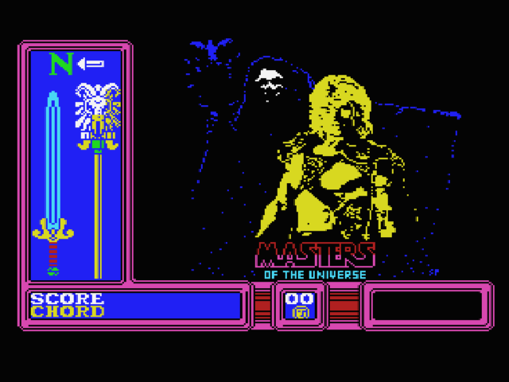
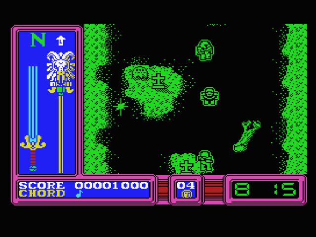
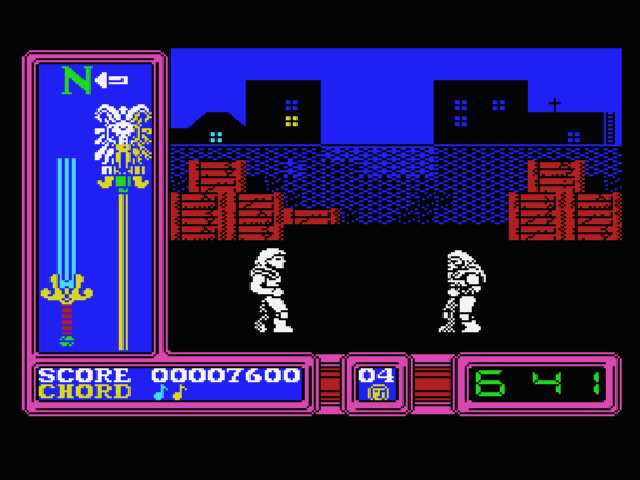
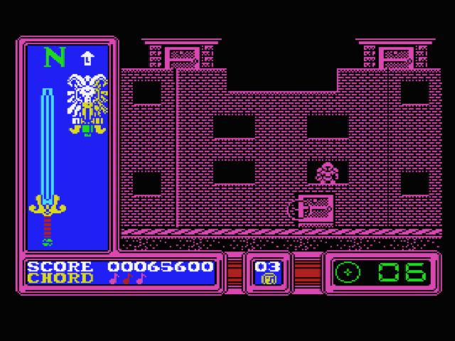
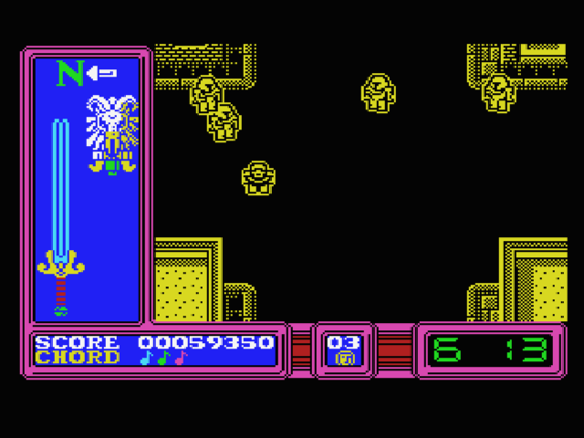
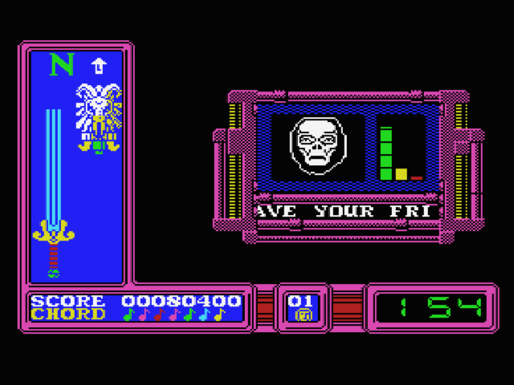
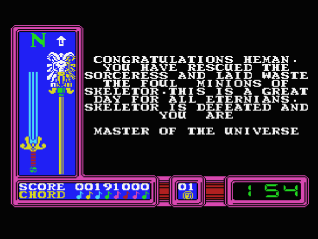
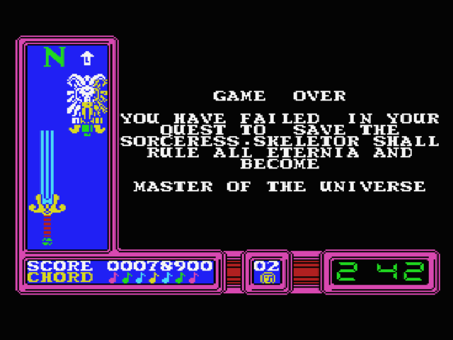

# Masters of the Universe: The Movie – MSX Archive

## Overview

*Masters of the Universe: The Movie* on the **MSX** computer architecture is an action-adventure adaptation of the 1987 live-action Cannon Films feature. Published by **Gremlin Graphics**, the MSX version brings He-Man's Earth-bound search for the Cosmic Key chords to standard Japanese and European MSX hardware.

The game features a diverse combination of gameplay perspectives—ranging from overhead exploration to side-scrolling duels and first-person target shooting—framed by an elaborate vertical status pillar on the left side of the display.

---

## Hardware Presentation & HUD Interface

The MSX version frames all gameplay modes with a permanent **vertical status pillar** on the left and a consolidated status strip along the bottom:

* **Compass Rose:** Top-mounted directional indicator featuring a static green **`N`** (North) alongside a rotating white arrow (`↑`, `←`, etc.) that signals the player's current heading relative to North.
* **Power Sword Gauge:** Vertical blue energy meter tracking He-Man's Power Sword charge and vitality. Depletes upon taking enemy fire or sustaining physical damage.
* **Havoc Staff Gauge:** Gold vertical staff gauge topped with a ram's skull, tracking the countdown toward Skeletor's total conquest. The golden shaft steadily recedes as time elapses and vanishes entirely upon mission failure.
* **Bottom Status Bar:**
  * `SCORE`: 8-digit numeric score readout (e.g., `00001000`).
  * `CHORD`: Color-coded musical note register tracking collected Cosmic Key chord frequencies (1 through 8, rendered as musical notes `♪`).
  * `LIVES`: Remaining life counter in stylized digital format (`00` through `04`), with a bordered He-Man helmet/bust icon positioned directly below the numeric display.
  * `TIMER`: Mission countdown display formatted in green digital numerals with a space separation (`MM SS`, e.g., `8 15`, `1 54`). In target-shooting sequences, this module switches to a crosshair icon and ammunition/target count (`(+) 06`).

---

## Screen Archive & Verbatim Transcriptions

### 1. Title Screen (`msx_motu_movie_intro.png`)



* **Visual Description:** High-contrast MSX Mode 2 graphics rendering of the title marquee. Features a chest-up bust portrait of He-Man in his movie battle harness and armor (Dolph Lundgren likeness) with Skeletor looming in a blue-and-white celestial cowl behind him.
* **Marquee & Credits:** The *Masters of the Universe* title logo is rendered with "MASTERS" in red and "OF THE UNIVERSE" in cyan lettering. The artist's initials (**`SP`**) appear in the lower-right corner of the illustration.
* **Initial HUD State:** Heading arrow indicates West (`N ←`), Power Sword and Havoc Staff gauges are fully charged, `SCORE` and `CHORD` displays are initialized, and lives counter displays `00`.

---

### 2. Gameplay Modes & Sector Exploration

The MSX edition transitions across several distinct gameplay perspectives and environmental sectors:

#### A. Overhead Graveyard Exploration (`msx_motu_movie_play-001.png`)



* **Mechanics Depicted:** Overhead exploration of the Cemetery sector. He-Man maneuvers past grave mounds, Latin crosses (`†`), skeletal remains, and perimeter trees while evading Skeletor's patrol troops.
* **Chord Collection:** A sparkling chord pickup zone flashes on one of the central grave plots.
* **HUD Status:** `SCORE 00001000`, `CHORD ♪` (1 note collected), `LIVES 04`, `TIMER 8 15`, heading North (`N ↑`).

#### B. Side-Scrolling Melee Duel (`msx_motu_movie_play-002.png`)



* **Mechanics Depicted:** Side-perspective 1-on-1 hand-to-hand combat sequence. He-Man faces an armed enemy warrior in front of stacked wooden crates and a chain-link fence, with a suburban evening skyline in the background.
* **Combat Systems:** Players execute high and low weapon strikes, defensive parries, and distance spacing.
* **HUD Status:** `SCORE 00007600`, `CHORD ♪♪` (2 notes collected), `LIVES 04`, `TIMER 6 41`, heading West (`N ←`).

#### C. First-Person Sniper Gallery (`msx_motu_movie_play-003.png`)



* **Mechanics Depicted:** First-person crosshair target-shooting sequence. Skeletor's troopers appear in the open windows and doorway of a multi-story brick tenement building.
* **Targeting HUD:** The standard mission countdown timer switches to an active crosshair reticle counter displaying defeated targets (`(+) 06`).
* **HUD Status:** `SCORE 00065600`, `CHORD ♪♪♪` (3 notes collected), `LIVES 03`, crosshair register `(+) 06`, heading North (`N ↑`).

#### D. Suburban Street Traversal (`msx_motu_movie_play-004.png`)



* **Mechanics Depicted:** Overhead navigation through town roadways. Depicts street curbs, brick sidewalks, storefront structures, and multiple converging enemy ground troopers surrounding He-Man.
* **HUD Status:** `SCORE 00059350`, `CHORD ♪♪♪` (3 notes collected), `LIVES 03`, `TIMER 6 13`, heading West (`N ←`).

#### E. Skeletor Communicator Transmission (`msx_motu_movie_play-005.png`)



* **Mechanics Depicted:** High-tech video communication monitor terminal. Displays an animated, digitized portrait of Skeletor on a CRT screen flanked by audio equalizer / transmission signal bars (green, yellow, red).
* **Teletype Ticker:** A scrolling ticker-tape message along the bottom of the console delivers in-game taunts from Skeletor (`...AVE YOUR FRI...`, completing "...SAVE YOUR FRIENDS...").
* **HUD Status:** `SCORE 00080400`, `CHORD ♪♪♪♪♪♪♪` (7 notes collected), `LIVES 01`, `TIMER 1 54`, heading North (`N ↑`).

---

### 3. Victory Ending (`msx_motu_movie_win.png`)



* **Context:** Triggered upon acquiring all 8 Cosmic Key chord notes and defeating Skeletor before the mission timer expires.
* **Verbatim Transcription:**

```text
CONGRATULATIONS  HEMAN.
  YOU  HAVE  RESCUED  THE
SORCERESS  AND  LAID  WASTE
  THE  FOUL  MINIONS  OF
SKELETOR. THIS  IS  A  GREAT
  DAY  FOR  ALL  ETERNIANS.
SKELETOR  IS  DEFEATED  AND
      YOU  ARE

MASTER  OF  THE  UNIVERSE
```

* **Final Recorded State:** `SCORE 00191000`, all 8 color-coded chords locked (`CHORD ♪♪♪♪♪♪♪♪`), `LIVES 01`, `TIMER 1 54`. The golden Havoc Staff gauge remains fully intact alongside the Power Sword.

---

### 4. Defeat / Failure State (`msx_motu_movie_fail.png`)



* **Context:** Triggered if He-Man's life reserves are exhausted or if Skeletor opens the Great Eye before all 8 chords can be assembled.
* **Verbatim Transcription:**

```text
     GAME   OVER

YOU  HAVE  FAILED  IN  YOUR
   QUEST  TO  SAVE  THE
SORCERESS. SKELETOR  SHALL
 RULE  ALL  ETERNIA  AND
        BECOME

MASTER  OF  THE  UNIVERSE
```

* **Final Recorded State:** `SCORE 00078900`, 6 chords collected (`CHORD ♪♪♪♪♪♪`), `LIVES 02`, `TIMER 2 42`.
* **Visual Breakdown:** The golden shaft of the Havoc Staff is completely depleted and absent, signaling Skeletor's victory, while the Power Sword's blue energy meter has collapsed down to its hilt.

---

## Cross-Platform Navigation

* **16-bit Atari ST Map & Guide:** [Atari ST Navigation Map & Route Guide](../../AtariST/MOTU_The_Movie/README.html)
* **Amstrad CPC Cassette Archive:** [Amstrad CPC Media Archive](../../AmstradCPC/MOTU_The_Movie/README.html)
* **Commodore 64 Cheats & Map:** [Commodore 64 Cheats & Map Guide](../../C64/MOTU_The_Movie/README.html)
