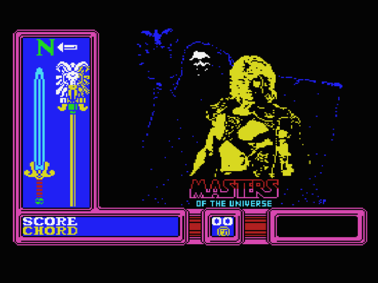
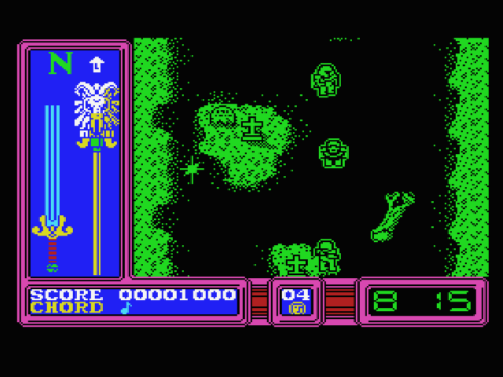
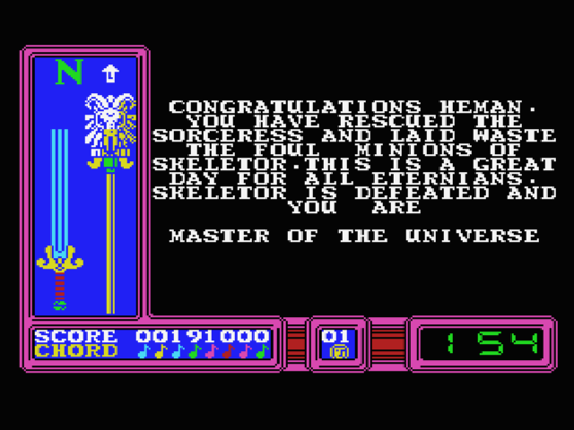
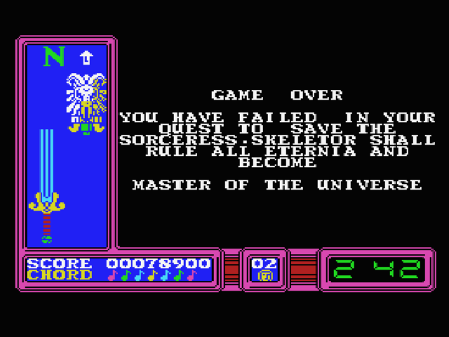

# Masters of the Universe: The Movie – MSX Archive

## Overview

*Masters of the Universe: The Movie* on the **MSX** computer architecture is an overhead action-adventure adaptation of the 1987 live-action Cannon Films feature. Released by **Gremlin Graphics**, the MSX version brings He-Man's Earth-bound search for the Cosmic Key chords to the standard Japanese and European MSX hardware platform.

The MSX edition features a customized graphical presentation and a distinctive vertical HUD layout that sets it apart from the Commodore 64, Amstrad CPC, and 16-bit Atari ST releases.

---

## Hardware Presentation & HUD Interface

Unlike the horizontal HUD bars common on western microcomputers, the MSX version features an elaborate **vertical status pillar** on the left side of the display:

* **Compass Rose:** Top-mounted directional indicator (`N`, `S`, `E`, `W`) with directional arrows signaling player heading.
* **Power Sword Gauge:** Vertical blue energy meter tracking He-Man's Power Sword charge and vitality.
* **Havoc Staff Gauge:** Gold vertical staff gauge tracking Skeletor's approaching threat level.
* **Bottom Bar:**
  * `SCORE`: 8-digit player score readout.
  * `CHORD`: Color-coded musical note registry tracking collected Cosmic Key chord frequencies (1 through 8).
  * `LIVES`: Remaining life counter in stylized digital format.
  * `TIMER`: Mission countdown timer formatted in green digital numerals (`MM:SS`).

---

## Screen Archive & Verbatim Transcriptions

### 1. Title Screen (`msx_motu_movie_intro.png`)



* **Visual Description:** High-contrast MSX Mode 2 graphics rendering of the *Masters of the Universe* title marquee, featuring He-Man with the Power Sword and Skeletor looming in the celestial backdrop.

---

### 2. In-Game Street Exploration (`msx_motu_movie_play-001.png` – `005.png`)



* **Mechanics Depicted:** Overhead town traversal showing street intersections, Skeletor's ground cruisers firing energy projectiles, weapon deflection timing, and chord pickup zones.

---

### 3. Victory Ending (`msx_motu_movie_win.png`)



* **Context:** Triggered upon acquiring all 8 Cosmic Key chord notes and defeating Skeletor before the mission timer reaches zero.
* **Verbatim Transcription:**

```text
CONGRATULATIONS HEMAN.
YOU HAVE RESCUED THE SORCERESS AND LAID WASTE
THE FOUL MINIONS OF SKELETOR. THIS IS A GREAT
DAY FOR ALL ETERNIANS.
SKELETOR IS DEFEATED AND YOU ARE

MASTER OF THE UNIVERSE
```

* **Final Recorded State:** `SCORE 00191000`, 8 color-coded chords locked (`CHORD ♪♪♪♪♪♪♪♪`), `LIVES 01`, `TIMER 1:54`.

---

### 4. Defeat / Failure State (`msx_motu_movie_fail.png`)



* **Context:** Triggered if He-Man's lives are exhausted or if Skeletor opens the Great Eye before the chords are assembled.

---

## Cross-Platform Navigation

* **16-bit Atari ST Map & Guide:** [Atari ST Navigation Map & Route Guide](../../AtariST/MOTU_The_Movie/README.html)
* **Amstrad CPC Cassette Archive:** [Amstrad CPC Media Archive](../../AmstradCPC/MOTU_The_Movie/README.html)
* **Commodore 64 Cheats & Map:** [Commodore 64 Cheats & Map Guide](../../C64/MOTU_The_Movie/README.html)
