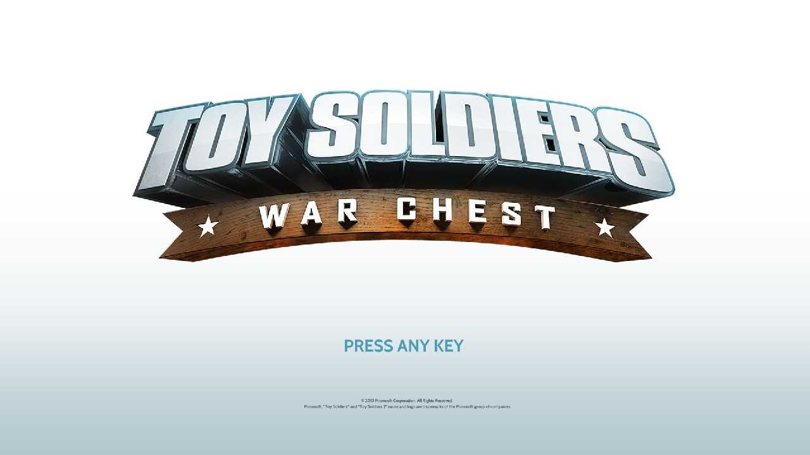
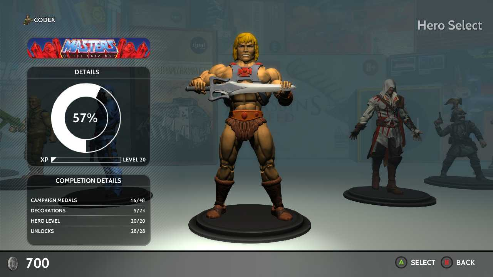
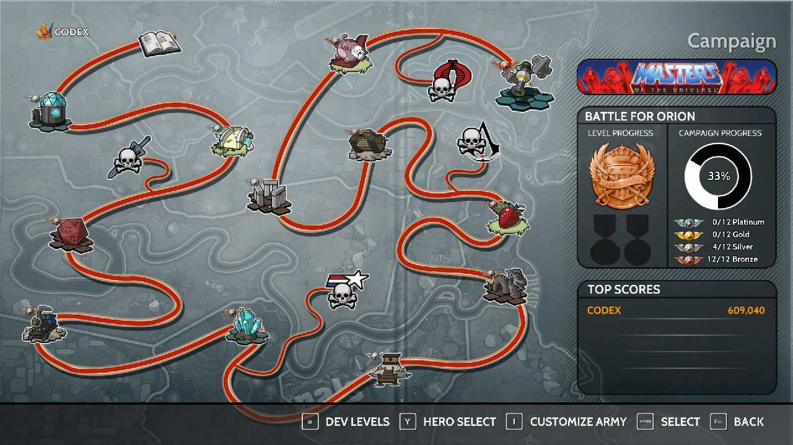
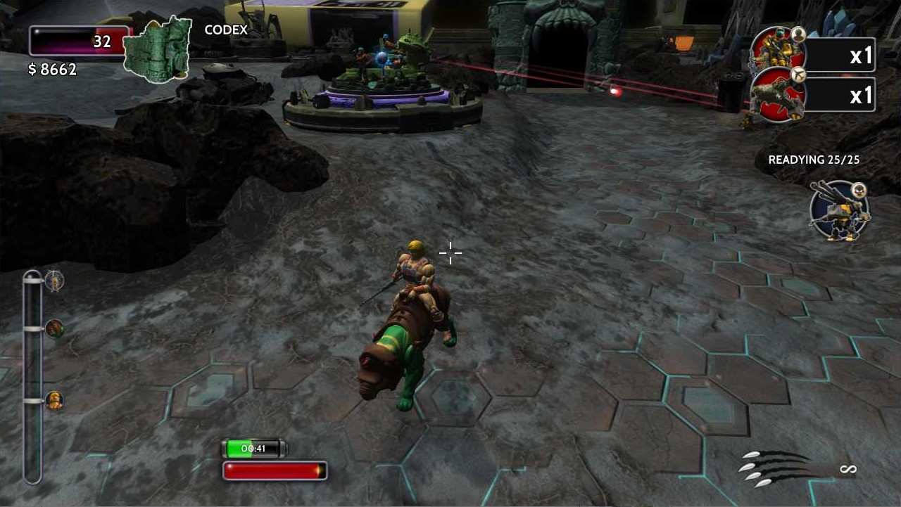
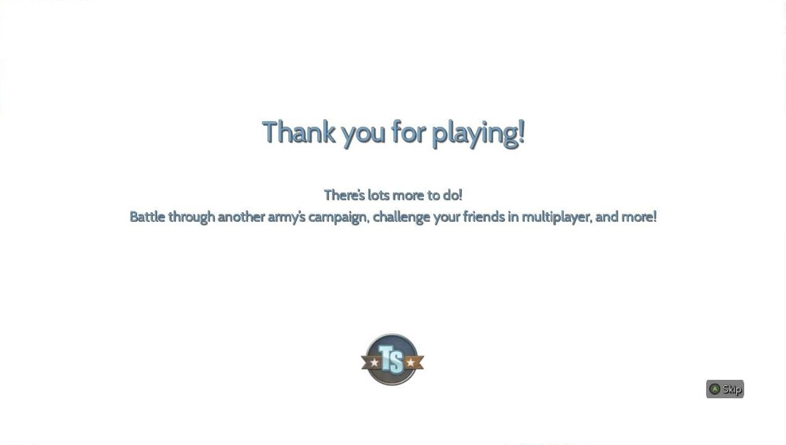

# Toy Soldiers: War Chest Bug Workarounds FAQ & Screenshot Archive

This is the current version 1.02 troubleshooting FAQ for *Toy Soldiers: War Chest*. It covers reports about frozen menus, previously acquired DLC becoming unavailable, PC black screens, and an unobtainable challenge achievement. Five captioned gameplay and menu screenshots document the game interface and campaign.

**Game release date:** August 12, 2015.

> **Caution:** Several reports involve changing the system date, disconnecting from the internet, or modifying game files. Such steps can affect other applications, saves, online features, or installation integrity. Back up saves and files first, and use only with a game copy and content you are authorized to access. The DLC notes concern restoring access to content previously purchased or redeemed.

## Table of contents

- [Main Menu Frozen](#main-menu-frozen)
  - [PC](#main-menu-pc)
  - [PlayStation 4](#main-menu-playstation-4)
  - [Xbox One](#main-menu-xbox-one)
- [Previously acquired DLC unavailable](#previously-acquired-dlc-unavailable)
  - [PC: development-console workaround](#pc-development-console-workaround)
  - [PlayStation 4: previously redeemed DLC](#playstation-4-previously-redeemed-dlc)
- [Black Screen](#black-screen)
  - [PC](#black-screen-pc)
- [Challenger trophy / achievement](#challenger-trophy-achievement)
  - [PlayStation 4: No Solution](#challenger-playstation-4)
  - [Xbox One](#challenger-xbox-one)
- [Screenshot archive](#screenshot-archive)
  - [Title screen](#screenshot-title-screen)
  - [Hero selection and completion status](#screenshot-hero-selection)
  - [Campaign map](#screenshot-campaign-map)
  - [Gameplay HUD](#screenshot-gameplay-hud)
  - [End screen](#screenshot-end-screen)
- [Archive note](#archive-note)

These are archival reports, not guarantees that the steps work today.

<a id="main-menu-frozen"></a>

## Main Menu Frozen

The frozen main menu prevents players from making selections, so only the tutorial mission is playable.

<a id="main-menu-pc"></a>

### PC

The menu responds when the game sees a system date before October 1, 2015. This date has been tested to work: August 2, 2015 12:00:00 AM. Changing the system clock can cause issues with other applications. To avoid these issues, use [RunAsDate by NirSoft](https://www.nirsoft.net/utils/run_as_date.html) rather than changing the computer's system clock

Alternatively, set the Windows date manually:

1. Disable the option to set the date and time from the network.

```
Change the date and time -> Set time automatically = Off
```

2. Set the date and time.

```
Change the date and time -> Set the date and time manually
```

<a id="main-menu-playstation-4"></a>

### PlayStation 4

The author did not observe the problem on update version 1.02. Users who encounter the issue have worked around it by setting the PS4 clock to August 1, 2015. The PS4 must be disconnected from the internet, either physically or through system settings.

Reference: [Amazon customer report](https://www.amazon.com/gp/customer-reviews/R9H5AKSFLDNHH/ref=cm_cr_dp_d_rvw_ttl?ie=UTF8&ASIN=B00YO2PRPS).

<a id="main-menu-xbox-one"></a>

### Xbox One

Users who have encountered the issue have worked around it by setting the system clock to January 1, 2015.

1. Disconnect from the Internet.

```
Settings -> General -> Network Settings -> Go Offline
```

2. Restart the console.
3. Change the date to January 1, 2015.

```
Settings -> System -> Time -> Date
```

4. Load the game.
5. Connect to the Internet.

```
Settings -> General -> Network Settings -> Go Offline
```

Reference: [Ubisoft forum post](https://forums.ubisoft.com/showthread.php/1885710-Menu-Screen-Frozen?p=14845763&viewfull=1#post14845763).

It may also be necessary to delete the game's saved options (not the saved
game). When deleting anything, it is best to back it up to USB first.

Reference: [Ubisoft forum post](https://forums.ubisoft.com/showthread.php/1885710-Menu-Screen-Frozen?p=13625667&viewfull=1#post13625667).

<a id="previously-acquired-dlc-unavailable"></a>

## Previously acquired DLC unavailable

DLC is available in the Hall of Fame edition of the game. It consists of four
character packs. Users who have purchased the DLC or redeemed it with a code may lose access to the DLC. It appears that this is a server-side issue.

<a id="pc-development-console-workaround"></a>

### PC: development-console workaround

For DLC you have already purchased or redeemed, the reported workaround replaces the main executable with a development build and enables the `UnlockAll` option:

The game includes a development console.
1. Rename the game's main executable `Game.exe` to `Game.exe.bak`
2. Copy and rename `GameD.exe` to `Game.exe`. Some users report that they have to use `GameP.exe`, instead.
3. Run `Game.exe`.
4. Advance to the main menu.
5. On the gamepad, click both the left and right analog sticks. The development console will open.
6. Scroll to **Heroes**.
7. Select it and change the **UnlockAll** option from `false` to `true`.
8. Close the development console.

Steps 3-8 must be performed each time the game is played. The option is not
saved. However, the last character used will continue to be available without
repeating the steps.

This workaround is a historical report, not a recommendation to bypass licensing or obtain content without a valid entitlement. Altering executable files can break an installation; preserve backups and use only with content you already own.

<a id="playstation-4-previously-redeemed-dlc"></a>

### PlayStation 4: previously redeemed DLC

If the user did not redeem the DLC at a time when the online store was
available, it may never be possible to play with the DLC. It seems unlikely that Signal Studios or Ubisoft will fix the store.

If the user did redeem the DLC successfully, then some players report that the
DLC becomes available after setting the system date to August 30, 2015. It is
necessary to disconnect the PS4 from Internet, either physically or through
system settings.

Reference: [Amazon customer report](https://www.amazon.com/gp/customer-reviews/R9H5AKSFLDNHH/ref=cm_cr_dp_d_rvw_ttl?ie=UTF8&ASIN=B00YO2PRPS).

<a id="black-screen"></a>

## Black Screen

<a id="black-screen-pc"></a>

### PC

The PC version may show a solid black screen in full-screen mode because of display issues. **Alt + Enter does not switch the game to windowed mode.** This workaround attempts to leave one game instance running in a window:

1. Set the monitor resolution to **1366 × 768**.

    This will provide enough screen space to accommodate the **1280 × 720** play
area, the title bar, and the Windows taskbar (if it is docked on the left or right).

2. Start the game.

   Wait until the monitor displays a solid black screen.

3. Start a second instance of the game.

   The second instance of the game will run in a window. If you are running a
single-monitor setup, you may need to press **Alt + Tab** to access the desktop and start the
second instance.

4. Close the first instance of the game.

   The remaining instance will continue to run in windowed mode.

<a id="challenger-trophy-achievement"></a>

## Challenger trophy / achievement

The PlayStation 4 platinum trophy cannot be obtained.

The **Challenger** trophy/achievement appears impossible to obtain because the challenges in the **GI Joe Survival** mission cannot be completed.

### PlayStation 4: No Solution

<a id="challenger-playstation-4"></a>

There is no known method of obtaining the trophy.

Reference: [PlayStation Trophies: Challenger](https://www.playstationtrophies.org/game/toy-soldiers-war-chest/trophy/118069-Challenger.html)

### Xbox One

<a id="challenger-xbox-one"></a>

There is no known method of obtaining the achievement.

Reference: [TrueAchievements: Challenger](https://www.trueachievements.com/a205085/challenger-achievement)

## Screenshot archive

<a id="screenshot-archive"></a>

The following captures are from the supplied image collection. Captions describe visible interface details; the images are not evidence that the troubleshooting steps above were tested.

### Title screen

<a id="screenshot-title-screen"></a>



**Caption:** The title screen appears in a desktop window. The centered *Toy Soldiers: War Chest* logo sits above a **PRESS ANY KEY** prompt; a small copyright line appears near the bottom of the game window.

### Hero selection and completion status

<a id="screenshot-hero-selection"></a>



**Caption:** The **Hero Select** screen shows He-Man centered, with other character figures on either side. The details panel displays **57%**, **Level 20**, **700** currency, **Campaign Medals 16/48**, **Decorations 5/24**, **Hero Level 20/20**, and **Unlocks 28/28**.

### Campaign map

<a id="screenshot-campaign-map"></a>



**Caption:** The **Campaign** screen shows a red winding route through stage icons. The right panel identifies **Battle for Orion**, shows **33%** campaign progress, and lists medal totals; the top-score panel displays **CODEX — 609,040**. Controller and keyboard navigation hints run along the lower edge.

### Gameplay HUD

<a id="screenshot-gameplay-hud"></a>



**Caption:** A third-person gameplay view shows He-Man riding Battle Cat across a stone arena. The HUD includes a **32** counter, **$8662**, a central reticle, two right-side unit counters marked **×1**, **READYING 25/25**, and lower status gauges including a timer reading **0:41**.

### End screen

<a id="screenshot-end-screen"></a>



**Caption:** A white end screen displays **“Thank you for playing!”** followed by **“There's lots more to do!”** and the invitation to battle through another army's campaign or challenge friends in multiplayer. A *Toy Soldiers* emblem appears near the bottom, with an **A Skip** prompt at lower right.

## Archive note

<a id="archive-note"></a>

- Personal order/shipping information and a redeem-code image are excluded from this public archive.
