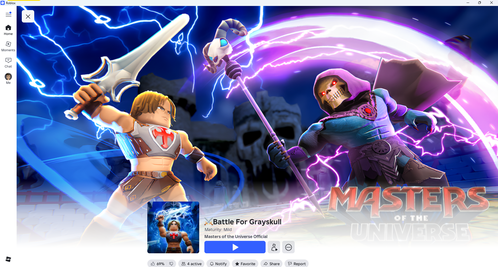
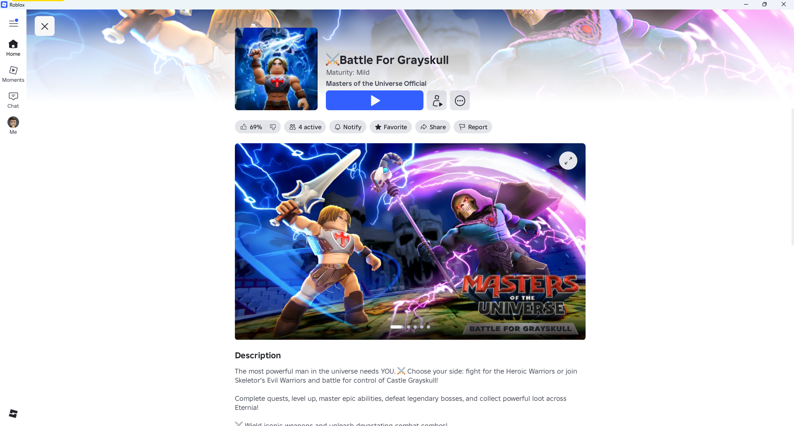
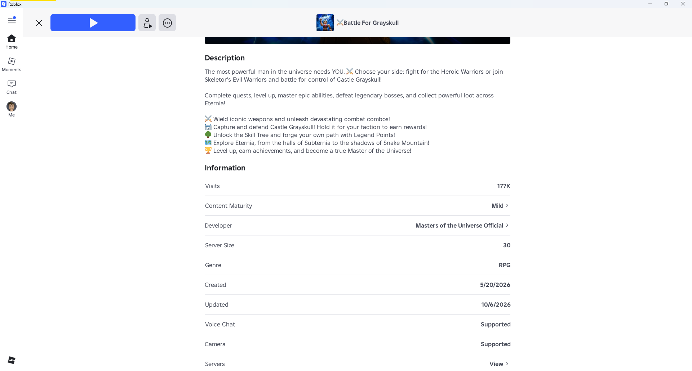
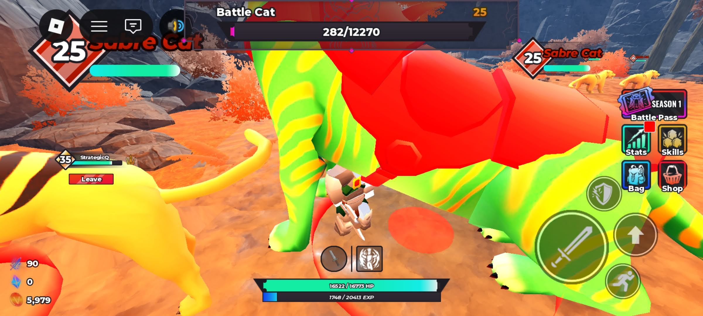
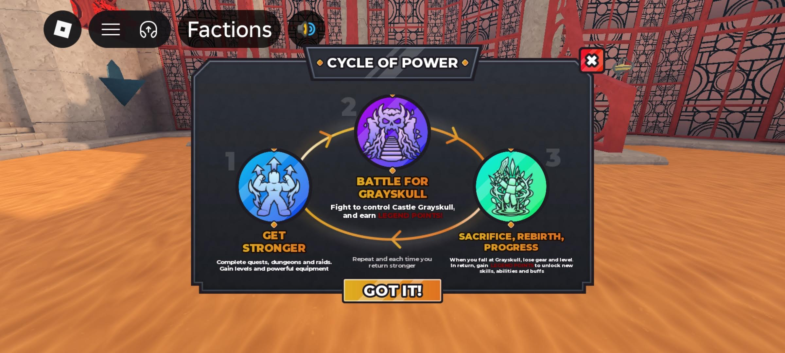
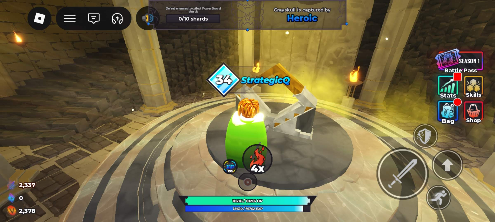
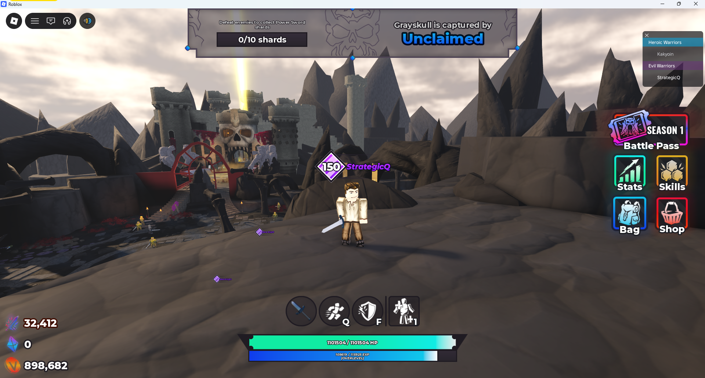
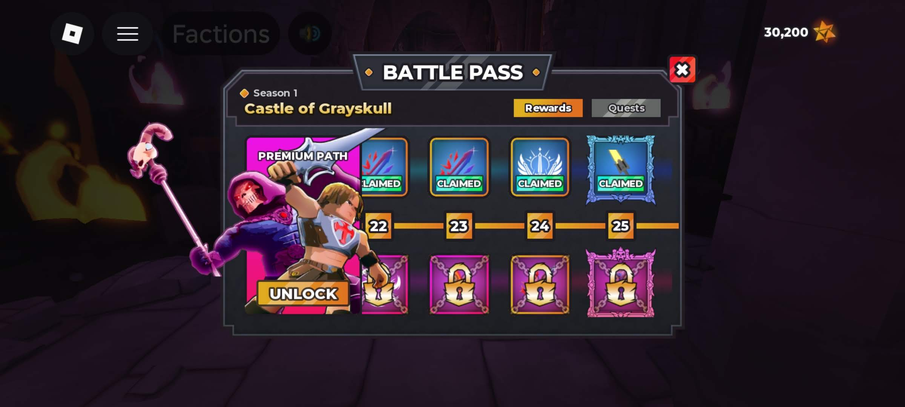
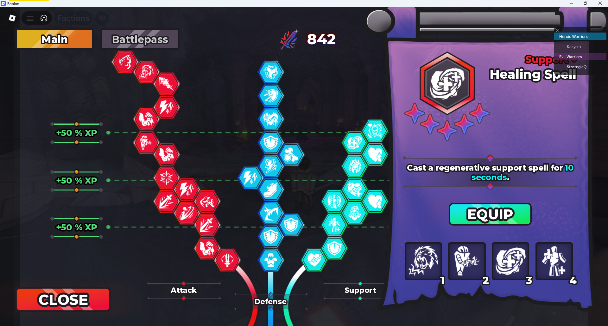
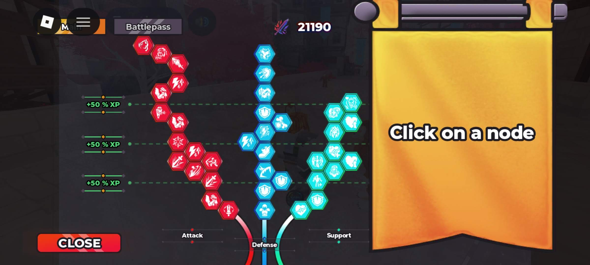

# Masters of the Universe: Battle for Grayskull

> **Platform:** Roblox
> **Developer:** Twin Atlas
> **Publisher:** Mattel Game Studios
> **Release Date:** October 6, 2026
> **Genre:** Action RPG
> **Visual Style:** Based on the 2026 *Masters of the Universe* movie
> **Author:** Jacob Quisenberry — Version 1.02 (2026-11-14)

---

## Overview

*Masters of the Universe: Battle for Grayskull* is a Roblox action RPG developed by Twin Atlas and published by Mattel Game Studios. It was released on Roblox on October 6, 2026. Its visual style is based on the 2026 *Masters of the Universe* movie.

The archive documents character and combat screens, Castle Grayskull encounters, a seasonal **Battle Pass**, character-specific **skill trees** split between Heroic and Evil factions, and character progression.

---

## Game Overview

| Field | Detail |
|---|---|
| **Full Title** | Masters of the Universe: Battle for Grayskull |
| **Developer** | Twin Atlas |
| **Publisher** | Mattel Game Studios |
| **Platform** | Roblox |
| **Release Date** | October 6, 2026 |
| **Genre** | Action RPG |
| **Visual Style** | Based on the 2026 *Masters of the Universe* movie |

---

## Screenshot Archive

The first three images are from the Roblox game page. The remaining screenshots were captured during active gameplay and document key states of the game's progression systems.

---

### Product Presentation

#### Product Screenshot 1 — Banner

**Caption:** Official product banner for *Battle for Grayskull*. The image displays He-Man and Skeletor in a visual style based on the 2026 *Masters of the Universe* movie. Castle Grayskull appears prominently in the background. The game title appears in stylized Masters of the Universe franchise lettering.

---

#### Product Screenshot 2 — Description 1

**Caption:** Image 1 from the Roblox game page.

---

#### Product Screenshot 3 — Description 2

**Caption:** Image 2 from the Roblox game page.

---

### In-Game Progression

#### Battle Cat — Character Detail

**Caption:** Gameplay screenshot showing **Battle Cat** and its displayed enemy level.

---

#### Gameplay Loop — Active Combat

**Caption:** Screenshot showing the core gameplay loop: "Get Stronger" -> "Battle for Grayskull" -> "Sacrifice, Rebirth, Progress".

---

#### Holding the Castle — Defense State

**Caption:** Screenshot showing a Castle Grayskull encounter. Castle Grayskull is held by the Heroic faction.

---

#### Level 150 — Maximum Character Level

**Caption:** Screenshot documenting a character at **Level 150, the maximum character level**. Characters cannot level beyond 150: filling the experience gauge again at Level 150 does not increase the level. This capture records the level indicator, progression display, and visible stat values at the cap.

---

#### Maximum Battle Pass — Completed Season Pass

**Caption:** Screenshot showing a **fully completed Battle Pass** with all reward tiers claimed. The Battle Pass UI displays the season's tier track from left to right, with every node marked as claimed. This capture documents the maximum achievable Battle Pass state. The specific season and tier count are reflected in the visible UI elements.

---

#### Maximum Skill Tree — Evil Faction

**Caption:** Screenshot of the **Evil faction skill tree at maximum level**, with all skill nodes fully unlocked and upgraded. The skill tree is displayed as a branching network of interconnected nodes, each representing a passive ability, active skill, or stat bonus. 

---

#### Maximum Skill Tree — Heroic Faction

**Caption:** Screenshot of the **Heroic faction skill tree at maximum level**, with all skill nodes fully unlocked and upgraded. The skill tree is displayed as a branching network of interconnected nodes, each representing a passive ability, active skill, or stat bonus.

---

## Gameplay Systems Summary

| System | Description |
|---|---|
| **Genre** | Action RPG |
| **Combat** | Action combat and character abilities, as represented in the archived gameplay captures |
| **Characters** | Heroic and Evil faction rosters, with character detail and progression screens |
| **Castle Encounters** | Captures include combat around Castle Grayskull |
| **Skill Trees** | Separate Heroic and Evil faction trees with passive stat upgrades |
| **Battle Pass** | Seasonal tier-based progression rewarding currency, characters, and upgrades |
| **Character Levels** | Per-character progression; the maximum character level is 150 |
| **Level Cap Behavior** | At Level 150, further experience-gauge fill does not raise the character above level 150 |
| **Progression Depth** | Level 150 is the confirmed cap; levels above 150 are not attainable |

---

*Document authored by Jacob Quisenberry. Version 1.02 — 2026-11-14. Platform corrected to Roblox.*
