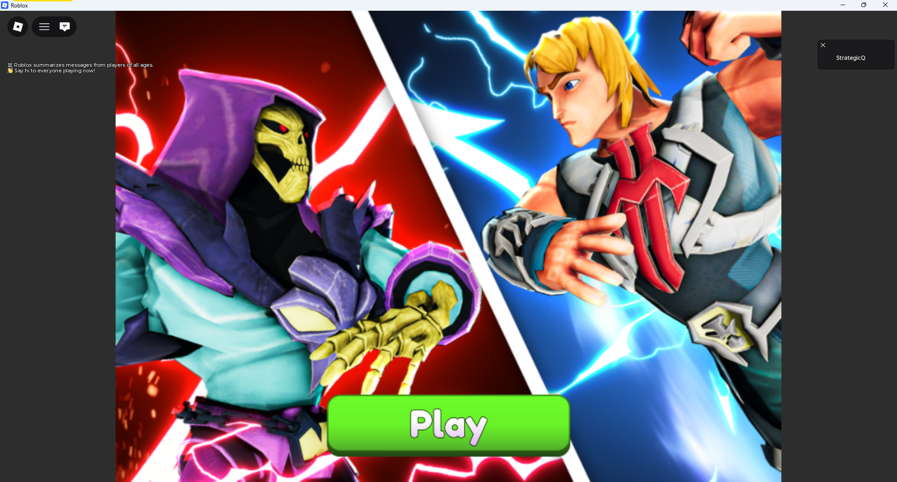
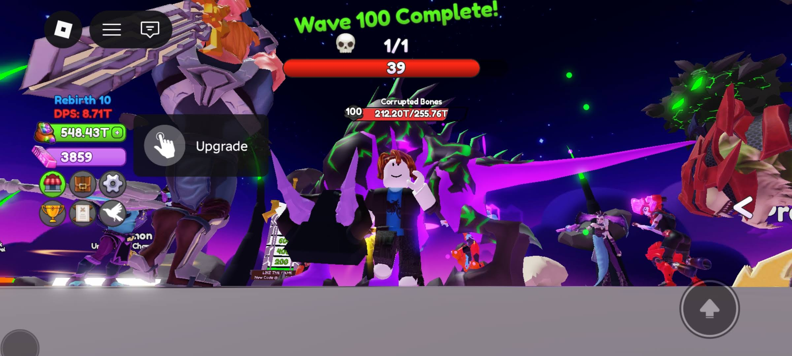
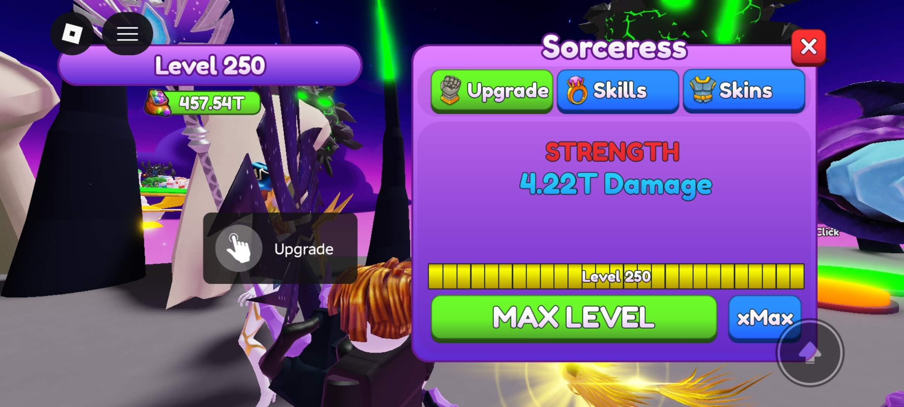
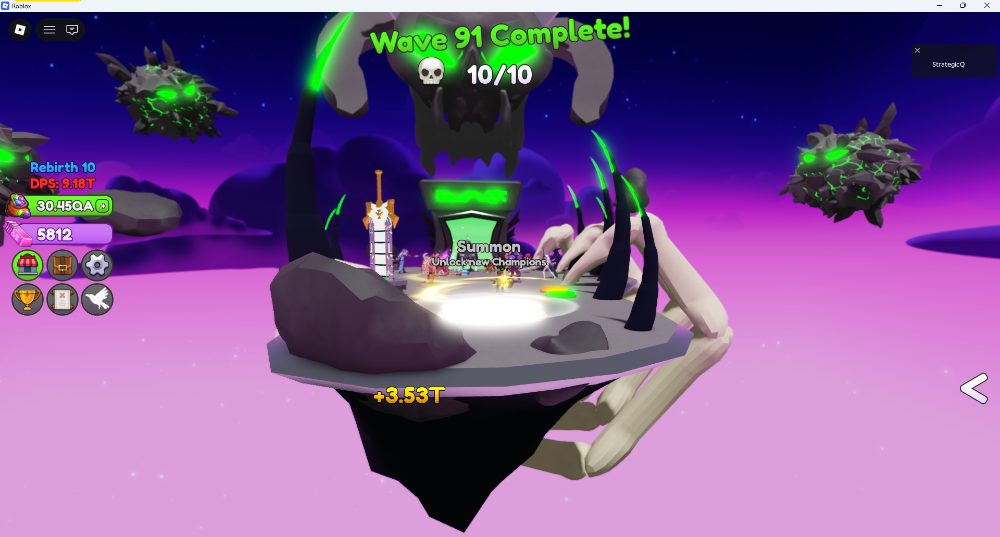
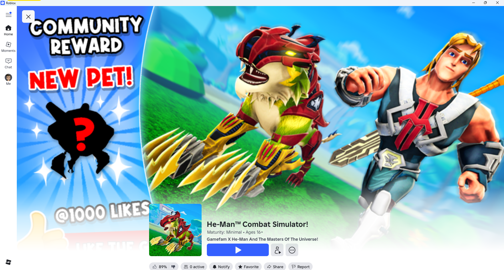
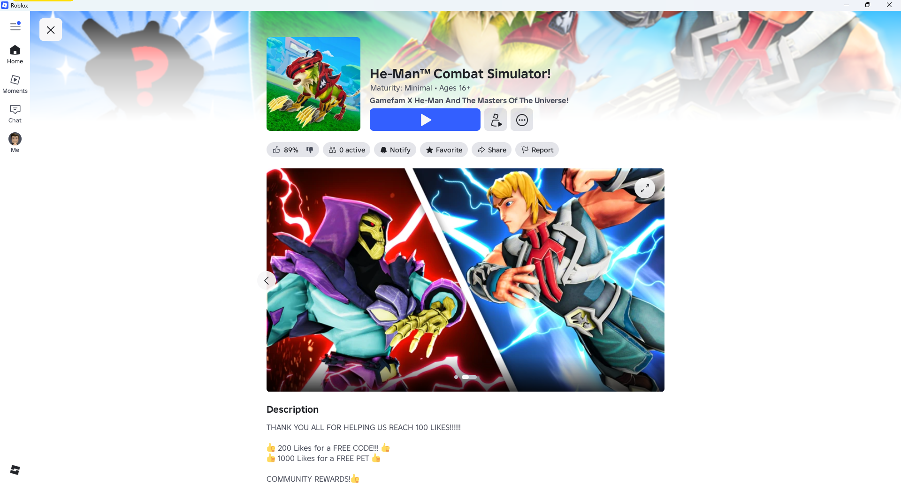
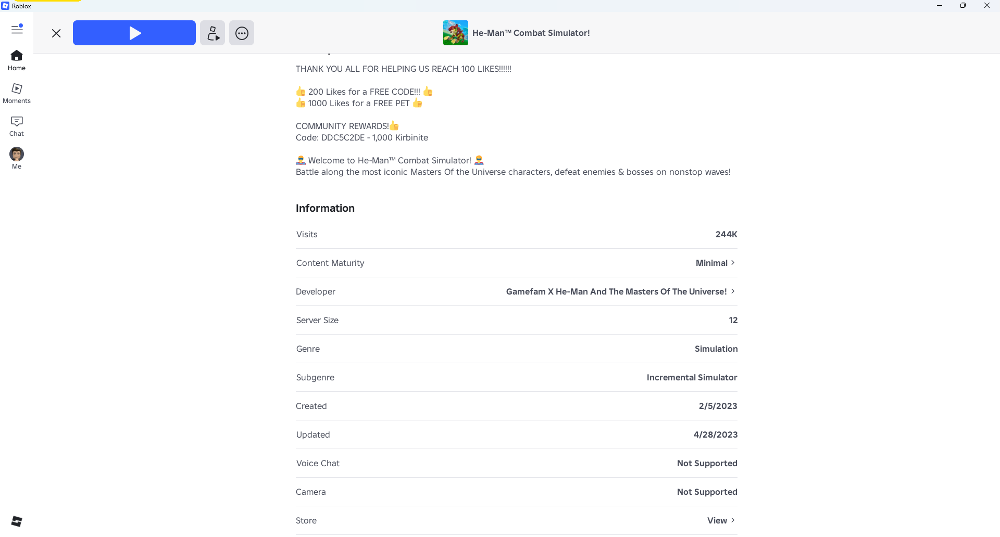
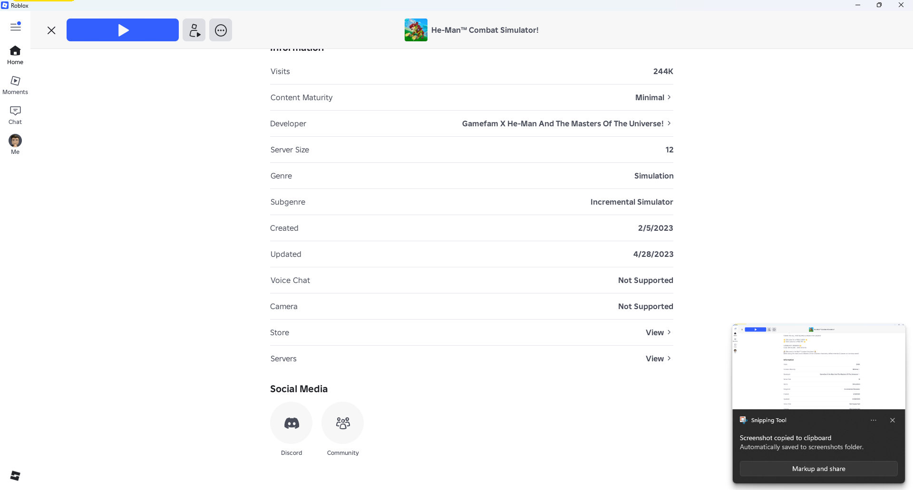

# He-Man: Combat Simulator

> **Platform:** Roblox 
> **Developer:** Gamefam
> **Publisher:** Mattel Inc.
> **Genre:** Simulation / Incremental Simulator 
> **Author:** Jacob Quisenberry — Version 1.04 (2026-11-16)

---

## Overview

*He-Man: Combat Simulator* (also known as *Masters of the Universe: He-Man Combat Simulator*) is a Roblox experience developed by Gamefam and published by Mattel Inc. The Roblox experience page classifies it as a Simulation in the Incremental Simulator subgenre.

The character roster and CGI art style are based on *He-Man and the Masters of the Universe* (2021–2022), the Netflix animated series. The **Sorceress of Castle Grayskull** is documented at maximum level in this archive, illustrating the game's character upgrade ceiling and stat presentation.

Combat is idle-style: allies attack enemies continuously, while the player can attack enemies at any time.

---

## Game Overview

| Field | Detail |
|---|---|
| **Full Title** | He-Man: Combat Simulator |
| **Developer** | Gamefam |
| **Publisher** | Mattel Inc. |
| **Platform** | Roblox |
| **Genre** | Simulation / Incremental Simulator (idle-style combat) |
| **Setting** | Eternia — Masters of the Universe universe |
| **Monetization** | Free-to-play with in-app purchases |

---

## Screenshot Archive

---

### Loading Screen

**Caption:** The **game loading screen** for *He-Man: Combat Simulator*, displaying the game's title treatment before play.

---

### In-Game Combat — Wave 100

**Caption:** Screenshot showing **Wave 100 Complete**, the game's highest wave. There is no option to proceed beyond Wave 100.

---

### Sorceress — Maximum Level

**Caption:** Character detail screen for **the Sorceress of Castle Grayskull at maximum level**. She is the most expensive character to upgrade and the most powerful character in the game. This screenshot documents her maximum-level stats and character portrait, rendered in the CGI art style of Netflix's *He-Man and the Masters of the Universe* (2021–2022).

---

### Full Arena — Zoom-Out View

**Caption:** This zoomed-out gameplay screenshot shows the arena, character positions, and surrounding environment. The HUD indicates **Wave 91 Complete**.

---

### Roblox Experience-Page Images

#### Product Screenshot 1

**Caption:** Roblox experience-page screenshot featuring a **COMMUNITY REWARD** and **NEW PET!** promotion, with the experience listing visible below.

---

#### Product Screenshot 2

**Caption:** Roblox experience-page screenshot showing promotional artwork of Skeletor and He-Man, along with the experience title and page controls.

---

#### Product Screenshot 3

**Caption:** Roblox experience-page screenshot showing information including the developer, server size, Simulation genre, Incremental Simulator subgenre, and creation and update dates.

---

#### Product Screenshot 4

**Caption:** Roblox experience-page screenshot showing server and store links, followed by social-media links.

---

## Gameplay Systems Summary

| System | Description |
|---|---|
| **Core Combat** | Allies attack continuously; the player can attack enemies at any time |
| **Abilities** | Unique ability sets per character with power costs |
| **Arena** | Dedicated combat arena with Eternia-themed backgrounds |
| **Wave Cap** | Wave 100 is the highest wave; there is no option to proceed past it |
| **Character Levels** | Per-character level upgrades; Sorceress documented at max level |

---

*Document authored by Jacob Quisenberry. Version 1.04 — 2026-11-16.*
