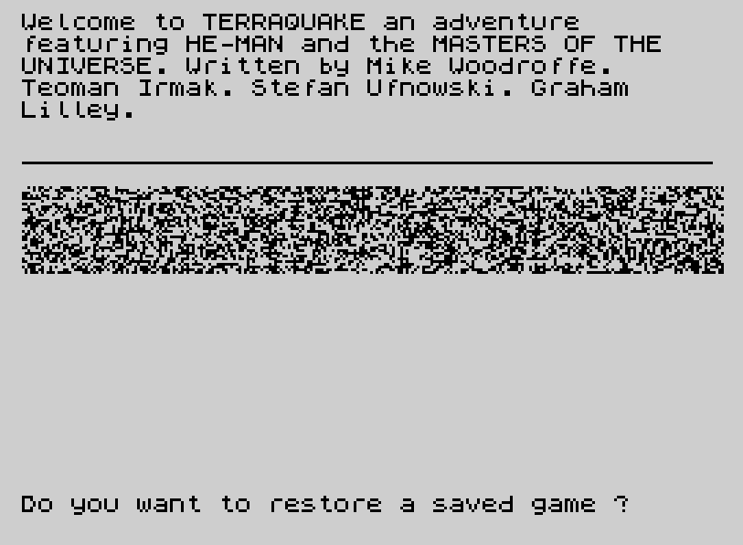
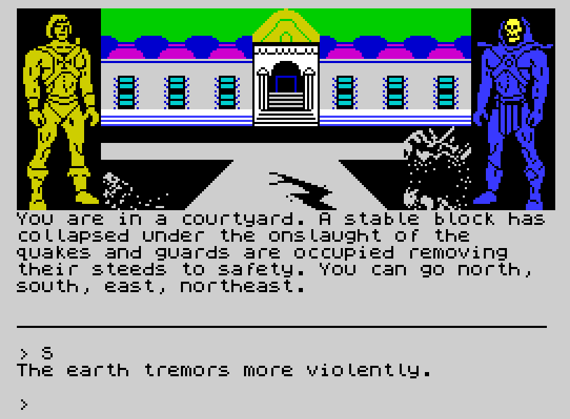
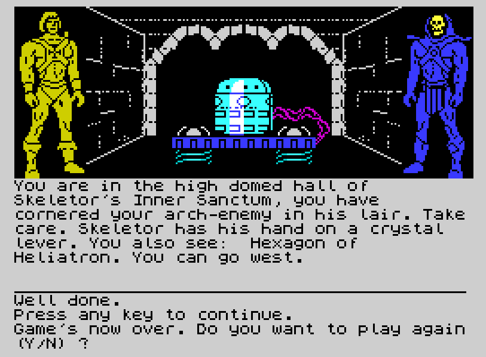
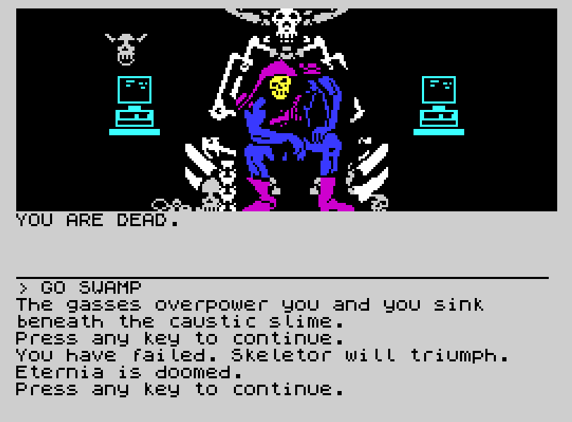

# Masters of the Universe in Terraquake – ZX Spectrum Archive

## Overview

*Masters of the Universe in Terraquake* (marketed as *Masters of the Universe Super Adventure* in physical packaging) is an interactive text adventure developed by Mike Woodroffe, Teoman Irmak, Stefan Ufnowski, and Graham Lilley, published by **U.S. Gold Ltd.** in 1987.

The **Sinclair ZX Spectrum** release is visually unique among all 8-bit editions: while the BBC Micro, Acorn Electron, and Commodore 64 versions rely exclusively on text readouts, the Spectrum 48K/128K version features **split-screen graphic illustrations**. 

The screen architecture is divided into three distinct vertical zones:
* **Upper Graphic Window:** Renders custom color artwork depicting the current location, typically flanked by standing sprites of **He-Man** (in gold on the left) and **Skeletor** (in blue with a yellow skull on the right).
* **Middle Text Pane:** Displays room titles, environmental narrative descriptions, and visible item inventories.
* **Lower Parser & Dialogue Area:** Separated by a solid black horizontal dividing rule, displaying the player command prompt (`>`) and interactive game responses.

---

## Screen Archive & Verbatim Transcriptions

### 1. Title & Introduction Screen (`spectrum_terraquake_intro.png`)



* **Display Architecture:** Text-mode presentation displaying the game's title treatment, author credits, a horizontal rule bounding a high-density static/noise pattern bar, and the initial game-restoration query.
* **Verbatim Transcription:**

```text
Welcome to TERRAQUAKE an adventure
featuring HE-MAN and the MASTERS OF THE
UNIVERSE. Written by Mike Woodroffe.
Teoman Irmak. Stefan Ufnowski. Graham
Lilley.
________________________________________

Do you want to restore a saved game ?
```

---

### 2. In-Game Illustrated Scene (`spectrum_terraquake_play.png`)



* **Graphic Window Details:** Depicts the royal courtyard of Castle Eternos following the seismic disturbances:
  * Central palace facade rendered with white columns, green trim, and magenta/blue domes.
  * Foreground paving shows dark jagged earthquake fissures flanked by piles of rubble and debris.
  * Flanked on the left by He-Man in gold armor and on the right by Skeletor in blue armor with a yellow skull.
* **Verbatim Transcription:**

```text
You are in a courtyard. A stable block has
collapsed under the onslaught of the
quakes and guards are occupied removing
their steeds to safety. You can go north,
south, east, northeast.
________________________________________
> S
The earth tremors more violently.

>
```

* **Game Mechanics Observed:**
  * Separated from the parser log by a solid black dividing rule (`________________________________________`).
  * The recurring atmospheric earthquake countdown prompt reads `"The earth tremors more violently."` (matching the BBC Micro wording, in contrast to the C64 version's `"trembles"`).

---

### 3. Victory Ending (`spectrum_terraquake_win.png`)



* **Context:** Cornering Skeletor in his Inner Sanctum, placing the Hexagon of Heliatron to halt time, and pulling the crystal lever to disable the earthquake generator.
* **Graphic Window Details:** Skeletor's subterranean machinery glowing under a protective dome with conduits and coils, positioned within a stone archway and flanked by He-Man and Skeletor.
* **Verbatim Transcription:**

```text
You are in the high domed hall of
Skeletor's Inner Sanctum, you have
cornered your arch-enemy in his lair. Take
care. Skeletor has his hand on a crystal
lever. You also see:   Hexagon of
Heliatron. You can go west.
________________________________________
Well done.
Press any key to continue.
Game's now over. Do you want to play again
(Y/N) ?
```

* **Game Mechanics Observed:**
  * Triple space renders after the colon in `"You also see:   Hexagon of Heliatron."`
  * Successfully halting time triggers the victory prompt `"Well done."` followed by the replay query `"Game's now over. Do you want to play again (Y/N) ?"`.

---

### 4. Defeat & Failure State: Caustic Slime (`spectrum_terraquake_fail.png`)



* **Context:** Entering the Tar Swamp (`> GO SWAMP`) without protective preparations, resulting in He-Man suffocating beneath the toxic gases and sinking into caustic slime.
* **Graphic Window Details:** A unique full-width illustration: **Skeletor seated triumphant on a throne fashioned from human bones and skulls**, flanked by two glowing cyan computer terminals with skull crests. The standard flanking standing sprites are absent.
* **Verbatim Transcription:**

```text
YOU ARE DEAD.
________________________________________
> GO SWAMP
The gasses overpower you and you sink
beneath the caustic slime.
Press any key to continue.
You have failed. Skeletor will triumph.
Eternia is doomed.
Press any key to continue.
```

* **Game Mechanics Observed:**
  * Environmental hazards result in immediate player death: `"YOU ARE DEAD."`
  * The game confirms total mission failure with the terminal sequence: `"You have failed. Skeletor will triumph. Eternia is doomed."`

---

## Cross-Platform Reference

* **Full Move-by-Move Solution:** See [Commodore 64 Complete Walkthrough & Keyword Dictionary](../../C64/MOTU_Terraquake/MOTU_Terraquake_Walkthrough.html) for a complete step-by-step game solution (including all Spectrum-specific command variants and cheat codes).
* **BBC Micro Teletext Edition:** See [BBC Micro Gameplay & Screen Reference](../../BBC_Micro/MOTU_Terraquake/README.html) for colored Mode 7 text comparison.
