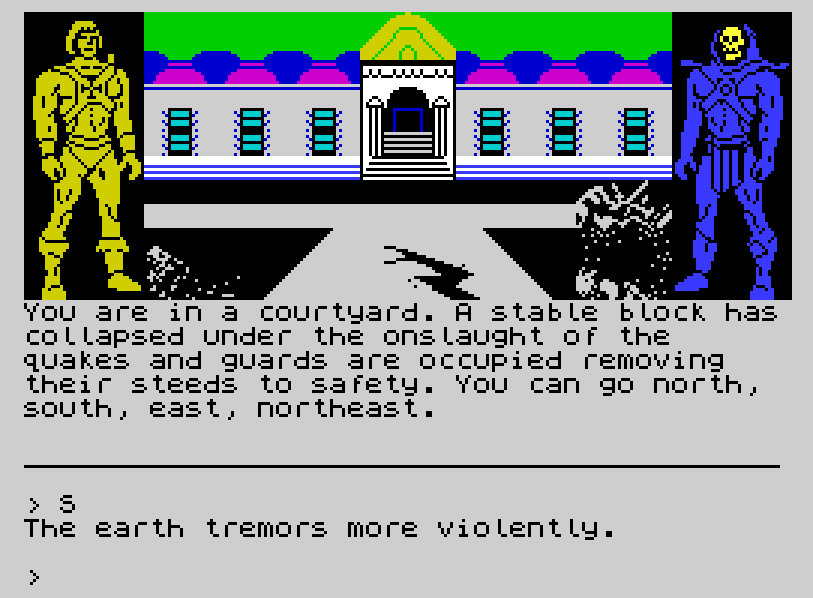
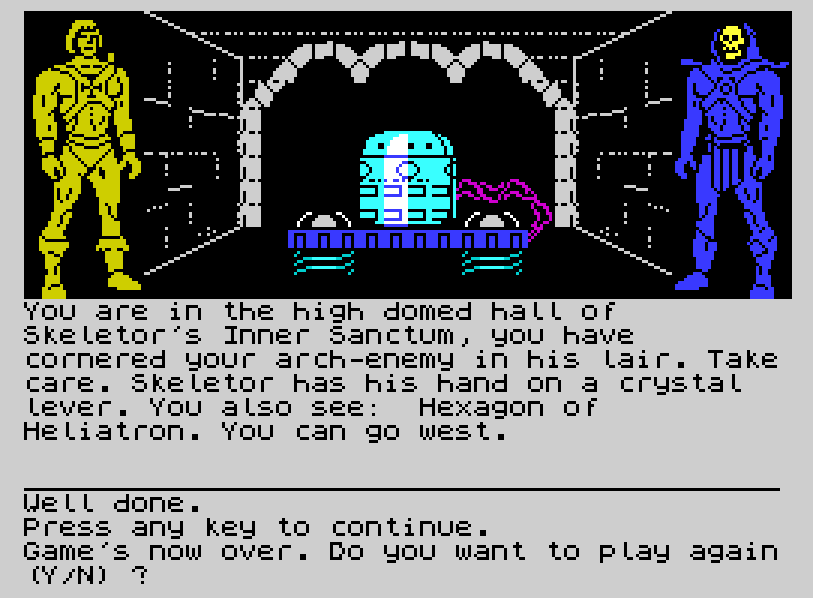
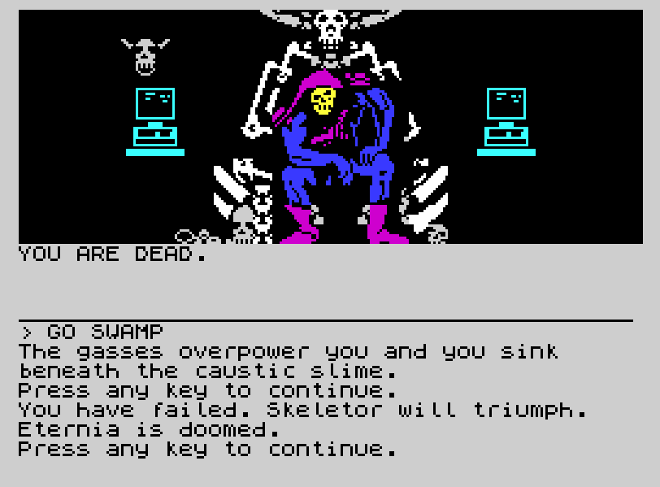

# Masters of the Universe in Terraquake – ZX Spectrum Archive

## Overview

*Masters of the Universe in Terraquake* (marketed as *Masters of the Universe Super Adventure* in physical packaging) is an interactive text adventure developed by Mike Woodroffe, Teoman Irmak, Stefan Ufnowski, and Graham Lilley, published by **U.S. Gold Ltd.** in 1987.

The **Sinclair ZX Spectrum** release is visually unique among all 8-bit editions: while the BBC Micro, Acorn Electron, and Commodore 64 versions rely exclusively on text readouts, the Spectrum 48K/128K version features **split-screen graphic illustrations**. The upper third of the display renders custom color artwork depicting the current location, flanked by static standing sprites of **He-Man** (in gold on the left) and **Skeletor** (in blue on the right).

---

## Screen Archive & Verbatim Transcriptions

### 1. In-Game Illustrated Scene (`spectrum_terraquake_play.png`)



* **Display Architecture:**
  * **Top Graphic Window:** Depicts Castle Eternos royal courtyard showing architectural collapse, subterranean seismic fissures in the paved walkway, and He-Man and Skeletor flanking the scene.
  * **Middle Text Pane:** Narrative room and environmental description.
  * **Bottom Command Line:** Parser input indicator (`>`) and interactive dialogue log.
* **Verbatim Transcription:**

```text
You are in a courtyard. A stable block has
collapsed under the onslaught of the
quakes and guards are occupied removing
their steeds to safety. You can go north,
south, east, northeast.
----------------------------------------
> S
The earth tremors more violently.
>
```

---

### 2. Victory Ending (`spectrum_terraquake_win.png`)



* **Context:** Cornering Skeletor in his Inner Sanctum, placing the Hexagon of Heliatron to halt time, and pulling the crystal lever to disable the earthquake generator.
* **Graphic Window Details:** Skeletor's subterranean machinery glowing under a protective dome with conduits and coils, flanked by He-Man and Skeletor.
* **Verbatim Transcription:**

```text
You are in the high domed hall of
Skeletor's Inner Sanctum, you have
cornered your arch-enemy in his lair. Take
care. Skeletor has his hand on a crystal
lever. You also see: Hexagon of
Heliatron. You can go west.
----------------------------------------
Well done.
Press any key to continue.
Game's now over. Do you want to play again
(Y/N) ?
```

---

### 3. Defeat / Game Over State (`spectrum_terraquake_fail.png`)



* **Context:** Entering Skeletor's chamber without defensive preparation, resulting in He-Man being vaporized by Skeletor's ram's head energy blast.

---

## Cross-Platform Reference

* **Full Move-by-Move Solution:** See [Commodore 64 Complete Walkthrough & Keyword Dictionary](../../C64/MOTU_Terraquake/MOTU_Terraquake_Walkthrough.html) for a complete step-by-step game solution (including all Spectrum-specific command variants and cheat codes).
* **BBC Micro Teletext Edition:** See [BBC Micro Gameplay & Screen Reference](../../BBC_Micro/MOTU_Terraquake/README.html) for colored Mode 7 text comparison.
