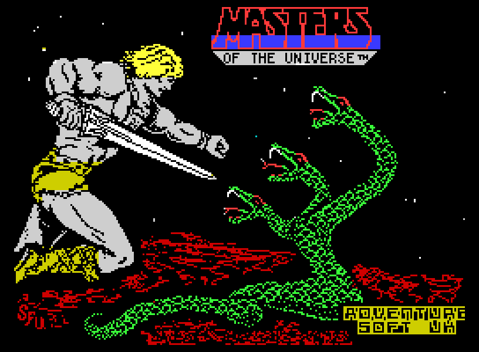
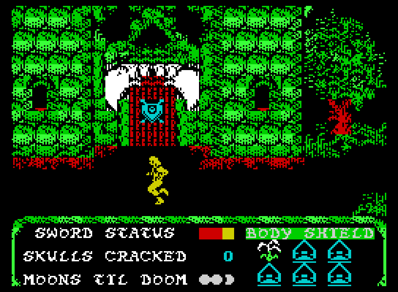
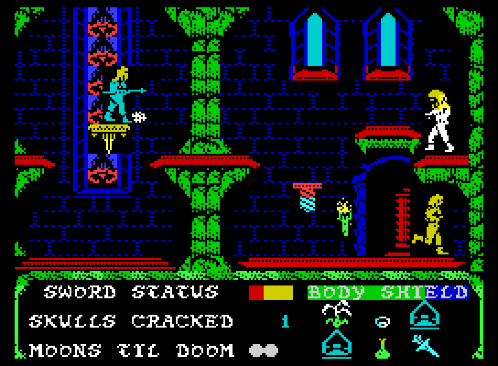
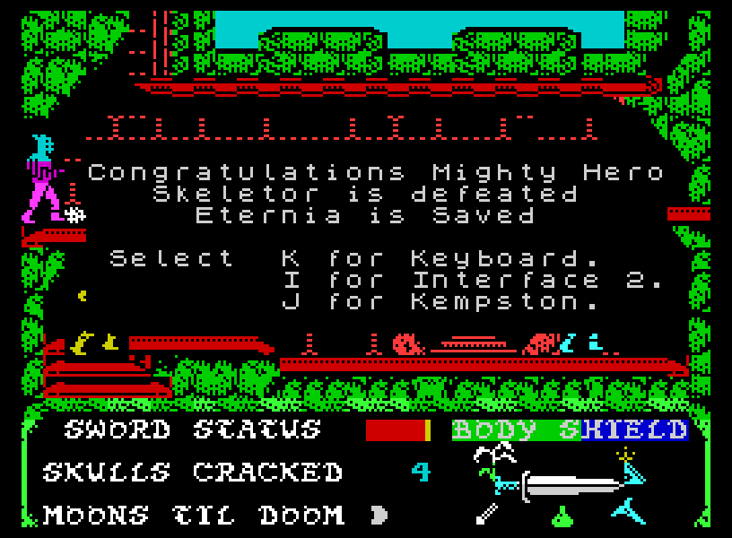
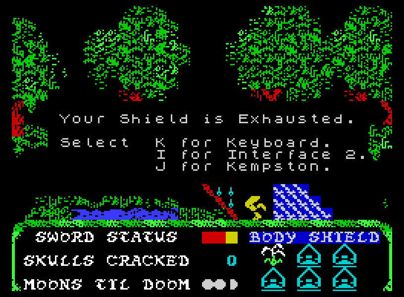

# Masters of the Universe: The Ilearth Stone – ZX Spectrum Archive

**Sinclair ZX Spectrum 48K/128K Media Archive, Screen Reference & Cheats**

---

## Overview

Published in the United Kingdom by **U.S. Gold Ltd.** under their **Adventure Soft** imprint in March 1987, the Sinclair ZX Spectrum release of *Masters of the Universe: The Ilearth Stone* (marketed as *The Arcade Game* on its physical outer packaging) adapts the multi-tiered Castle Grayskull platforming quest to the Sinclair 8-bit architecture.

While mechanically identical in objective to the Commodore 64 version—requiring He-Man to harvest six arcane ingredients, visit Orko to forge the **Atom Smasher**, shatter the mystical **Ilearth Stone**, and banish Skeletor—the ZX Spectrum edition displays notable hardware-level adaptations, color attribute styling, distinct item placements, and a dedicated full-screen ending sequence.

---

## Screen Archive & Verbatim Transcriptions

### 1. Title & Credits Sequence (`spectrum_motu_illearth_intro.png`)



* **Visual Architecture:** Rendered using the Spectrum's standard 256×192 resolution with black border. Displays the double-height title block in bright cyan and yellow attribute cells:
  ```text
  HE-MAN
  AND THE
  MASTERS OF THE UNIVERSE
  IN THE ILEARTH STONE
  ```
* **Developer & Legal Imprint:**
  ```text
  COPYRIGHT 1987 U.S. GOLD

  DESIGN AND GRAPHICS S. UFNOWSKI

  PROGRAMMING BY C STUDIO
  MEMBERS AGY. ESZ. GP. SCH.

  PRESS RETURN TO CONTINUE
  ```

---

### 2. Castle Grayskull Interior – Ground Floor Foyer (`spectrum_motu_illearth_play001.png`)



* **Display Analysis:**
  * **Main Playfield:** Depicts He-Man positioned at the lower-left entry platform beside the Ground Floor floor-switch lever and vertical spinning elevator shaft.
  * **Color Mapping:** Uses cyan outlines for castle brickwork and platform ledges, with white character sprites for He-Man and purple-toned defensive guards on the upper catwalks.
  * **Bottom HUD:** Features the five docked status readouts (`MOONS TIL DOOM`, `SKULLS CRACKED`, `LIVES`, `BODY SHIELD`, `SWORD STATUS`) rendered in crisp 1-line monochrome text.

---

### 3. Upper Ledges & Enemy Engagement (`spectrum_motu_illearth_play002.png`)



* **Display Analysis:**
  * Shows He-Man engaging Skeletor's clone sentries on the upper catwalk tier of Castle Grayskull.
  * Demonstrates the directional jump arc and sword attack mechanics.
  * Captures the energy barrier and elevating platform mechanisms governing access to the western ingredient stations.

---

### 4. Victory Ending Screen (`spectrum_motu_illearth_end.png`)



* **Display Analysis:** Unlike the Commodore 64 version (which overlays a `CAPTURED` banner within the in-game HUD), the ZX Spectrum version cuts to a dedicated solid black screen with bright white centered victory text:
  ```text
  Congratulations Mighty Hero
  Skeletor is defeated
  Eternia is Saved
  ```
* **Game Flow:** Displays the victory text until a keypress or timer interval resets the program to the main title sequence for replay.

---

### 5. Game Over / Defeat State (`spectrum_motu_illearth_fail.png`)



* **Display Analysis:** Upon exhausting all lives—or triggering instant death by making physical contact with Skeletor while his Ilearth Stone shield remains active—the game halts current execution and displays the failure screen, prompting the player to restart their quest.

---

## Spectrum Hardware & Gameplay Variations

1. **Dedicated Victory Display:** The Sinclair Spectrum version does not use the C64's in-place HUD text switch (`CAPTURED`). Instead, striking Skeletor with the Atom Smasher triggers an immediate screen clear to the 3-line text screen shown in `spectrum_motu_illearth_win.png`.
2. **Wall Access Recess:** The indentation on the exterior roof that allows He-Man to drop down to the second floor is rendered in bright red (compared to dark brown on the Commodore 64).
3. **Elevator Switch:** A dedicated physical wall switch is mounted directly above the Snake Man sentry on the second floor; tripping this switch triggers the descending roof lift mechanism.
4. **Catwalk Item Station:** An additional ingredient spawn point is present on the catwalk platform immediately after the second gap on the ground floor.

---

## Verified Cheats & Memory POKEs

### 1. *Your Sinclair* Issue 32 POKEs

From *Your Sinclair*, issue 32 (March 1987), supplement page 29:

```basic
45 POKE 25451,60
47 POKE 27107,0
100 MERGE "": RUN
```

* `Line 45 (POKE 25451,60)`: Freezes the `MOONS TIL DOOM` timer, granting infinite time.
* `Line 47 (POKE 27107,0)`: Prevents the swamp monster from spawning in the marshland west of Castle Grayskull on Screen 1.

### 2. World of Spectrum / Hackers Anon Multiface POKEs

Verified Multiface memory POKEs documented by Hackers Anon:

| Cheat Effect | Memory Address & Value | Description |
| :--- | :--- | :--- |
| **Infinite Energy (Body Shield)** | `POKE 24576,0` | Disables player hit-box damage from sentry projectiles and collision. |
| **Infinite Time (Moons)** | `POKE 25451,0` | Freezes the lunar countdown clock completely. |
| **Infinite Sword Power** | `POKE 25222,0` | Keeps the `SWORD STATUS` gauge locked at maximum, enabling unlimited ranged energy bolts. |

---

## Cassette Loading Instructions

* **ZX Spectrum 48K / 128K (in 48K Basic Mode):**
  1. Type `LOAD ""` and press **ENTER**.
  2. Press **PLAY** on the cassette recorder.
  3. The title screen and border loader will initialize automatically.
