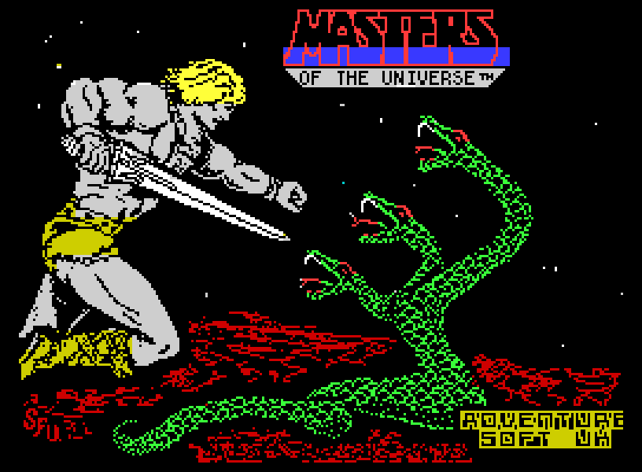
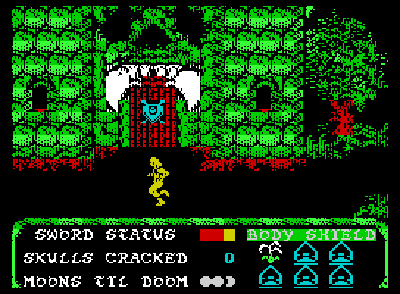
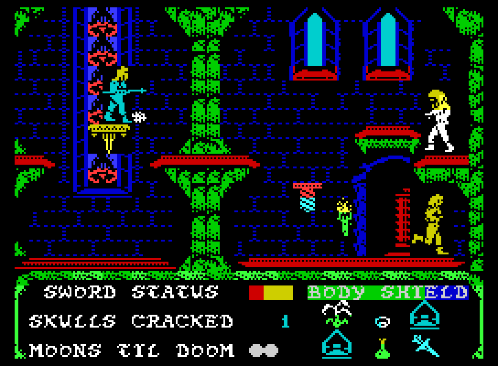
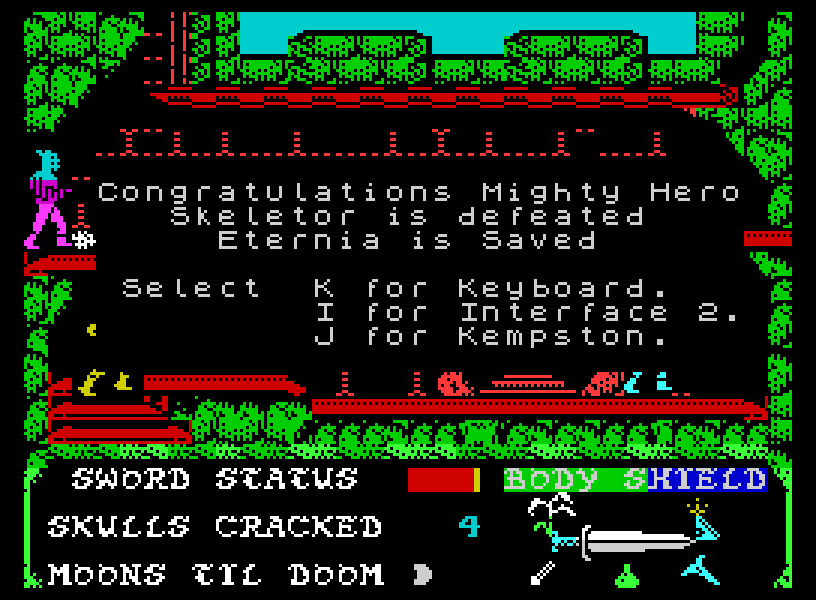
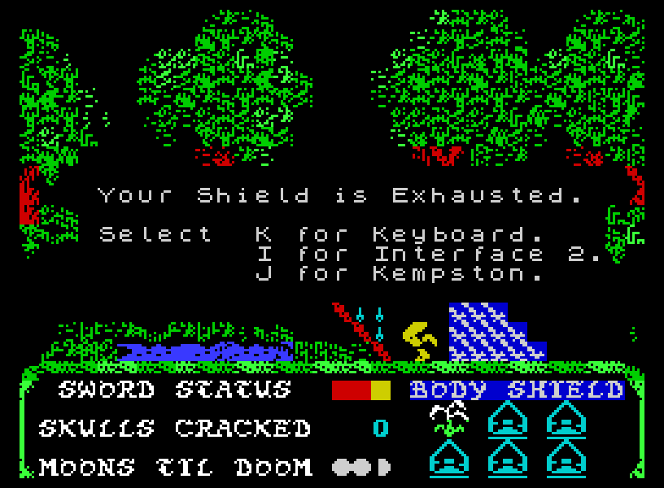

# Masters of the Universe: The Ilearth Stone – ZX Spectrum Archive

**Sinclair ZX Spectrum 48K/128K Media Archive, Screen Reference & Cheats**

---

## Overview

Published in the United Kingdom by **U.S. Gold Ltd.** under their **Adventure Soft** imprint in March 1987, the Sinclair ZX Spectrum release of *Masters of the Universe: The Ilearth Stone* (marketed as *The Arcade Game* on its physical outer packaging) adapts the multi-tiered Castle Grayskull platforming quest to the Sinclair 8-bit architecture.

While mechanically identical in objective to the Commodore 64 version—requiring He-Man to harvest six arcane ingredients, visit Orko to forge the **Atom Smasher**, shatter the mystical **Ilearth Stone**, and banish Skeletor—the ZX Spectrum edition displays notable hardware-level adaptations, color attribute styling, distinct item placements, and a dedicated full-screen ending sequence.

---

## Screen Archive & Verbatim Transcriptions

### 1. Loading / Attract Screen (`spectrum_motu_illearth_intro.png`)



* **Visual Description:** This is the **loading / attract illustration screen**, not an in-game credits scroll. It fills the full 256×192 Spectrum display with a hand-drawn combat scene rendered in the Spectrum's characteristic high-contrast attribute palette against a black starfield background.
  * **Centre-left:** He-Man, depicted in grey bodysuit with yellow cross-harness and boots, lunges forward in combat stance wielding the Power Sword (white blade, yellow hilt) horizontally across the frame.
  * **Centre-right:** A large rearing serpent / snake creature rendered in bright green with red-tinted claws and underbelly rises to meet him, its upper body arched back and foreclaws raised.
  * **Ground plane:** The lower register shows red jagged rock or lava terrain in red/dark-red attribute cells.
  * **Top-centre logo:** The stylized `MASTERS OF THE UNIVERSE™` wordmark logo — with the classic Masters font in red/pink lettering over a blue horizontal band — appears at the upper-centre of the display.
  * **Lower-right imprint:** `ADVENTURE SOFT UK` in yellow pixel lettering on a yellow-bordered box in the lower-right corner.
  * **Lower-left:** Artist signature `S.FU` or similar is visible in the lower-left ground detail.
* **No text credits are present on this screen.** The title/credits scroll (`HE-MAN AND THE MASTERS OF THE UNIVERSE IN THE ILEARTH STONE`, copyright notice, programming credits, `PRESS RETURN TO CONTINUE`) appears on a separate subsequent screen not captured in this archive.

---

### 2. Castle Grayskull Exterior – Jawbridge Approach (`spectrum_motu_illearth_play001.png`)



* **Display Analysis:**
  * **Main Playfield:** Shows the **outdoor exterior of Castle Grayskull**, not the ground floor interior. He-Man (rendered in solid yellow) stands in the foreground courtyard directly in front of the castle facade.
  * **Castle Facade:** The iconic Grayskull skull-mouth Jawbridge dominates the upper-centre of the playfield, depicted in green stone brickwork with the white/grey skull visage, red jaw-gate, and a cyan shield emblem on the door.
  * **Environment:** Green foliage and red rock details line the left and right margins. A red energy particle or hazard is visible to the right of the castle entrance.
  * **Bottom HUD:** Features the five docked status readouts in monochrome text — `SWORD STATUS` (with partial red gauge), `BODY SHIELD` (green, full), `SKULLS CRACKED 0`, and `MOONS TIL DOOM` (two moon icons remaining). The LIVES area displays three cyan castle-shaped icons.

---

### 3. Castle Grayskull Interior – Second Floor Combat (`spectrum_motu_illearth_play002.png`)



* **Display Analysis:**
  * **Main Playfield:** Shows the **interior of Castle Grayskull** rendered in blue brick with green ivy/foliage detailing on the walls. Two tall arched stained-glass windows in cyan and red are visible in the upper-right register.
  * **Left side:** A cyan/blue enemy sentry stands on a spinning rotating elevator platform inside a blue-bordered shaft. He-Man (yellow) is positioned on a ledge engaging the enemy; a spark or hit-effect is visible between them.
  * **Right side:** A white-suited clone warrior stands on an upper ledge to the right, and He-Man (yellow) is also shown on the lower-right ground level, illustrating multi-tier combat.
  * **Item Pedestals:** Collectible ingredient items are visible on the lower-centre floor — a blue flask/bottle icon and a yellow torch/wand item on their pedestals.
  * **Bottom HUD:** `SWORD STATUS` (partial red/yellow gauge), `BODY SHIELD` (green, full), `SKULLS CRACKED 1`, `MOONS TIL DOOM` (two moon icons). The LIVES area shows one cyan castle icon plus item/sword icons in the inventory slots.

---

### 4. Victory Ending Screen (`spectrum_motu_illearth_end.png`)



* **Display Analysis:** Unlike the Commodore 64 version (which overlays a `CAPTURED` banner within the in-game HUD), the ZX Spectrum version displays a text overlay on the **live game screen** — the castle interior remains visible in the background with enemies, platforms, and the full HUD active. The victory and control-selection text appears in white in the mid-screen area:
  ```text
  Congratulations Mighty Hero
  Skeletor is defeated
  Eternia is Saved

  Select  K for Keyboard.
          I for Interface 2.
          J for Kempston.
  ```
* **HUD State:** `SWORD STATUS` (partial red gauge), `BODY SHIELD` (green, full), `SKULLS CRACKED 4`, `MOONS TIL DOOM` (one moon icon remaining). The LIVES/inventory area displays the Atom Smasher sword icon.
* **Game Flow:** After the player selects their control method, the program restarts from the main attract screen.

---

### 5. Game Over / Defeat State (`spectrum_motu_illearth_fail.png`)



* **Display Analysis:** When He-Man's Body Shield is fully depleted, the game pauses on the **current playfield** — the visible background is an **outdoor exterior scene** (green trees, blue/green ground, red foliage accents), not a castle interior. The defeat and control-selection text appears in white in the centre of the screen:
  ```text
  Your Shield is Exhausted.

  Select  K for Keyboard.
          I for Interface 2.
          J for Kempston.
  ```
* **HUD State:** `SWORD STATUS` (partial red/yellow gauge), `BODY SHIELD` (empty / red bar only, indicating the depletion that triggered the defeat), `SKULLS CRACKED 0`, `MOONS TIL DOOM` (two moon icons remaining). The LIVES area shows three cyan castle-shaped life icons, indicating this is a first-life loss.
* **Trigger Condition:** Triggered by Body Shield depletion from enemy contact or projectile hits. A separate instant-death condition (touching Skeletor while the Ilearth Stone is active) also causes this screen but depletes all remaining lives simultaneously.

---

## Spectrum Hardware & Gameplay Variations

1. **Dedicated Victory Display:** The Sinclair Spectrum version does not use the C64's in-place HUD text switch (`CAPTURED`). Instead, striking Skeletor with the Atom Smasher triggers an immediate text overlay on the live game screen showing the victory message shown in `spectrum_motu_illearth_end.png`.
2. **Wall Access Recess:** The indentation on the exterior roof that allows He-Man to drop down to the second floor is rendered in bright red (compared to dark brown on the Commodore 64).
3. **Elevator Switch:** A dedicated physical wall switch is mounted directly above the Snake Man sentry on the second floor; tripping this switch triggers the descending roof lift mechanism.
4. **Catwalk Item Station:** An additional ingredient spawn point is present on the catwalk platform immediately after the second gap on the ground floor.

---

## Verified Cheats & Memory POKEs

### 1. *Your Sinclair* Issue 32 POKEs

From *Your Sinclair*, issue 32 (March 1987), supplement page 29:

```basic
45 POKE 25451,60
47 POKE 27107,0
100 MERGE "": RUN
```

* `Line 45 (POKE 25451,60)`: Freezes the `MOONS TIL DOOM` timer, granting infinite time.
* `Line 47 (POKE 27107,0)`: Prevents the swamp monster from spawning in the marshland west of Castle Grayskull on Screen 1.

### 2. World of Spectrum / Hackers Anon Multiface POKEs

Verified Multiface memory POKEs documented by Hackers Anon:

| Cheat Effect | Memory Address & Value | Description |
| :--- | :--- | :--- |
| **Infinite Energy (Body Shield)** | `POKE 24576,0` | Disables player hit-box damage from sentry projectiles and collision. |
| **Infinite Time (Moons)** | `POKE 25451,0` | Freezes the lunar countdown clock completely. |
| **Infinite Sword Power** | `POKE 25222,0` | Keeps the `SWORD STATUS` gauge locked at maximum, enabling unlimited ranged energy bolts. |

---

## Cassette Loading Instructions

* **ZX Spectrum 48K / 128K (in 48K Basic Mode):**
  1. Type `LOAD ""` and press **ENTER**.
  2. Press **PLAY** on the cassette recorder.
  3. The title screen and border loader will initialize automatically.
